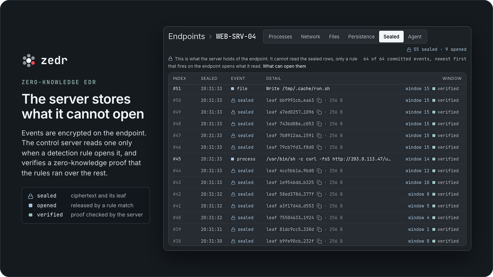
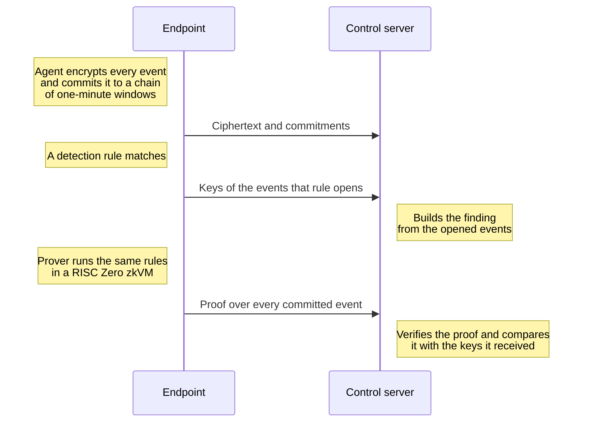
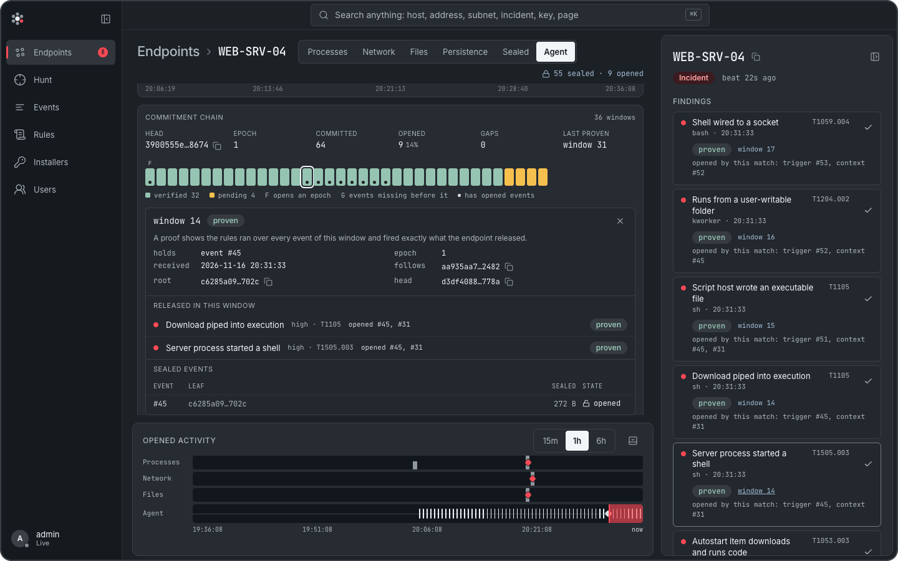
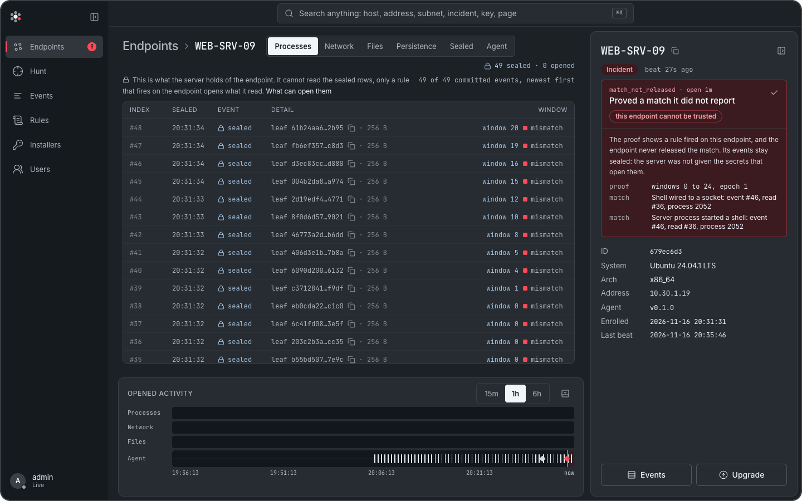

<p align="center">
  
</p>

<h1 align="center">zedr</h1>

<p align="center">Zero-knowledge endpoint detection and response.</p>

<p align="center">
  <a href="https://github.com/auditware/zedr/actions/workflows/ci.yml"></a>
  <a href="LICENSE"></a>
  <a href="#status"></a>
  <a href="#status"></a>
  <a href="#status"></a>
</p>

zedr is an open source EDR that stays in user space and keeps endpoint telemetry private from its own control server.

## What it does

- The agent reads processes, outbound connections, autostart items and packages without a kernel driver.
- Every event is encrypted on the endpoint, so the control server stores ciphertext and commitments.
- A detection rule that matches releases the keys of the events it opens, and the server reads only those.
- A zero-knowledge proof shows the server that the rules ran over everything else.
- The console shows opened events in the clear and the rest as sealed rows with their proof state.

## How it works



A match that an endpoint held back is named by its own proof, and the server opens an incident for it.

## Screenshots

<p align="center">
  <br>
  <sub>A window of an endpoint's chain, proven, with the two findings released in it.</sub>
</p>

<p align="center">
  <br>
  <sub>An endpoint that held a match back, caught by its own proof.</sub>
</p>

The endpoints in these images are simulated, as they are in `make demo`.

## Quick start

The Makefile assumes a macOS machine with Docker, Rust and Node 22. Anything that proves also needs RISC Zero 3.1.0 from [rzup](https://dev.risczero.com/api/zkvm/install): `rzup install cargo-risczero 3.1.0` and `rzup install r0vm 3.1.0`.

```bash
cp secrets/.env.local.example secrets/.env.local
make test             # unit and integration tests, needs neither Docker nor RISC Zero
make test-e2e-linux   # the whole flow for real in containers, about ten minutes once built
make demo             # console on http://localhost:7771 with a simulated fleet
make help             # every other target
```

Sign in to the demo with the test tenant button. Its fleet is simulated and its proof states are stand-ins, which the console says. `make test-e2e-linux` is the run with a real agent and real proofs.

## Status

This is a proof of concept.

| Part | State |
|---|---|
| Linux agent | The whole flow runs end to end. `make test-e2e-linux` does it for real in containers, including an endpoint that hides a match and is caught by its own proof. |
| Detection rules | 16 rules, of which 15 are detections with MITRE ATT&CK ids and one is a follow-up. |
| Proving | About 20 CPU-seconds per event, so a quiet server keeps up and a busy workstation does not yet. |
| macOS agent | Seals processes, outbound connections, launchd jobs, cron, shell profiles, SSH keys, Homebrew, apps and installer receipts. Tested on Apple silicon; a run as root under launchd against a real server is not done yet, and macOS endpoints do not prove yet. |
| Windows agent | Its sensor (processes, connections, Run keys, services, scheduled tasks, Startup folders, installed programs) type-checks for x64 and ARM64 and its parsing is unit-tested, it has not run on Windows yet. |

A proof covers what the endpoint committed, so whoever has root on an endpoint can still keep an event from being sealed.

## Layout

| Path | What |
|---|---|
| `agent/` | The agents in Rust: a shared sensor loop, ledger and server link, and the Linux, Windows and macOS parts |
| `protocol/` `ledger/` `rules/` | Messages, the commitment chain with sealing, and the detection rules a proof is about |
| `prover/` | The rule program for the RISC Zero zkVM and the `zedr-prover` binary that runs on an endpoint |
| `control_server/` | The control server in Rust with Axum and SQLite, and the console in React |
| `deploy/` `e2e/` | Container image, Helm chart and Terraform, and the run behind `make test-e2e-linux` |

## Documentation

| Document | What it covers |
|---|---|
| [ADR 031](docs/adr/031-sealed-telemetry-opened-by-proven-rules.md) | The design and its limits |
| [AGENT_PROTOCOL.md](docs/architecture/AGENT_PROTOCOL.md) | The messages between agent and control server |
| [DETECTIONS.md](docs/DETECTIONS.md) | What is collected, the rules and what proving costs |
| [BYPASSES.md](docs/BYPASSES.md) | Known ways around the agent and the control server |
| [ANTI_TAMPERING.md](docs/ANTI_TAMPERING.md) | What the agent and the server do against tampering |
| [TODO.md](TODO.md) | What is done and what is open |
| [CONTRIBUTING.md](CONTRIBUTING.md) | Who can contribute today |
| [SECURITY.md](SECURITY.md) | How to report a vulnerability |

## License

MIT, see [LICENSE](LICENSE).
