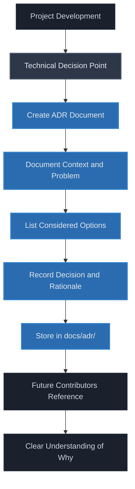

# adr usage for rationalized-over-time project documentation

## Context and Problem Statement

When constructing a large project the technical "why"s exponentially grows as well, causing confusion for future human or ai-based contributors down the line.

## Considered Options

- Classical Documentation
- Visual Documentation (mermaid graphs)
- Changelog
- ADR (Architectural Decision Records)

## Decision Outcome

Chosen option: "ADR (Architectural Decision Records)", because it organizes decision making to a point in time, which can be easily discovered when inspecting a specific element of the code base. It also has formality and open-source standard with multiple contributors, see [https://github.com/adr/madr](https://github.com/adr/madr).

### Decision Outcome Visualization
<!-- Mermaid diagram of adr proposed result architecture, not the decision making itself, ensure to follow proper mermaid syntax and not get parse errors, diagram, direction is top-to-bottom -->

<!-- This is an optional element. Feel free to remove. -->

### Consequences

- Good, because it provides structured documentation that maintains context over time
- Good, because it follows an open-source standard with proven methodology
- Good, because it enables easy discovery of decision rationale when examining code
- Bad, because it requires additional documentation overhead for each major decision
- Bad, because it may slow down rapid prototyping phases of development
