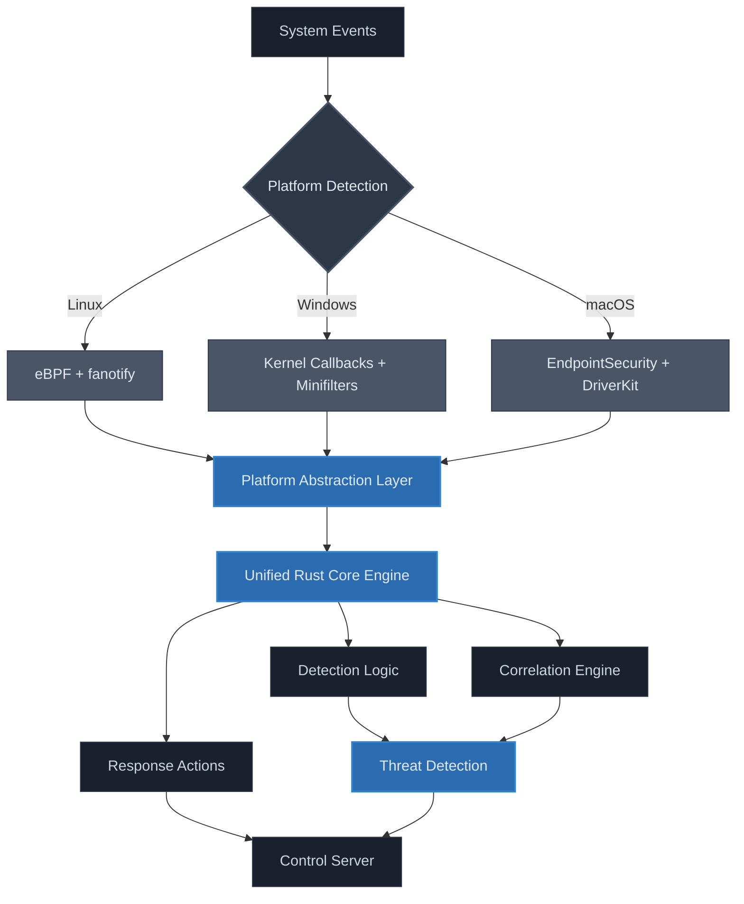

# Agent Monitoring Techniques and Platform-Specific Implementations

## Context and Problem Statement

The zedr EDR agent needs to monitor system events, network activity, and process behavior across Windows, Linux, and macOS platforms. Each operating system provides different kernel-level APIs and monitoring capabilities, requiring platform-specific implementations while maintaining a unified core detection engine. The challenge is to choose the most effective monitoring techniques for each platform that provide comprehensive visibility with minimal performance impact and maximum tamper resistance.

## Considered Options

### Linux Options

- **eBPF (extended Berkeley Packet Filter)** - Comprehensive system and network monitoring through kernel-level programs
- **fanotify** - Filesystem event monitoring with permission events for blocking file operations
- **Netlink sockets + procfs** - Traditional Linux monitoring through filesystem interfaces
- **Kernel modules** - Custom kernel drivers for deep system integration
- **ptrace + audit subsystem** - Process tracing and audit framework combination

### Windows Options

- **Kernel callbacks (PsSetCreateProcessNotifyRoutine, etc.)** - Official Windows kernel notification mechanisms
- **ETW (Event Tracing for Windows)** - Windows event tracing framework
- **WFP (Windows Filtering Platform)** - Network monitoring and filtering
- **eBPF-for-Windows** - Microsoft's eBPF implementation for network monitoring
- **Minifilter drivers** - File system monitoring through filter drivers

### macOS Options

- **EndpointSecurity framework** - Apple's modern security monitoring API
- **DriverKit** - Apple's modern driver framework for system-level access
- **NetworkExtension** - Apple's network monitoring and filtering framework
- **KEXT (Kernel Extensions)** - Traditional kernel-level drivers (deprecated)
- **System Extensions** - Apple's replacement for kernel extensions

## Decision Outcome

Chosen option: **Platform-specific optimal monitoring techniques with unified Rust core**, because this approach maximizes detection capabilities while leveraging each platform's most powerful and stable APIs.

### Decision Outcome Visualization

### Implementation Details

**Linux: eBPF + fanotify for monitoring and prevention**

- Use eBPF programs for system call monitoring, process events, file operations, and network activity
- Use fanotify with FAN_OPEN_EXEC_PERM and FAN_OPEN_PERM for blocking file execution and writes
- Provides kernel-level visibility with minimal performance overhead
- Tamper-resistant due to kernel-level execution
- eBPF handles detection, fanotify handles prevention

**Windows: Kernel callbacks + Minifilters + eBPF-for-Windows hybrid**

- Kernel callbacks (PsSetCreateProcessNotifyRoutine, PsSetCreateThreadNotifyRoutine, etc.) for system events
- Minifilter drivers for filesystem monitoring, real-time blocking, and file quarantine capabilities
- eBPF-for-Windows for network monitoring and packet inspection

**macOS: DriverKit + EndpointSecurity + NetworkExtension**

- EndpointSecurity framework for process, file, and system event monitoring
- DriverKit for low-level system access where EndpointSecurity is insufficient
- NetworkExtension for network monitoring and traffic analysis
- Follows Apple's modern security architecture and maintains compatibility

**Core Architecture: Rust-based unified logic**

- Platform-specific layers only forward raw events to Rust core
- All detection logic, correlation, and response implemented in Rust
- Platform abstraction layer provides consistent event format
- Enables code reuse and consistent behavior across platforms

### Consequences

**Good, because:**

- Each platform uses its most powerful and officially supported monitoring APIs
- Unified Rust core ensures consistent detection logic across all platforms
- Platform-specific implementations can be optimized for each OS's characteristics
- Tamper resistance is maximized by using kernel-level monitoring where available
- Performance is optimized by using native APIs designed for each platform
- Maintenance is simplified by separating platform concerns from core logic

**Bad, because:**

- Requires maintaining three different platform-specific codebases
- Development complexity is higher due to multiple technology stacks
- Testing must be performed across all three platforms for each feature
- Platform-specific expertise is required for each implementation
- Update cycles may vary based on platform API availability and changes
