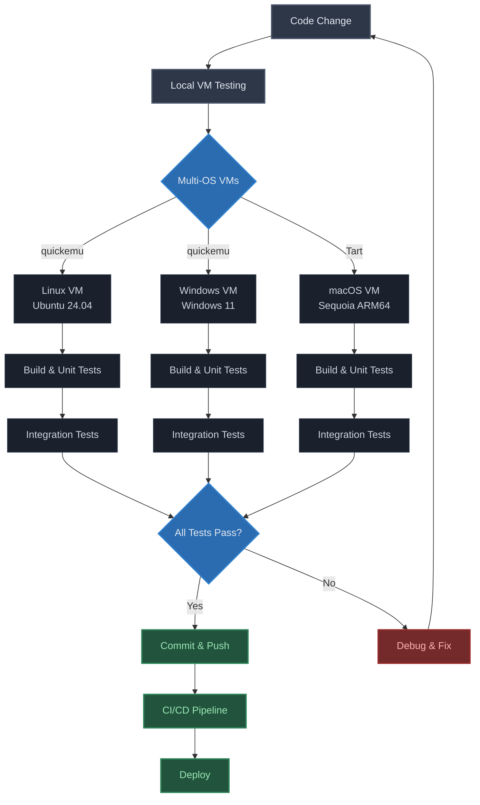

# Agent Operating System Testing on Virtualization Solution

## Context and Problem Statement

On each change, the agents must be tested against Windows, Linux, and macOS. For the userspace-only architecture, we need lightweight, automated VM orchestration that works on Apple Silicon development machines.

## Considered Options

- Tart for macOS, quickemu for Linux and Windows
- UTM (requires manual VM setup)
- Parallels Desktop (commercial, requires license)
- GitHub Actions only (no local testing)

## Decision Outcome

Chosen option: "Tart for macOS, quickemu for Linux and Windows", because it provides automated image downloading and VM orchestration for all three OSes on Apple Silicon.

### Decision Outcome Visualization

### Consequences

- Good, because Tart provides native Apple Silicon macOS VMs with OCI image registry
- Good, because quickemu automates Linux/Windows VM downloads and configuration
- Good, because both tools support headless operation for CI/CD integration
- Good, because developers can test all three OSes locally before committing
- Good, because VM images are automatically downloaded on first use
- Bad, because requires ~50GB disk space for VM images (25GB macOS, ~10GB Linux, ~15GB Windows)
- Bad, because initial image download takes time on first run
- Bad, because requires Apple Silicon Mac for development (no Intel support)
