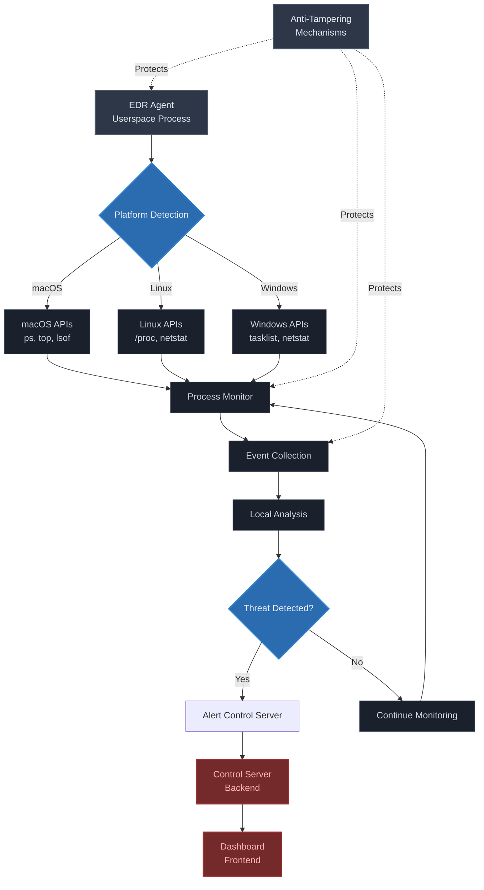

# Userspace Agents to Overcome Kernel Cross-development Difficulty

## Context and Problem Statement

Initially it was believed that for an EDR to meet industry standards it has to have kernel-level support. this is to be able to provide reliable, anti-tampering capabilities, actionable OS-level blocking, and trusted data sources.

This was proven highly difficult, and to harm the speed of progress, not only for development but for future developers.

Setup isn't automatable without long human intervention, if it's bypassing SIP, secure boot, TPM requirements, signing requirements and a lot of hurdles that the OS providers position, making cross-kernel development un-productive to say the least.

Moreover, CrowdStrike has shown us ( [CrowdStrike issue impacting Windows endpoints causing an 0x50 or 0x7E error message on a blue screen](https://support.microsoft.com/en-us/topic/kb5042421-crowdstrike-issue-impacting-windows-endpoints-causing-an-0x50-or-0x7e-error-message-on-a-blue-screen-b1c700e0-7317-4e95-aeee-5d67dd35b92f) ) that kernel level protection has its downfalls and can lead to crashes and unexpected behavior.

An alternative is to have a user-space process, that proves reliable by enforcing sophisticated anti-tampering mechanisms from user-space. Even though the agent will be killable rather easily by an admin, it can still employ tricks and multiple detection fallbacks to fight this, and meeting an EDR standard without leaving user-space.

## Considered Options

- Kernel-oriented agents (Minifilter driver, Driver extensions, etc)
- User-space agents with sophisticated anti-tampering

## Decision Outcome

Chosen option: "User-space agents with sophisticated anti-tampering", because it enables rapid cross-platform development without kernel-level complexity, maintains EDR functionality through userspace APIs, and avoids the operational risks demonstrated by kernel-level protection failures like the CrowdStrike incident.

### Decision Outcome Visualization

### Consequences

- Good, because development velocity increases dramatically without kernel driver signing and testing overhead
- Good, because cross-platform testing is fully automated through VM orchestration (Tart for macOS, quickemu for Linux/Windows)
- Good, because userspace agents avoid system crashes and boot loops that plague kernel-level protection
- Good, because security posture remains strong through sophisticated anti-tampering mechanisms and process monitoring
- Good, because deployment is simpler without requiring kernel module signatures or secure boot bypasses
- Good, because debugging is significantly easier with standard userspace tools
- Bad, because agents can be terminated by privileged users more easily than kernel components
- Bad, because some deep system visibility requires elevated privileges or workarounds
- Bad, because anti-tampering mechanisms must be implemented in userspace rather than kernel-protected memory
