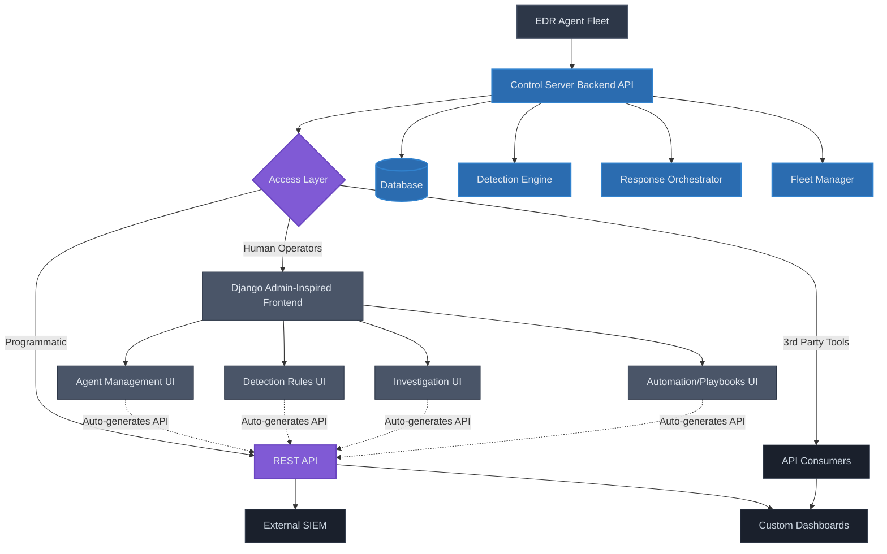

# Control server with API to control and monitor agents

## Context and Problem Statement

An EDR agent tied to a specific UI or dashboard can introduce an unwanted lock-in. EDR development should be around the agent and its agent capabilities and not around UX/UI features.

That said, an EDR agent does not have the same strength it can have with a powerful control and operations center, that's unavailable and unreadable by the attacker:
- In case of compromise, the server is (hopefully) in a different network and compute environment.
- It can be a verifier if the agent behaves as it should.
- It can perform checks/enforcements that can not be reversed, as the attacker is unaware and don't access the code in the server.
- Visibility of the agent fleet in one place is obviously crucial for protection, as well as playbooks, automations, queryability, investigation capability, etc.
- A UI teaches the user the capabilities in the product the fastest

So to enlarge zedr's capabilities we must use a server, that is certain.

But we must make it adaptive to work as a powerful API layer as well, serving as backbone for future UI's to build on top of it reliably - in terms of security, speed, and accuracy.

## Considered Options

- No UI handling and only agent code
- Built-in UI server that is glued to the agent code
- Verbose, Adaptive, API-first Control Server Frontend inspired by Django Admin Site

## Decision Outcome

Chosen option: "Verbose, Adaptive, API-first Control Server Frontend inspired by Django Admin Site", because the control server frontend should be a verbose technical-user-oriented admin interface. If we take inspiration from the [Django admin site](https://docs.djangoproject.com/en/6.0/ref/contrib/admin/) it is:
- Reads code models to provide a model-centric interface, where trusted admins can manage the inner workings of the site
- Designed for managing the code and the framework, and empowers the builders on top of it to use it as a management interface, not as their app
- On production, admins using django can operate the backoffice through the django admin, instead of having to create the ui for it, but if they want, they can easily do that too

The control server should be django-admin inspired in experience - it should control all controllable aspects of the agents.

On top of that, it should automatically ensure every action possible in the control server is consumable as an API from a theoretical 3rd party UI consumer.

It is a UI to show what is possible.

### Decision Outcome Visualization

### Consequences

**Good:**
- **UI-first development with API-first architecture**: Every UI feature automatically becomes an API endpoint, preventing UI/API drift
- **No vendor lock-in**: Third-party tools and custom UIs can consume the same API as the built-in frontend
- **Faster operator onboarding**: Django Admin-style interface provides immediate visibility into all agent capabilities without custom UI development
- **Separation of concerns**: Agent development focuses on detection/response; control server focuses on orchestration and visibility
- **Progressive complexity**: Users can start with the built-in admin interface and graduate to custom integrations as needed
- **Enhanced security posture**: Control server operates in isolated environment, providing defense-in-depth against agent compromise
- **Rapid prototyping**: New detection rules, response actions, and workflows can be tested through the admin interface before API automation

**Bad:**
- **Increased complexity**: Adds another component to deploy, maintain, and secure (server + database + frontend)
- **Additional attack surface**: Control server becomes a high-value target requiring hardening, authentication, and access control
- **Network dependency**: Agents require reliable connectivity to the control server for full functionality (mitigated by 30-day offline mode)
- **Development overhead**: Every agent capability must be properly exposed through the control server API layer
- **Potential performance bottleneck**: Control server must handle telemetry from entire agent fleet at scale
