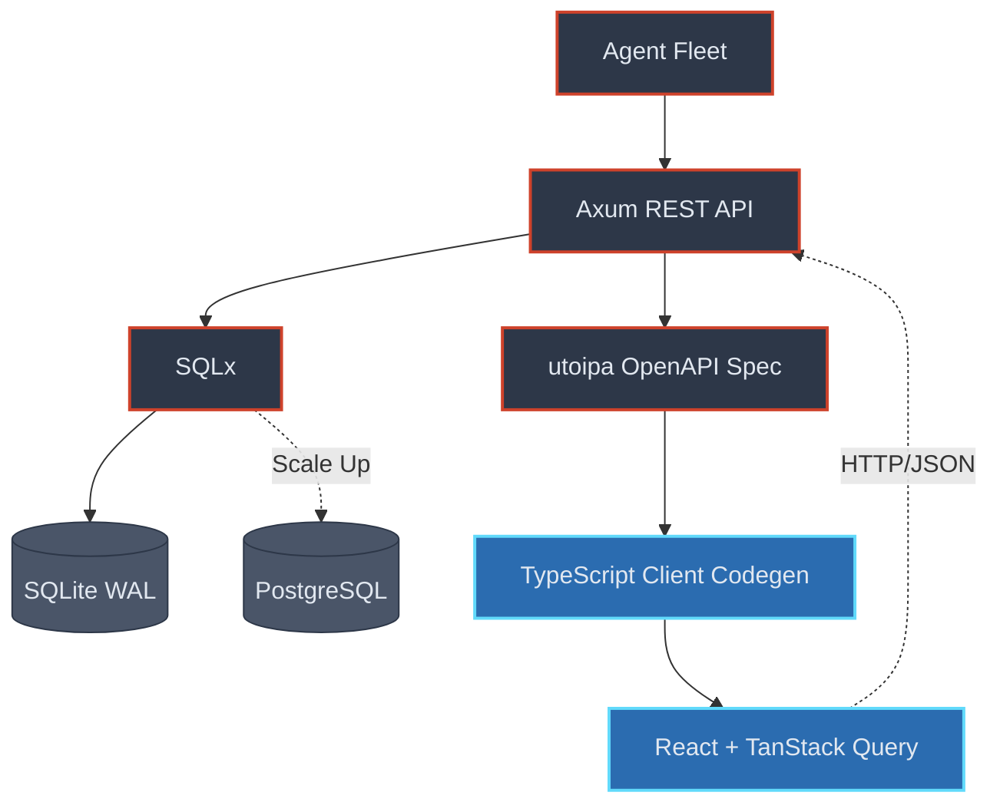

# Control Server Tech Stack

## Context and Problem Statement

The control server needs high-performance event ingestion from agent fleet, lightweight local development, and API-first architecture per ADR 006. Stack must prioritize throughput over ORM convenience, as EDR workload is write-heavy time-series data (1000s events/sec) with simple read queries.

## Considered Options

**Backend:**
- **Axum** - Async, type-safe, modular
- **Actix-web** - Mature, high performance
- **Rocket** - Ergonomic, async support

**Database:**
- **SQLite WAL** - Embedded, concurrent, zero-config
- **PostgreSQL** - Full-featured, separate server required

**Data Layer:**
- **SQLx** - Compile-time SQL checks, minimal overhead, async
- **SeaORM** - ORM with entity hydration, more abstraction
- **Diesel** - Mature but sync-only

**Frontend:**
- **React + Vite** - Fast HMR, large ecosystem
- **Tailwind CSS** - Utility-first, dark mode built-in

## Decision Outcome

Chosen option: **Axum + SQLite WAL + SQLx + React + Tailwind**

**Backend:** Axum + SQLite WAL + SQLx + utoipa (OpenAPI generation) + Tower (CORS, auth)

**Frontend:** React + TypeScript + Vite + TanStack Query + Tailwind CSS dark theme

**API:** REST with JSON, OpenAPI spec auto-generated from Rust types, TypeScript client codegen

**Tools:** pm2 (process management), sqlx-cli (migrations), cargo-watch (auto-rebuild)

### Decision Outcome Visualization

### Consequences

**Good:**
- High performance: Axum handles 100k+ req/s, SQLite WAL supports 1000+ concurrent readers
- SQLx minimal overhead for bulk event inserts (no ORM entity hydration)
- Type safety: Rust → OpenAPI → TypeScript with compile-time verification
- Lightweight: Embedded SQLite, no external database server
- Fast dev loop: Vite HMR + cargo-watch
- Easy deployment: Single binary + SQLite file + static assets

**Bad:**
- SQLite scaling ceiling at ~5k agents with high event volume (migrate to PostgreSQL if exceeded)
- Manual SQL writing (but EDR queries are straightforward)
- Rust compile times (mitigated by incremental builds)
- No ORM convenience for complex relations (trade-off for performance)
