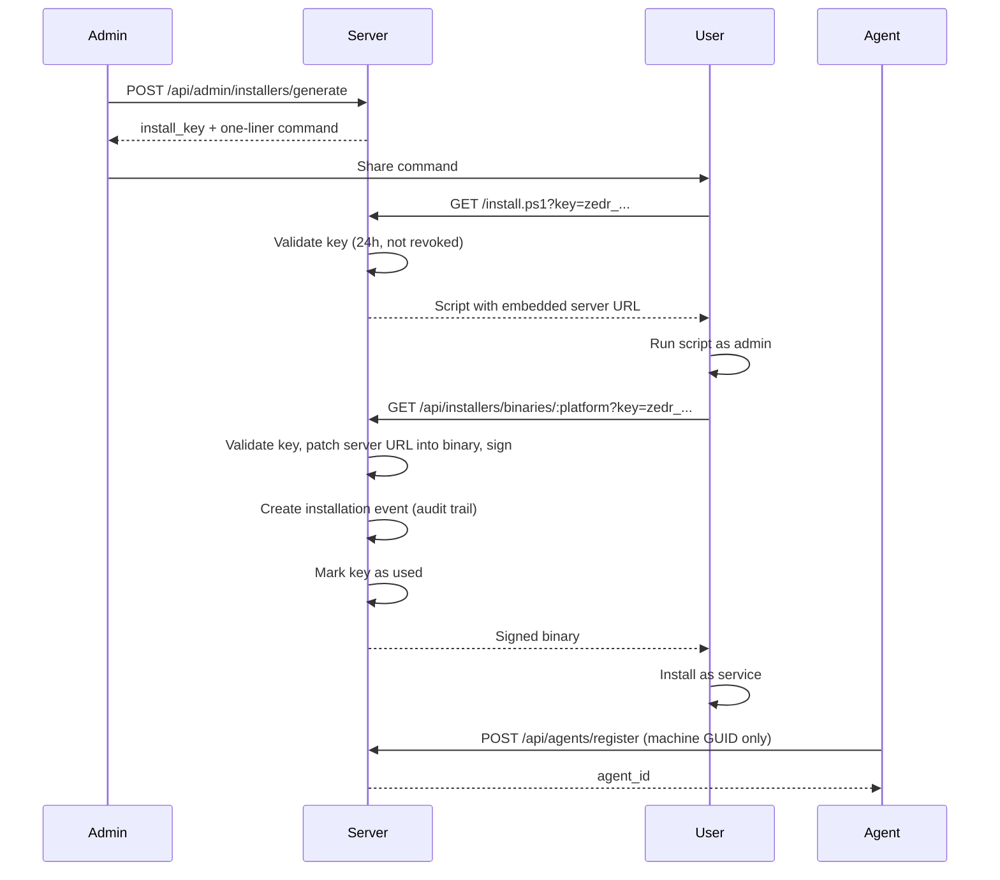

# Secure Installer Generation

## Context and Problem Statement

Agent installation is security-critical: unauthorized deployments compromise the entire EDR system. Current installers are generic scripts with hardcoded defaults, no authentication, and configuration passed as CLI parameters (visible in logs). Need secure one-time installation with curl|bash UX, complete audit trail, and revocation capability.

## Considered Options

- **Install Keys (curl|bash pattern)** - Admin generates 24h key, user runs one-liner
- **Pre-Shared Keys** - Same key on all agents
- **Certificate-Based** - X.509 PKI per agent
- **Interactive Install** - Prompt for credentials during install

## Decision Outcome

Chosen option: **Install Keys with curl|bash pattern**

Admin generates single-use 24-hour install key via API, shares one-liner command with user. Control server dynamically generates installer script on-demand with embedded config. Key validated during script download and binary download, creating complete audit trail. Agent is unaware of install key and registers with machine GUID only.

**Workflow:**
1. Admin: `POST /api/admin/installers/generate` → receives install key + one-liner commands
2. User: Runs one-liner as admin/root
3. Server: Validates key, generates installer script with embedded server URL
4. Installer: Downloads binary (key validated again), installs service
5. Server: Creates installation event at binary download (audit trail complete)
6. Agent: Registers with machine GUID only (no install key sent)

**User Experience:**

Windows: `iwr -useb https://server/install.ps1?key=zedr_... | iex`

macOS/Linux: `curl -fsSL https://server/install.sh?key=zedr_... | sudo bash`

### Decision Outcome Visualization


### Database Schema

    key_hash TEXT NOT NULL UNIQUE,
    key_plaintext TEXT NOT NULL,   -- Ed25519 private key: signs upgrade/shell commands, agent verifies signatures
    agent_version TEXT NOT NULL,   -- Version to install
    created_at INTEGER NOT NULL,
    expires_at INTEGER NOT NULL,   -- 24 hours from generation
    used_at INTEGER,
    revoked_at INTEGER,
    created_by TEXT NOT NULL       -- Admin who generated it
);

-- Installation event created at binary download time (in events table)
-- Links install_key to agent via installation event with agent_id NULL
-- When agent registers, second install event created with agent_id populated  ip_address TEXT,
    hostname TEXT,
    installed_at INTEGER NOT NULL
);
```

### Endpoints

**Admin API:**
- `POST /api/admin/installers/generate` - Generate install key, return one-liner commands
- `GET /api/admin/installers` - List all install keys (active, used, expired, revoked)
- `POST /api/admin/installers/:id/revoke` - Revoke unused key

**Public API:**
- `GET /install.ps1?key=zedr_...` - Dynamic PowerShell installer script
- `GET /install.sh?key=zedr_...` - Dynamic bash installer script
- `GET /api/installers/binaries/:platform/:filename` - Pre-built agent binaries
 (key validated)
- `GET /install.sh?key=zedr_...` - Dynamic bash installer script (key validated)
- `GET /api/installers/binaries/:platform-:arch?key=zedr_...` - Authenticated binary download (key validated, installation event created)

**Agent API:**
- `POST /api/agents/register` - Agent registration with machine GUID only (no install_key)
**Good:**
- Familiar curl|bash UX with authentication
- Single-use 24h keys prevent unauthorized deployments
- Complete audit trail (who generated, who used, when, from which IP)
- Configuration embedded in script, not CLI params
- Revocation before use

**Bad:**
- Requires control server reachable during installation
- Admin must generate key per deploymentdownloaded, when, from which IP)
- Server URL patched directly into binary (64-byte placeholder)
- Binary signature verified by agent at startup
- Agent completely unaware of install key (cleaner architecture)
- Installation event created at download time (immediate audit trail)
- Revocation before use

**Bad:**
- Requires control server reachable during installation
- Admin must generate key per deployment

**Note:** Install key is purely server-to-client authorization for downloading installer script and binary. Agent registers with machine GUID only, never sending install key. This separation of concerns ensures agent code remains clean and focused on EDR functionality.