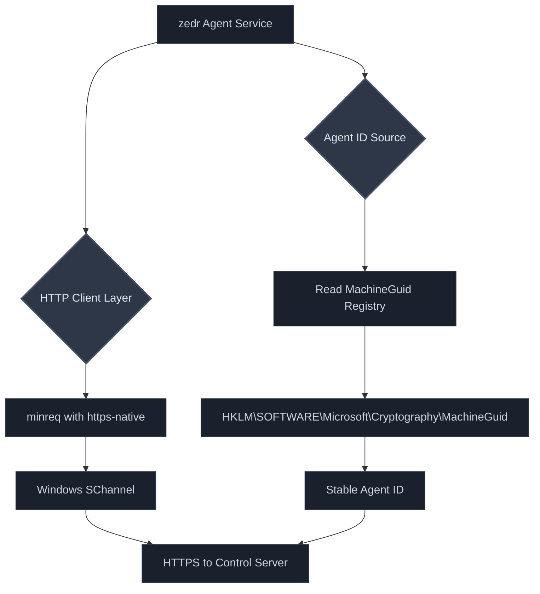

# Windows Service Compatibility

## Context and Problem Statement

The zedr agent must run as a Windows service architecture, requiring stable HTTPS communication with the control server. Windows services crash when using common Rust HTTP clients with `rustls`/`ring` crypto libraries, causing STATUS_STACK_BUFFER_OVERRUN (0xc0000409) errors. Additionally, the agent needs a stable identifier that persists across reinstalls to maintain consistent tracking in the control server.

## Considered Options

- Use `ureq` with default features (rustls)
- Use `ureq` with native-tls feature
- Use `minreq` with https-native feature (Windows SChannel)
- Generate random UUID for agent ID on each install
- Use Windows Machine GUID as agent ID

## Decision Outcome

Chosen option: "Use `minreq` with https-native feature and Windows Machine GUID for agent ID", because it provides reliable TLS in Windows services and ensures stable agent identification across reinstalls.

### Decision Outcome Visualization

### Consequences

- Good, because Windows SChannel (native TLS) works reliably in Windows services without requiring clang or additional build dependencies
- Good, because Machine GUID provides a stable identifier that survives service reinstalls, ensuring consistent agent tracking
- Good, because it eliminates the ring crate's ARM64 compatibility issues
- Bad, because minreq has a more limited API compared to ureq or reqwest
- Bad, because Machine GUID is tied to Windows installation and changes if Windows is reinstalled (though this is rare)
- Neutral, because agent must run as LocalSystem to read the Machine GUID registry key
