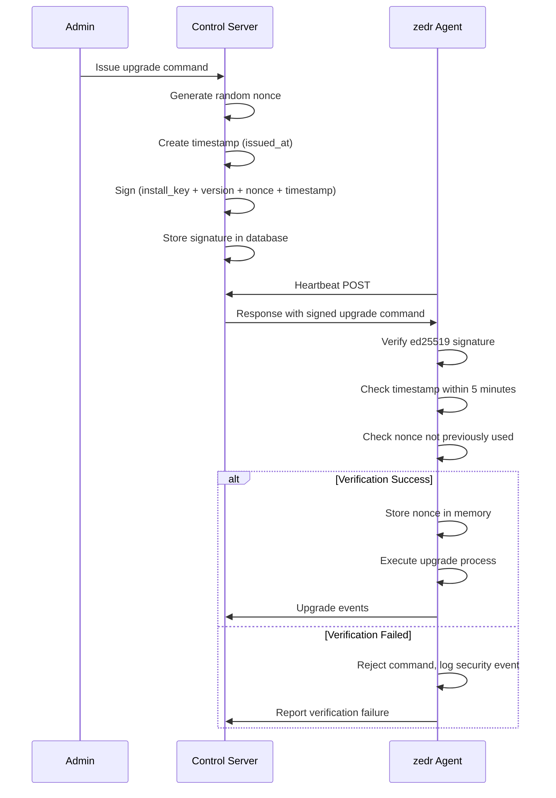

# Upgrade Command Cryptographic Signing

## Context and Problem Statement

Upgrade commands from control server to agents are transmitted via heartbeat responses and protected only by TLS. If TLS is compromised through certificate theft, CA compromise, or MITM attacks, attackers can inject malicious upgrade commands forcing agents to downgrade to vulnerable versions or execute arbitrary binaries. While agents verify binary signatures before execution, they blindly trust upgrade commands received over TLS. How can we provide defense-in-depth by ensuring upgrade commands are cryptographically authenticated even if the TLS layer is compromised?

## Considered Options

- **TLS-Only Protection**: Current state, rely solely on transport security
- **Command Signing with Timestamp**: Sign commands with ed25519, include timestamp to prevent stale replays
- **Command Signing with Nonce**: Sign commands with ed25519, use unique nonce per command to prevent replays
- **Command Signing with Timestamp + Nonce**: Combine both mechanisms for defense-in-depth
- **Message Authentication Codes (HMAC)**: Use shared secret HMAC instead of asymmetric signatures

## Decision Outcome

Chosen option: **Command Signing with Timestamp + Nonce**, because it provides cryptographic proof of authenticity using the existing ed25519 signing infrastructure, prevents replay attacks through nonce uniqueness tracking, bounds command lifetime to prevent stale command execution, maintains consistency with binary signing approach, and adds no network exposure while requiring minimal agent state.

### Decision Outcome Visualization

### Consequences

**Good:**

- **Defense-in-depth**: Commands authenticated cryptographically, TLS compromise insufficient for attack
- **Replay attack prevention**: Nonce uniqueness prevents captured commands from being reused
- **Bounded command lifetime**: 5-minute timestamp window limits exposure of captured commands
- **Infrastructure reuse**: Leverages existing ed25519 signing key and verification code
- **Consistent security model**: Matches binary signature verification pattern agents already implement
- **Zero network changes**: Uses existing heartbeat protocol, no additional endpoints
- **Minimal agent state**: In-memory nonce cache sufficient, no persistent storage required. This no longer holds: every command the agent accepts is recorded on disk, so that a restarted agent does not accept one again ([ADR 029](./029-signed-commands-run-once-across-agent-restarts.md))

**Bad:**

- **Backend signing overhead**: Every command creation requires cryptographic signing operation
- **Agent verification overhead**: Every command requires ed25519 verification before execution
- **Memory footprint**: Agent must maintain nonce cache for command deduplication
- **Clock synchronization dependency**: Timestamp validation requires agent and server clocks roughly synchronized

## References

- Existing implementation: [agent/shared/src/lib.rs](../../agent/shared/src/lib.rs) - Binary signature verification
- Existing implementation: [control_server/backend/src/signing.rs](../../control_server/backend/src/signing.rs) - Ed25519 signing service
- Security standard: Ed25519 signature scheme (RFC 8032)
- Attack pattern: TLS compromise and command injection vectors
- Industry pattern: Command signing in Windows Update, apt-get package verification
