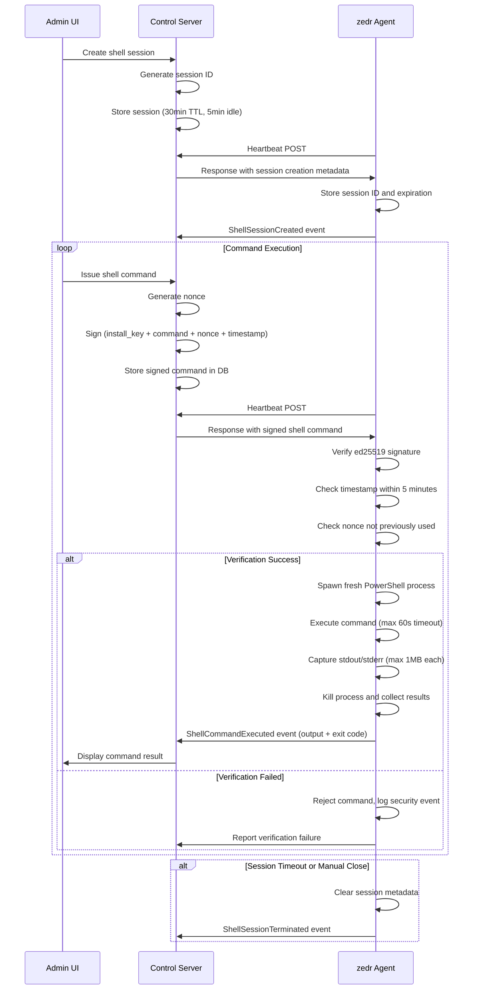

# Secure Remote Shell Access

## Context and Problem Statement

Administrators need to run diagnostic commands and investigations on remote agents without SSH access or manual login. How can we provide secure, audited remote command execution that maintains the same cryptographic guarantees as upgrade commands while supporting interactive shell sessions?

## Considered Options

- **Stateless One-Shot Commands**: Each command independent, no persistent shell state
- **Stateful Session with Signed Command Stream**: Persistent shell process, sequential command execution
- **SSH Tunneling**: Embed SSH server in agent, use standard SSH clients
- **WebSocket Command Channel**: Real-time bidirectional command/output streaming

## Decision Outcome

Chosen option: **Session-scoped stateless commands**, because it provides secure command execution with session-based authorization and audit boundaries, spawns fresh isolated process per command (no state leakage), reuses proven upgrade command signing pattern with ed25519+timestamp+nonce, integrates cleanly with existing heartbeat protocol requiring no new network channels, and prevents resource leaks from persistent processes.

### Decision Outcome Visualization

### Consequences

**Good:**

- **Cryptographic authentication**: Commands signed with ed25519, prevents MITM injection even if TLS compromised
- **Replay attack prevention**: Nonce uniqueness prevents captured commands from being reused, also after the agent restarted ([ADR 029](./029-signed-commands-run-once-across-agent-restarts.md))
- **Bounded command lifetime**: 5-minute timestamp window limits exposure of captured commands
- **Full audit trail**: All commands, outputs, and exit codes logged in database
- **Resource protection**: 60s timeout, 1MB output caps prevent abuse and memory exhaustion
- **Process isolation**: Fresh process per command prevents state leakage and resource leaks
- **Infrastructure reuse**: Uses existing signing service and heartbeat protocol
- **No additional network exposure**: Reuses existing HTTPS heartbeat channel
- **Simple failure modes**: Process timeout = kill and report, no cleanup complexity

**Bad:**

- **Buffered output only**: No real-time streaming within 60s command execution (acceptable trade-off)
- **Output truncation**: 1MB cap may cut verbose commands (user must redirect to file). The result also has to fit in one event batch, which cuts output that is mostly escaped characters earlier ([ADR 027](./027-shell-results-cut-to-one-event-batch.md))
- **No state preservation**: Working directory and environment variables reset per command
- **Clock synchronization dependency**: Timestamp validation requires roughly synchronized clocks
- **Process spawn overhead**: ~100-500ms per command for fresh PowerShell initialization

## References

- Existing implementation: [docs/adr/011-upgrade-command-signing.md](./011-upgrade-command-signing.md) - Command signing pattern
- Existing implementation: [agent/shared/src/lib.rs](../../agent/shared/src/lib.rs) - Signature verification logic
- Existing implementation: [control_server/backend/src/signing.rs](../../control_server/backend/src/signing.rs) - Ed25519 signing service
- Security standard: Ed25519 signature scheme (RFC 8032)
- EDR pattern: Remote shell capabilities in Carbon Black, CrowdStrike Falcon RTR
