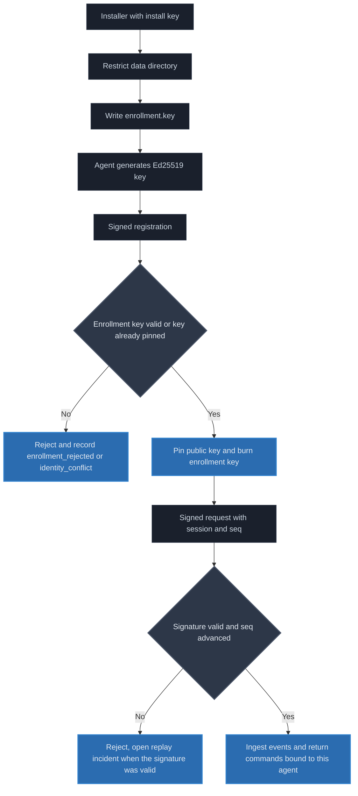

# Agent Identity and Signed Requests

## Context and Problem Statement

Agents identified themselves with a bare machine GUID. Anyone who could reach the control server could register as any agent, read its pending signed commands, keep a dead agent looking alive and write fake shell output into the audit trail. Signed commands carried the install key, which the agent never knew, so a command signed for one agent was valid on every agent, and the server had to keep install keys in plaintext to sign with them.

How does the control server know that a request really comes from the machine it enrolled, and how does an agent know that a command was meant for it?

## Considered Options

- Bearer token issued at enrollment
- Mutual TLS with a per-agent client certificate
- Per-agent Ed25519 key generated on the endpoint, pinned at enrollment, signing every request

## Decision Outcome

Chosen option: "Per-agent Ed25519 key generated on the endpoint", because the private key never leaves the machine, a stolen database yields no credential that can impersonate an agent, the agent already ships `ed25519-dalek`, and the same key lets the server detect replays and clones. The pattern is ported from the collector of another project of ours, where it has run in production.

- The installer writes the single-use install key to `enrollment.key` in the agent data directory, which it first restricts to SYSTEM and Administrators.
- On first start the agent generates a key pair and stores the seed in `identity.json` in that directory.
- Registration presents the public key, the enrollment key and a signature over the request body. The server pins the public key to the agent and burns the enrollment key. A later registration needs either the pinned key or a fresh enrollment key.
- Every request carries `X-Zedr-Signature`, an Ed25519 signature over the exact request bytes, plus a `session` counter that advances on every process start and a `seq` counter that advances on every request. The server accepts a request only when `seq` is higher than the last one seen for that session, and keeps the four most recent sessions so the staging service and the main service can report during an upgrade without rejecting each other.
- Signed commands now bind `agent_id`, and shell commands also bind `session_id`. The signed bytes are produced by one function in the `protocol` crate used by both sides, with a purpose tag per command type. The agent refuses a command issued for another agent.
- A registration that replaces the pinned key of an enrolled agent is recorded as an `identity_rotated` event, so a reinstall and a takeover with a stolen install key both leave a trace.
- Install keys are stored as hashes only.

### Decision Outcome Visualization

### Consequences

- Good, because an unauthenticated party can no longer register agents, submit events, read pending commands or forge shell results.
- Good, because a captured or replayed request is rejected and raises an incident, which also exposes a cloned identity.
- Good, because a signed command is valid for exactly one agent and one shell session.
- Good, because the server no longer holds install keys in plaintext.
- Good, because the agent grew by about 55 KB on the x64 build, which keeps it tiny.
- Bad, because this is a breaking protocol change. Agents built before it are rejected and must be rebuilt and enrolled again.
- Bad, because a local administrator can read `identity.json` and impersonate the agent. The directory ACL only keeps standard users out.
- Bad, because restoring a VM snapshot rolls the session counter back, so the agent is rejected until it is enrolled again.
