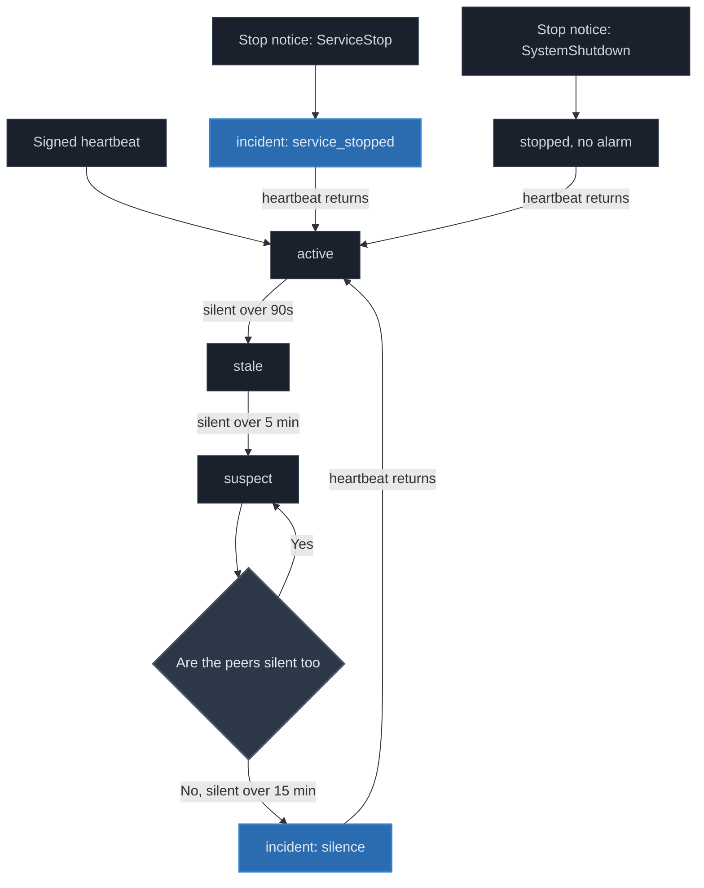

# Liveness State Machine and Tamper Incidents

## Context and Problem Statement

A userspace agent can be stopped or killed by an administrator ([ADR 004](./004-userspace-agents.md)). The control server only marked an agent offline after 60 seconds without a heartbeat, which could mean a reboot, a sleeping laptop, a server outage or an attacker. On Windows there is no supported way to prevent the kill without a driver, so the realistic goal is to notice it reliably and to stay quiet for everything benign.

How does the control server turn silence into a trustworthy signal?

## Considered Options

- Keep the fixed 60 second offline timer
- Alert on every missed heartbeat
- Liveness state machine with a fleet differential and signed stop notices

## Decision Outcome

Chosen option: "Liveness state machine with a fleet differential and signed stop notices", because it separates benign gaps from targeted silence. The logic is ported from another project of ours and kept as a pure function so its false positive behaviour is pinned by unit tests.

- A sweeper runs every 15 seconds and derives a state per agent from the time since its last signed heartbeat: `active` up to 90 seconds, `stale` up to 5 minutes, `suspect` up to 15 minutes, then `incident`.
- Fleet differential: when every other agent is silent as well, the cause is the server or the network, so agents hold at `suspect` and nobody is blamed.
- Silence is measured from the later of the last heartbeat and the server start, so a server restart never alarms the fleet.
- The agent announces why it stops. `SystemShutdown` puts it in `stopped` with no alarm. `ServiceStop` opens a `service_stopped` incident at once, because someone stopped the EDR while the machine kept running. `Upgrade` is recorded and the normal thresholds apply.
- Incidents are rows with an open and a close time. A valid heartbeat or registration closes `silence` and `service_stopped`. Each transition is written to the event stream, so the Events page shows it without a new screen.
- Incident types: `silence`, `service_stopped`, `replay`, `identity_conflict`.

### Decision Outcome Visualization

### Consequences

- Good, because a killed or network-isolated agent becomes an incident with no kernel component.
- Good, because reboots, shutdowns, upgrades, server restarts and network outages do not raise incidents.
- Good, because a clean service stop is reported within one request and does not wait for the silence window.
- Bad, because detection of a hard kill takes 15 minutes. The thresholds are constants in `liveness.rs`.
- Bad, because an attacker who silences every agent at once is held at `suspect`. With two agents this means silencing both.
- Bad, because the stop notice is best effort. A process kill sends none and is caught by the silence window only.
- Bad, because this is detection only. Preventing the stop on Windows needs a protected process, which needs a Microsoft signed driver.
