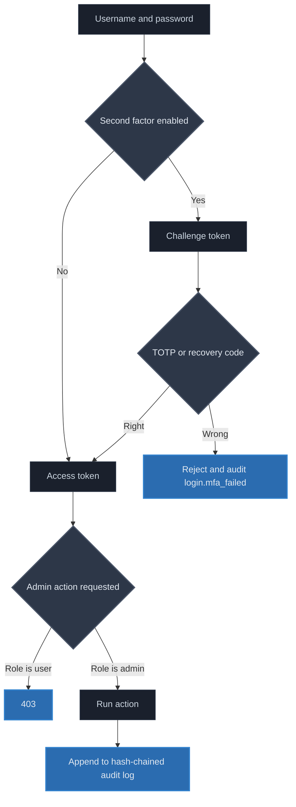

# Console Access Hardening

## Context and Problem Statement

The central management standard asks for multi-factor authentication, role-based access control and tamper-proof, auditable logs. The console had one seeded admin account, a role column that no handler checked, no second factor and no record of who issued an install key, an upgrade or a shell command. The event streams also fell back to a publicly known JWT secret when `JWT_SECRET` was unset.

How does the console prove who did what, and limit what each account can do?

## Considered Options

- External identity provider (OIDC) for login, roles and second factor
- Built-in roles, TOTP and a hash-chained audit log

## Decision Outcome

Chosen option: "Built-in roles, TOTP and a hash-chained audit log", because a self-hosted control server must work with no third party, the pieces are small, and another project of ours already proved the same design. An identity provider can be added later without removing any of this.

- Roles: `admin` and `user`. Handlers that change state or expose shell output take an `AdminUser` extractor, so the compiler shows which routes need the role. A `user` can read agents, events and incidents.
- User management: admins create and delete accounts. Passwords need 12 characters with mixed classes. An admin cannot delete their own account or the last admin.
- Second factor: RFC 6238 TOTP implemented in the server with `hmac` and `sha1`, six digits, 30 second steps, one step of drift, and each time step usable once. Ten single-use recovery codes are stored as hashes. Login returns a five minute challenge token signed with a key derived from `JWT_SECRET`, so it can never be used as an access token.
- Audit log: every login, failed login, install key, upgrade, shell session, shell command, API key, user and second factor change is appended to `audit_log`. Each row stores the hash of the previous row and its own hash. `GET /api/admin/audit` returns the entries and verifies the whole chain, reporting the first broken row.
- The JWT secret fallback is removed. A missing secret is a configuration error.
- Operator surface: `ZEDR_ADMIN_ALLOWED_CIDRS` limits the console, `/api/admin`, `/api/auth` and `/api-docs` to the given networks while agent-facing paths stay reachable.

### Decision Outcome Visualization

### Consequences

- Good, because read-only accounts exist and cannot issue install keys, upgrades or shell commands.
- Good, because every privileged action is attributed to an account, and editing or deleting an audit row is detected.
- Good, because a stolen password alone no longer opens an account that has a second factor.
- Bad, because the audit chain is tamper-evident, and an attacker with database write access can rewrite the whole chain. The newest hash must be anchored outside the server to close that gap.
- Bad, because the second factor is optional per account and the access token still lives 24 hours. Enforcing a second factor for admins and rotating refresh tokens are not done.
- Bad, because the standard asks for three signers to approve a shell session. This ADR does not provide that.
- Bad, because TOTP secrets are stored in the database in recoverable form, as TOTP requires.
