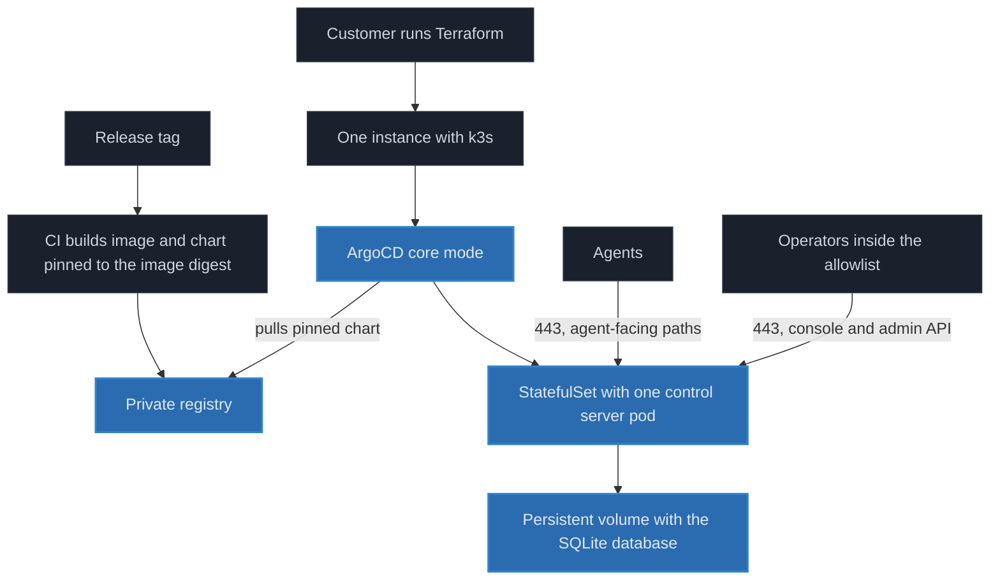

# Bring Your Own Cloud Deployment

## Context and Problem Statement

The development standard asks for the control server to be deployable with Infrastructure as Code and to support rolling upgrades. The control server only ran through `pm2` with `cargo run`, read its TLS files from a path derived from the working directory, and had no container, no health probes and no upgrade story.

A security team that runs zedr must be able to stand it up inside their own cloud account, keep every secret and every event there, and still receive updates.

## Considered Options

- Vendor-hosted control server
- Customer-run binary with a documented manual install
- Customer-run container on a single-node Kubernetes, installed by Terraform and updated by pull

## Decision Outcome

Chosen option: "Customer-run container on a single-node Kubernetes, installed by Terraform and updated by pull", because the events, the audit log and the remote shell channel stay in the customer account, and the publisher holds no credentials into any deployment. The layout is ported from another project of ours, where it was applied on AWS and rolled several releases.

- Image: multi-stage build that compiles the console and the control server, and runs as a non-root user on a read-only root filesystem. The server no longer links OpenSSL.
- The control server terminates TLS itself, so it is exposed with a LoadBalancer Service and no ingress controller. `externalTrafficPolicy: Local` keeps the real client address, which the operator allowlist needs.
- One port, two surfaces: agent-facing paths are open, and the console, `/api/admin`, `/api/auth` and `/api-docs` are limited to `ZEDR_ADMIN_ALLOWED_CIDRS`.
- State: one SQLite file on a persistent volume, so the chart runs exactly one replica as a StatefulSet.
- Probes: `/healthz` for liveness and `/readyz` for readiness. The server drains for 10 seconds on SIGTERM.
- Configuration: `ZEDR_TLS_CERT_PATH`, `ZEDR_TLS_KEY_PATH` and `ZEDR_BINARIES_DIR` are required, `ZEDR_FRONTEND_DIST` makes the server serve the console on the same origin.
- Updates: ArgoCD in core mode runs in the customer cluster and pulls a pinned chart version from the registry. The publisher releases a version and the customer moves the pin.
- Terraform module for AWS creates one instance with k3s, with Traefik disabled so port 443 belongs to the control server.

### Decision Outcome Visualization

### Consequences

- Good, because the database, the audit log and the remote shell channel never leave the customer account.
- Good, because the publisher needs no access to a deployment to update it.
- Good, because the same chart can run on any cluster the customer already has.
- Bad, because one SQLite file means one replica. An upgrade restarts the only pod, and agents retry until it is back.
- Good, because each deployment generates its own signing key. The control server patches the matching public key into every agent it serves, so the image holds no key and can be handed to another operator ([ADR 017](./017-per-deployment-signing-key.md)).
- Bad, because the volume holds the database and the cluster holds the signing key. Losing or replacing the key strands every deployed agent, so it must be backed up outside the cluster.
- Bad, because without an ingress controller there is no HTTP-01 challenge. The certificate comes from DNS-01 or from a secret the customer provides.
- Bad, because the image has not been built and the chart has not been installed on a cluster yet. Only the chart rendering, the Terraform validation and the script linting have been run.
- Bad, because the server reads its certificate at startup, so a renewed certificate is served only after the pod restarts.
- Bad, because the agent binaries are baked into the image, so a new agent build needs a new image.
