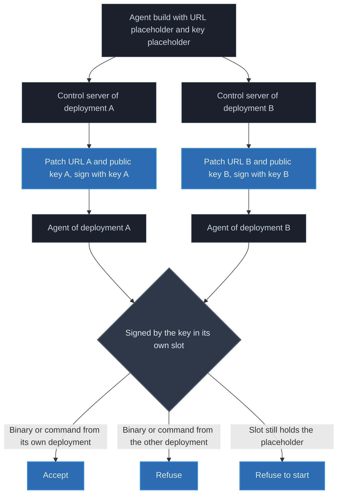

# Per-Deployment Signing Key

## Context and Problem Statement

The agent checked its own binary, upgrade binaries and signed commands against one public key compiled into the agent source. Every control server therefore had to hold the same private key. A second operator could only run zedr with the publisher's private key, and with that key they could sign binaries and commands that the agents of every other deployment accept. Replacing the key needed a source change and a rebuild of every agent.

How does each deployment get its own signing key while the agent stays one prebuilt binary?

## Considered Options

- One publisher key compiled into every agent
- Public key handed over at enrollment and stored in the agent data directory
- Public key patched into the agent binary at download and covered by the binary signature

## Decision Outcome

Chosen option: "Public key patched into the agent binary at download", because the control server already rewrites a 64 byte slot per download for the server URL and signs the result, so the key travels inside the same signature as the code and the agent needs no extra file and no network step before it can verify anything. A key stored in the data directory would sit in a file that can be replaced apart from the binary, and the agent would have to start before it trusts anything.

- The agent is built with a 64 byte placeholder where the key belongs. The placeholder and the slot format are defined once in the `protocol` crate and used by both sides.
- On every download, for install and for upgrade, the control server writes the public key of its own `ZEDR_SIGNING_KEY_HEX` into the slot as hex, then signs the whole binary and appends the signature.
- The control server refuses to serve an agent binary where the placeholder is missing or appears more than once.
- The agent reads the slot at run time. A slot that still holds the placeholder is an error, so an agent that did not come from a control server refuses to start.
- The agent checks its own binary, upgrade binaries and signed commands against the slot key. An upgrade is checked with the key of the running agent, so a binary from another deployment is refused even when its own signature is valid.
- Any 32 random bytes are a valid key, so a deployment generates its own with `openssl rand -hex 32`.
- The control server records its public key in the database on the first start. On a later start with a different key it refuses to run while agents are enrolled, and names both public keys in the error. `ZEDR_SIGNING_KEY_CHANGE_ACCEPTED` set to the new public key lets it start, and the change is written to the audit log. With no enrolled agents the new key is taken and audited without that step.

### Decision Outcome Visualization

### Consequences

- Good, because every deployment has its own key, so a leaked key exposes one deployment and no control server can sign for the agents of another.
- Good, because the image and the agent binaries can be handed to another operator without sharing a private key and without a source change.
- Good, because the key is inside the signed bytes, so a binary where only the key was replaced fails its own check.
- Good, because the Windows agent did not grow. The x64 build is 780 KB before and after.
- Bad, because trust starts at the first download. The installer fetches the binary from the control server over TLS, and the endpoint trusts the key that arrives in it. A compiled-in key gave no more here, since nothing on the endpoint checks the binary before it runs.
- Bad, because an attacker who can rewrite the binary on disk can replace the key and the signature together. The self check runs inside the binary it checks and never covered this case.
- Good, because a key that changed by accident stops the control server at startup with both public keys in the error, before any agent is sent a command it would refuse.
- Bad, because replacing `ZEDR_SIGNING_KEY_HEX` strands every enrolled agent. They keep the key they were installed with and refuse commands and upgrades until they are reinstalled. There is no rotation path yet.
- Bad, because after an accepted key change the console still shows the stranded agents as active. Their heartbeats are signed with their own identity key, which the change does not touch, so only the audit log and the startup warning say that they need a reinstall.
- Bad, because agent binaries built before this decision have no key slot. The control server refuses to serve them, so the agent has to be rebuilt.
- Bad, because the slot is read through `std::hint::black_box` to keep the compiler from folding the placeholder into the code. A release build of the shared agent code was patched by two control servers and behaved as described on macOS, and the Windows build holds exactly one copy of the placeholder, but the Windows agent itself has not run with a patched key yet.
