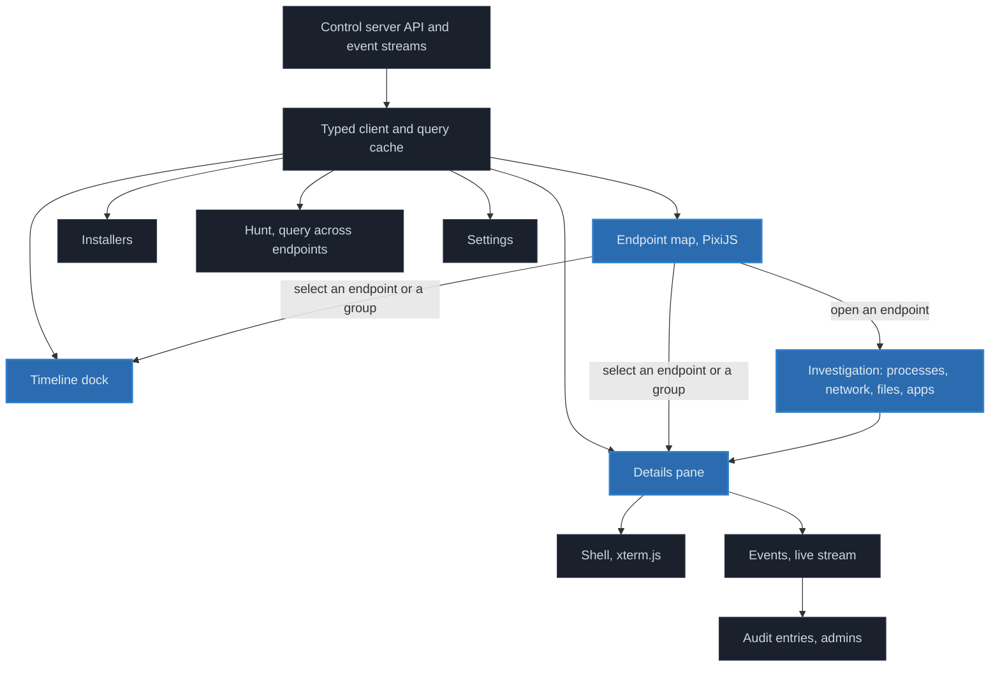

# Console Redesign

## Context and Problem Statement

The console was four pages of hand-rolled tables with no shared components, no tests and 86 type errors, so `npm run build` could not gate a release. Analysts are the people who use zedr all day, on anything from a laptop to a wall of monitors, and the console gave them a flat agent list and no way to see the state of all endpoints at once.

What should the console be built on, and how should it be laid out, so that it is fast to read, pleasant for long sessions and still exact for technical users?

## Considered Options

- Keep the pages and restyle them
- Rewrite on a server-rendered framework such as Next.js
- Rewrite as a static single page application on React, with a WebGL map as the home view

## Decision Outcome

Chosen option: "Rewrite as a static single page application on React, with a WebGL map as the home view", because the control server already serves static files on the same origin, so no Node process is needed at run time, and a canvas is the only way to show thousands of endpoints as one picture.

- Stack: React 19, Vite, strict TypeScript, Tailwind 4, TanStack Router, Query and Virtual, Zustand, PixiJS for the map, React Flow for the investigation canvas, xterm.js for the shell, Radix primitives and cmdk for dialogs, menus, tooltips and search, react-resizable-panels for panes. Fonts are bundled, the console makes no third-party request.
- One home view, the endpoint map. Every endpoint is a dot, grouped by subnet, system, agent version or liveness. Colour and shape carry the liveness state, an open incident pulses.
- Incidents have no page of their own. They show on the map, in the queue of the details pane, and in a timeline that opens when one endpoint or one group is selected. The timeline draws signed heartbeats, silence, incident spans and other events on one time axis.
- Opening one endpoint turns the stage into its investigation, with a breadcrumb back to the map. It has six views, each with one picture of its own. Processes is the tree rebuilt from process events, as a canvas or as an indented list. Network puts processes on the left and destinations on the right, with edges weighted by bytes. Files is the folder tree of every path that was touched, with a track beside each row that marks when, in red where a flagged process did it, and long quiet folders start closed. Apps is a mosaic of the programs that ran, sized by runs, traffic or file touches, over a table of the same programs. Persistence is what starts by itself (cron, systemd units and timers, shell profiles, SSH keys and preloaded libraries), led by a chain of the moments that trigger it, boot, schedule, sign-in, remote access and every program start, each with a dot per item, and a moment narrows the list. The sixth is Agent. The Agent view draws the signed heartbeats as a pulse trace, one spike per heartbeat, a red flat line where the agent was silent, a red band over an open incident and a pin for every other thing the agent reported. Under it a rail lists the same story newest first, with runs of heartbeats folded into one line, and any entry opens its full JSON. The open entry is part of the URL.
- The process canvas opens on the most suspicious chain, an interpreter that talks to the network, and draws that chain in red. A busy endpoint starts on the notable branches with the quiet siblings counted, identical idle leaves stack, any subtree folds, and a find box steps through matches. Arrow keys walk the tree.
- An opened endpoint leads with its findings. The console rates each process with named rules (`lib/findings.ts`), each carrying a MITRE ATT&CK technique id: an Office application starting a script host, an encoded PowerShell command, a system binary loading code from a user-writable folder, a server process starting a shell, a download piped into execution and others. A high finding turns the process and its chain red, and the rules stay quiet on ordinary build and server work. The findings listed for the endpoint are the server's open detection incidents (ADR 025), each with a control to close it.
- Under the canvas an activity dock draws process starts, network volume and file writes as lanes over time, with the agent's heartbeats, silence and incidents as a fourth lane. Flagged events are marks that select their process, an incident on the agent lane opens the Agent view on its time span, and dragging across the lanes sets a time window that dims every process outside it. The window is part of the URL.
- The map and the canvases share one set of gestures: drag pans, a two-finger scroll pans, a pinch or a wheel with the control key zooms at the cursor, and the same three buttons zoom and fit.
- The top bar holds only the search, which covers endpoints, subnets, open incidents, shell sessions, install keys and pages, and offers actions on the endpoint it found. A lost live stream or an impersonation shows at its far right. The logo is the link home. The side rail collapses to icons from a control beside the logo, which moves under the logo once collapsed, and ends in the account, whose menu holds settings and sign out and whose dot is the live stream state. The page declares the rail's colour as its theme colour and root background, so a browser or an embedding pane that tints its own frame from the page matches the rail.
- Each other page is built around one visual. Events has a lane per category over the last hour, day or week, drawn from counts the server makes per time bucket (`GET /api/admin/events/histogram`), so a quiet category is not drowned by heartbeats, and a drag across the lanes cuts the list to that period. Shell is a real terminal beside the list of sessions, and it is left at that: a tape of the session's commands, a ring of the time left and a prompt line in place of the host dialog were tried and taken out again, the terminal reads better without them. Installers draws where every issued key went as a flow from issued to enrolled, unused, downloaded, expired and revoked, and an outcome is also the filter of the list. Users gives each account a lane of what it did on one shared time axis. Settings draws the path from this browser through the control server to the database with the measured state of each hop. Hunt has a query editor that colours the language and underlines the word a mistake is about, a dot for every endpoint of the fleet with the ones that matched lit, and a strip of when the matches happened (ADR 026).
- The audit log has no page of its own. It is one more category on the Events page, shown to admins, with a text filter and a mark when the hash chain is broken.
- Panes are resizable and collapsible, and their sizes are remembered per browser. A collapsed pane stays as a labelled strip on its edge, and the control that collapses it sits inside the pane. Below 860 px the panes stack.
- One shared layer for everything that repeats: `Button`, `Segmented`, `FindBox`, `Row`, `Card`, `Chip`, `StateDot`, `Dialog`, `Split`, `PaneStrip`, `ZoomControls` and `JsonView` in `components/`. A list is a flat table with hairlines inside one bordered pane, and a bordered card is kept for things that stand alone. The palette is a cool steel gray, lighter than black so panels do not glare in a bright room, with one signal red for incidents and the brand, and amber for suspect. Corners are tight, 6 px on controls and 10 px on cards, and headings share the body typeface. Every colour and radius is a token in `styles.css`, code that needs a value reads it through `lib/palette.ts`, and the canvas styles load after the React Flow stylesheet so the tokens reach the canvas, its minimap and its controls.
- The API types are generated from the OpenAPI document. Navigation lives in the URL: the endpoint, the view, the selected process, the layout, the find text, the open item, the moment picked in Persistence and the camera of the canvas, and on the other pages the filters, the period and the open row. A link opens the same pane another analyst was looking at.
- Live data comes from the two existing event streams, with polling as the fallback for state the streams do not carry.
- The install key list now returns `enrolled_at` and `enrolled_agent_id`, so a key shows the endpoint that used it.
- `npm run dev` starts a throwaway test tenant: the real control server binary on its own port and database, with 194 simulated endpoints, Windows desktops and servers and a group of Linux web servers with packages and autostart items, that enrol, sign their events and answer shell commands. The dev login page is one button. The dev server performs a real login for it, so the password stays in that process, the server's authentication is untouched, and the production bundle contains neither the button nor the route.
- `npm run sweep` plays the console as an analyst in system Chrome against the same real server, on three screen sizes, the narrowest being a console squeezed beside another pane: it pans, pinches, finds, folds, switches views and opens a shared link in a second page. It asserts the camera math and the URL, fails on any console error, and leaves screenshots and timings in `e2e/.out`. Canvas positions reach the tests through `window.__zedr`, which exists only when `localStorage['zedr.debug']` is set.

### Decision Outcome Visualization

### Consequences

- Good, because the strict build passes, so the type check gates CI and the image build again.
- Good, because the state of every endpoint is readable in one view, and an incident is read where it happened.
- Good, because the same components and tokens are used on every page, so a new page starts from the shared layer.
- Good, because the map, the terminal and the rest load as separate chunks.
- Bad, because the console is larger. The main chunk is about 240 KB compressed, PixiJS adds 280 KB on the map, the investigation 69 KB and xterm.js 84 KB on the shell.
- Bad, because the map is a canvas. A screen reader gets a summary of it, and the endpoints are reached through the details pane and the search, not through the canvas itself.
- Good, because the browser journeys caught what unit tests could not: a canvas that opened on the root instead of the suspicious chain, a view left on empty space after a filter change, and fonts missing from the production build.
- Bad, because the browser journeys run on a developer machine only. They need the server binary and Chrome, and CI does not run them yet.
- Bad, because the investigation has only been exercised with simulated events, and it shows only what process, network and file events carry. Persistence items, DNS, hashes and logons need new agent events.
- Good, because since ADR 025 the server raises the findings as incidents, so the map shows behavioural incidents beside the tamper ones. The console's copy of the rules only colours the process tree.
- Good, because the event lanes are counted by the server over a fixed period, with an index on event time, so they are true whatever part of the list is loaded. Console activity is in those counts for admins only.
- Bad, because the Files view has only seen simulated events. The protocol has a file event and no agent sends it yet.
- Bad, because an install key cannot be revoked from the console. The flow has a revoked outcome and the server has no route that sets it.
- Bad, because the installers page shows a macOS command the server returns, while only the Windows and Linux agents are built today.
- Good, because the installers page offers operating systems only. EC2 user data was listed beside them and is not one: it is a way to deliver the Linux command, and for a fleet it belongs with the enrollment tokens (ADR 019), which have no console page yet.
- Bad, because an incident cannot be acknowledged or assigned. The server has no such state.
- Bad, because the previous console routes under `/admin` are gone, old bookmarks land on the map.
