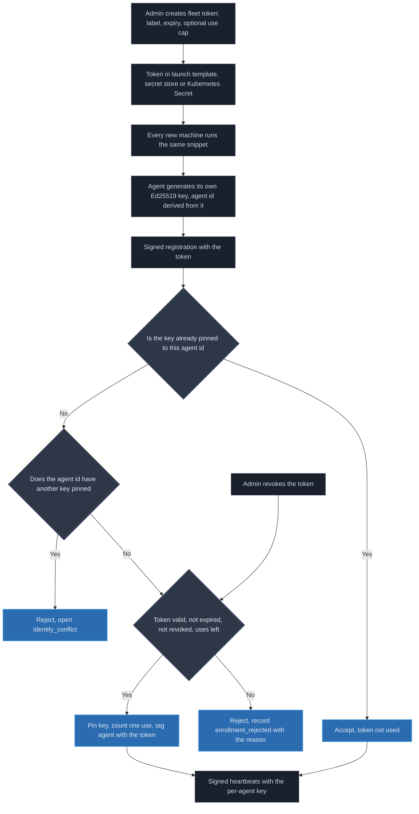

# Fleet Enrollment Tokens

## Context and Problem Statement

An install key enrolls exactly one machine and is burned at enrollment ([ADR 013](./013-agent-identity-and-signed-requests.md)). An autoscaling group, a Kubernetes DaemonSet and a golden image all run the same snippet on machines that do not exist yet when the operator writes it. With single-use keys the first machine enrolls and every later one is rejected. Only the Windows agent could enroll at all, the Linux agent was a stub.

How does one snippet enroll every machine of a fleet, for as long as the fleet keeps replacing machines, without giving up what ADR 013 bought?

## Considered Options

- Mint a single-use install key per machine from automation that holds a console credential
- Bake an enrolled identity into the machine image
- Platform attestation, such as the signed AWS instance identity document
- Reusable enrollment token with an expiry, an optional use cap, revocation and a group label

## Decision Outcome

Chosen option: "Reusable enrollment token with an expiry, an optional use cap, revocation and a group label", because it is the only option that works the same way on a Linux server, an EC2 autoscaling group, a container host and a Kubernetes node, and it needs nothing from the cloud provider and nothing new on the endpoint. The token only decides who may join. Every request after that is still signed by the per-agent key of ADR 013.

Why the others lost:

- A key per machine needs a launch hook that holds an admin credential for the console. That credential is worth far more than an enrollment token, and it would sit in the same place.
- A baked identity gives every clone the same key. ADR 013 already treats that as a cloned identity and raises `replay` incidents.
- The instance identity document proves that a request comes from an instance of one AWS account, with no secret in the launch template. It is AWS only, the server has to carry the AWS certificate of every region, and the document is readable by every process on the instance through the metadata service, the same place where user data is readable. It narrows who can enroll, it does not replace the secret for Kubernetes, containers and servers outside AWS. It is left as a later condition on a token ("this token only enrolls instances of account X"), not built now.

What a fleet token is:

- Format `zedr_fleet_` followed by 32 random bytes as hex. Only the SHA-256 hash is stored, in a table of its own, so the single-use path of ADR 013 is untouched.
- `label` names the group, for example `prod-web`. Agents remember the token that enrolled them and the console API returns the label as `enrollment_group`. A replacement token with the same label keeps the group.
- `expires_at` is mandatory, between 1 and 365 days, chosen by the operator. There is no default, because an expired token silently stops a fleet from enrolling.
- `max_uses` is optional. One use is counted for every agent the token enrolls, inside the registration transaction.
- Revocation takes effect on the next registration. Agents that already enrolled keep their pinned key and keep working.

What a fleet token cannot do:

- It never replaces a pinned key. It enrolls only an agent id that has no key yet. A registration that presents a fleet token for an enrolled agent with a different key is rejected and opens an `identity_conflict` incident. Replacing the identity of an enrolled machine still takes a single-use install key.
- A registration signed with the pinned key ignores the token and uses none of its uses, so the installer can be run again on an enrolled machine.
- The pinned key is written with a condition in the same statement, so two registrations that race for one agent id cannot overwrite each other.

How it reaches the machine:

- `/install.sh`, `/install.ps1` and the binary download accept the credential in the `X-Zedr-Enrollment-Key` header. `/install.sh` without a credential is served as a script with no secret in it and reads `ZEDR_ENROLLMENT_KEY` from the environment, so the token never has to appear in a URL and can come from a secret store at boot.
- The Linux agent takes its agent id from its own public key (the first 16 bytes of the SHA-256, as hex). Machines cloned from one image share `/etc/machine-id` more often than not, and a container has none. An id derived from the key is unique per identity and cannot be claimed by anyone who does not hold the key.
- A registration or an agent download that a known token can no longer authorize is recorded as `enrollment_rejected` with the token id, the label and the reason (`expired`, `revoked`, `exhausted`), so a fleet that stopped enrolling shows up in the event stream. A token the server has never issued leaves no event at download.

### Decision Outcome Visualization

### Consequences

- Good, because one line in user data or one manifest enrolls every machine a fleet ever starts, on any platform.
- Good, because the per-agent key, signed requests, replay detection and agent-bound commands of ADR 013 apply unchanged to fleet agents.
- Good, because a fleet token cannot take over an enrolled agent, which is the one thing a single-use key can do.
- Good, because a leaked token is contained by revocation, expiry and the use cap, and its use count, last use and enrolled agents are visible to the operator.
- Bad, because this is weaker than ADR 013 at the door. A single-use key is worthless after the first enrollment. A fleet token is a long-lived bearer secret that sits in a launch template, in user data that every process on the instance can read from the metadata service, or in a Kubernetes Secret. Whoever reads it can enroll machines that are not part of the fleet until it expires, runs out or is revoked.
- Bad, because a rogue enrollment is a real agent to the control server. It can report false telemetry, and an operator who opens a remote shell to it types commands into a machine the attacker controls. It cannot read the events or the commands of any other agent.
- Bad, because there is no way yet to remove or quarantine an agent, so after a leak the operator can revoke the token and see which agents it enrolled, but cannot evict them.
- Bad, because an expired or exhausted token stops new machines from enrolling while the old ones keep reporting. The gap is visible only as `enrollment_rejected` events.
- Bad, because machines that an autoscaling group terminated stay listed as `stopped` agents. Nothing retires them yet.
- Bad, because the Linux agent id is no longer stable across a reinstall that wipes `/var/lib/zedr`. The machine comes back as a new agent and the old one goes silent.
- Bad, because the container image fetches the agent when it starts. The state volume keeps the last agent and installer, so only the first start of a node depends on the control server and on a valid token.
