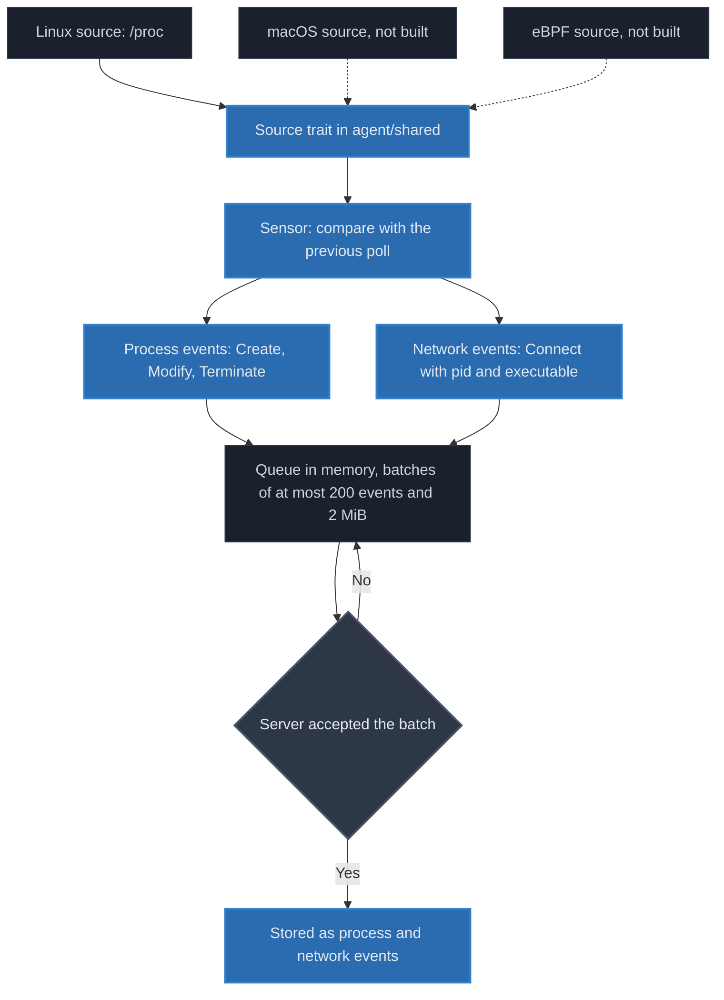

# Polling Sensor for Process and Connection Telemetry

## Context and Problem Statement

The Linux agent enrolled, sent heartbeats and ran signed shell commands, but it reported nothing about what the machine does. Every analysis the console is meant to offer starts from that raw record: which processes run, who started them, and which of them talk to the network. The protocol already has `Process`, `Network` and `File` events and the control server already stores them, but no agent produced any.

How does a userland agent ([ADR 004](./004-userspace-agents.md)) collect process and connection telemetry on any Linux host it can be installed on, including a container, and in a shape the macOS agent can reuse?

## Considered Options

- eBPF programs on `execve`, `exit` and `connect`
- Netlink process connector and `sock_diag`
- Audit subsystem rules
- The `sysinfo` crate
- Poll `/proc` on an interval, behind a source trait shared by all agents

## Decision Outcome

Chosen option: "Poll `/proc` on an interval, behind a source trait shared by all agents", because it needs no kernel feature, no capability beyond root, no new dependency and no `unsafe`, it works the same in a systemd service, a container and a DaemonSet, and it could be built and checked against `ps` today. It misses whatever lives shorter than the interval. That gap is the reason eBPF stays on the list in [OS_CAPABILITIES.md](../OS_CAPABILITIES.md), and the split below is what lets it arrive later without touching the rest.

Why the others lost for now:

- eBPF sees every `execve` and `connect` as it happens. It needs a loader, `CAP_BPF`, a recent kernel and a test matrix across kernels, and it does not run in an unprivileged container.
- The process connector reports forks and exits in real time, but it needs raw netlink sockets, which means `unsafe` or a new dependency, and it still has to read `/proc` for the command line.
- Audit rules depend on how the host's audit daemon is set up and compete with whatever else consumes the audit stream.
- `sysinfo` lists processes on every platform but does not say which process owns which socket, and it reads far more than the agent needs on every refresh.

What is built:

- `agent/shared/src/sensor.rs` holds the logic that is the same on every platform. A platform implements `Source`: the list of running processes as cheap keys, the details of one process, the open outbound sockets, and which processes hold a socket. `Sensor` compares each poll with the previous one and turns the difference into events.
- `agent/linux/src/collector.rs` implements `Source` from `/proc`. Each poll reads one `stat` file per process. The command line, the executable, the user and the network namespace are read only when a process is new or has changed its image.
- Processes are reported as `Process` events. The first poll reports every running process as `Create` with its real start time, so the tree can be rebuilt from `pid` and `ppid`. Later polls report `Create`, `Terminate`, and `Modify` when a process replaced its image with `exec`. Kernel threads and zombies are left out.
- Outbound TCP connections are reported as `Network` events with action `Connect`, the process id and the executable path. A connection counts as outbound when its local port is not a listening port of the same network namespace. Socket tables are read per network namespace, so connections of containers are seen when the agent shares the host's process namespace. A socket inherited by child processes is attributed to the oldest process that holds it.
- Loopback connections and the agent's own connections are not reported. The same process and destination is reported once in five minutes.
- The sensor polls every five seconds (`ZEDR_SENSOR_INTERVAL`). Events wait in a queue of 20,000 in memory and are sent in batches of at most 200 events and 2 MiB. A batch that the server does not answer for stays queued, one that it refuses is narrowed down to the refused event ([ADR 024](./024-event-batches-sized-by-encoding-and-narrowed-on-refusal.md)), and the oldest events are dropped when the queue is full.

Event types this needs next. `Persistence` is decided and built for Linux in [ADR 022](./022-persistence-inventory.md). None of the others is built, each needs a decision on its fields before an agent sends it:

| Asked for | Proposed event | Fields | Source on Linux | Source on macOS |
|---|---|---|---|---|
| Login items and other ways to start at boot | `Persistence` | kind, path, owner, content hash, action (present, added, changed, removed) | systemd units and timers, cron, `rc.local`, shell profiles, `authorized_keys` | LaunchAgents, LaunchDaemons, login items |
| Resource use per process | `ProcessUsage` | pid, start time, cpu time, resident memory, bytes read and written, sampled for the busiest processes | `/proc/<pid>/stat`, `statm`, `io` | `proc_pid_rusage` |
| Apps being used | `AppUsage` | bundle or desktop id, name, pid, became active at, active seconds | desktop sessions only, not servers | frontmost application and launches |
| Who is logged in | `Login` | user, source address, terminal, session id, action | logind sessions, `utmp` | console and ssh sessions |
| What listens on the network | none, `Network` with action `Listen` exists | already defined | the same socket tables | `proc_pidfdinfo` |
| Bytes per connection | none, `bytes_sent` and `bytes_received` exist | already defined | `sock_diag` or eBPF, not available from `/proc` | `nettop` counters |
| What was looked up | `Dns` | pid, name, answers | eBPF or a resolver hook | DNS proxy provider |

### Decision Outcome Visualization

### Consequences

- Good, because a process tree and "which process connected where" now come from a real machine through event types the server and the console already understand.
- Good, because the trackers are plain logic with tests that run on any platform, and the Linux reader is tested against a real `/proc`.
- Good, because the cost is small on an ordinary host. On the test hosts the agent stayed at about one megabyte of resident memory and used 0.11 to 0.15 seconds of CPU per minute with 10 to 25 processes.
- Good, because the agent grew by about 65 KB.
- Bad, because a process or a connection that starts and ends between two polls is never seen. A shell that immediately replaces itself with another program is reported as that program only.
- Bad, because the cost grows with the number of processes, one file read per process per poll, and a search through file descriptors whenever a new connection appears.
- Bad, because the socket tables are read once per network namespace per poll and each read walks the kernel's whole connection table. It measured about 2 ms per namespace on the test VM, so a node with a hundred pods would spend a few percent of a core on it. `sock_diag` or eBPF is the cheaper source.
- Bad, because UDP, listening sockets, byte counts and DNS are not collected.
- Bad, because the agent reads what `/proc` says. A process can rewrite its own command line and name, and anything that hides entries from `/proc` hides them from the agent.
- Bad, because events wait in memory only. An agent that stops loses what it had not sent, and after a restart it reports the whole process list again as `Create` events with the original start times.
- Bad, because the server stores one row per event with no retention limit, so a busy fleet grows the database quickly.
