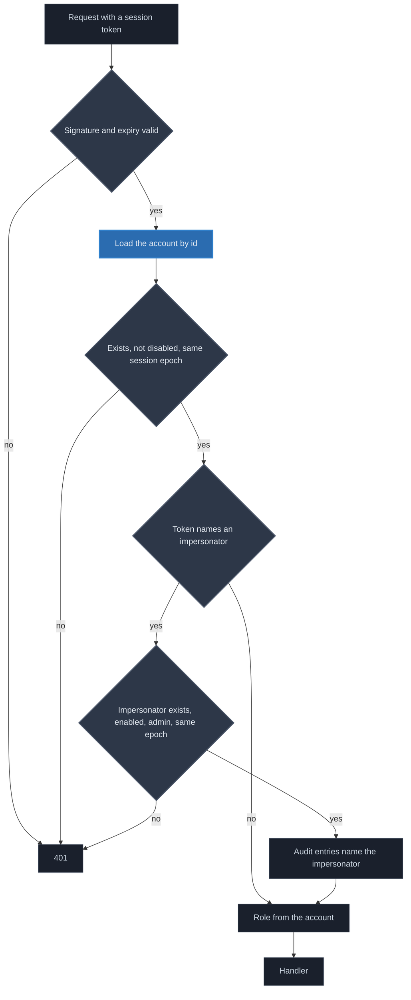

# Account Controls And Impersonation

## Context and Problem Statement

A console session was a signed token that the server trusted until it expired. The token carried the role, and nothing looked at the account again, so a deleted user kept full access for up to 24 hours and a demoted admin stayed an admin. An admin could create and delete accounts and nothing else: no way to change a role, suspend an account, replace a lost password, clear a lost second factor or end a session.

Admins also need to see the console as another account sees it.

How should the server decide who is behind a request, what should an admin be able to do to an account, and how does an admin use the console as someone else without weakening the audit log?

## Considered Options

- Keep trusting the token and shorten its lifetime
- Keep a server-side table of sessions and revoke rows
- Read the account on every request and compare a per-account counter carried in the token
- Give the admin a short read-only session for their own account
- Impersonate a chosen user in a session the server limits to reading
- Impersonate a chosen user with the full rights of that user's role, and record the admin as the actor

## Decision Outcome

Chosen options: "Read the account on every request and compare a per-account counter carried in the token" and "Impersonate a chosen user with the full rights of that user's role, and record the admin as the actor", because the first makes every account change take effect on the next request with one indexed read and no session table, and the second lets an admin see and do exactly what that user can while the audit log still names the person who acted. A read-only session for the admin's own account and a read-only impersonation were both built first and dropped at the product owner's request: an impersonation is meant to be whatever the impersonated role is, in full.

- Every authenticated request loads the account by id. A missing or disabled account is refused. The role comes from the account, never from the token.
- Each account has a `session_epoch`. A token carries the epoch it was issued under and is refused once the account's epoch has moved. Signing an account out everywhere and replacing its password both move the epoch.
- The two event streams check the session when they open and again every 30 seconds, and close when it has ended.
- An API key stops working while its account is disabled.
- New admin endpoints, each written to the audit log: change a role, disable or enable, replace a password, clear a second factor and its recovery codes, sign out everywhere. The account list now shows the last sign-in and the disabled state.
- An admin cannot demote or disable their own account, cannot clear their own second factor here, and replaces their own password only with the current one.
- `POST /api/admin/users/{id}/impersonate` gives an admin a 30 minute token that carries the other account's identity and names the admin as the impersonator. The server answers it as that account with that account's role, no more and no less: what the role may read or change, the impersonation may too, including the account's own API keys and second factor.
- Starting an impersonation is an audit entry under the admin's name with the target account. Every audited action taken while impersonating is recorded with the admin as the actor and the impersonated account in an `as` field, so the log never names someone who was not at the keyboard.
- An admin cannot impersonate themselves, another admin or a disabled account. Another admin's view is the admin's own view, and the block keeps one admin from holding admin rights under another admin's name.
- The impersonation ends when either account changes: the target is signed out, disabled or deleted, or the impersonator is signed out, disabled, deleted or stops being an admin.
- The console gains a Users page: one row per account with its recent audit activity drawn on a time lane, and the controls in a side pane, Impersonate among them. While impersonating, a banner names the account, counts the time left and returns to the admin session.

### Decision Outcome Visualization

### Consequences

- Good, because deleting, disabling or demoting an account, and signing it out, apply to sessions that are already open.
- Good, because an admin can reproduce what a user sees and does, with that user's rights.
- Good, because the audit log keeps the real actor on every entry, and each impersonation is recorded with who started it and whom it was.
- Good, because the guard against deleting the last admin is no longer needed: the caller must be an existing admin other than the target.
- Bad, because every request now reads one row from the accounts table, and two while impersonating.
- Bad, because an impersonating admin can change the other account's own settings, such as creating an API key for it or changing its second factor. The audit log shows it, nothing prevents it.
- Bad, because agent-facing records that are not audit entries, such as the creator stored on an install key, would carry the impersonated name if the role were ever allowed to create them.
- Bad, because an open event stream can outlive its session by up to 30 seconds.
- Bad, because a read-only user still cannot change their own password, and there is no password change that keeps other sessions open.
- Bad, because signing out everywhere ends every session of the account, there is no list of sessions to end one by one.
- Bad, because tokens issued before this change carry no epoch and are read as epoch zero, so they keep working until the account is signed out once or they expire.
