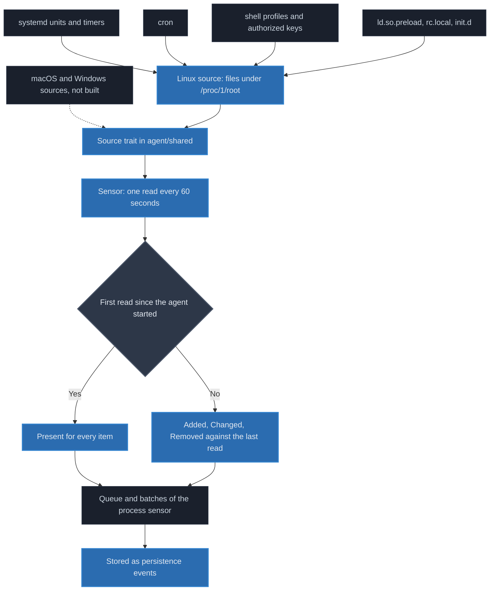

# Persistence Inventory with Change Events

## Context and Problem Statement

The Linux agent reports which processes run and where they connect ([ADR 020](./020-polling-sensor-for-process-and-connection-telemetry.md)). It says nothing about what will run again after a reboot or a login. An intruder who wants to stay writes a systemd unit, a cron line, a line in a shell profile or an SSH key, and none of that is a process until it fires. ADR 020 proposed a `Persistence` event and left its fields open.

How does the agent list the things that start programs on their own, and report when one is added, changed or removed, without sending files off the machine and without tools the host may not have?

## Considered Options

- Ask the service managers: `systemctl`, `crontab -l`, or systemd over D-Bus
- Watch the files with inotify or fanotify
- Send a hash per watched file and nothing else
- Read the configuration files on an interval, parse them into items, and compare with the previous read in the shared sensor

## Decision Outcome

Chosen option: "Read the configuration files on an interval, parse them into items, and compare with the previous read in the shared sensor", because it needs no tool, no kernel feature, no new dependency and no `unsafe`, it works where systemd does not run, it reports what is on disk for the next boot and not what a manager chooses to say, and it fits the `Source` and `Sensor` split that processes already use. A change is seen at the next read, not when it happens, and a change that is undone between two reads is never seen.

Why the others lost for now:

- Running `systemctl` or `crontab` is shelling out, depends on what the image ships, and trusts the answer of a program an intruder can replace. systemd over D-Bus works only while systemd runs and covers systemd only.
- inotify and fanotify report a change as it happens, but they need raw system calls, which means `unsafe` or a new dependency, a watch per directory including every home, and a full read at start anyway for what changed while the agent was down. They can replace the interval later behind the same trait.
- A hash per file says that `/etc/cron.d/backup` changed and not what it runs now. An analyst and a detection rule both need the command line.

What is built:

- `protocol` has `SystemEvent::Persistence`. The control server stores it with `event_type` `persistence` and the event as `data`:

| Field | Meaning |
|---|---|
| `timestamp` | When the agent noticed, in Unix seconds. Every event of one read carries the same value |
| `action` | `Present` for the first read after the agent starts, then `Added`, `Changed`, `Removed` |
| `kind` | `systemd_unit`, `systemd_timer`, `cron`, `shell_profile`, `authorized_key`, `ld_preload`, `rc_local`, `init_script` |
| `name` | What tells the item apart inside its file or directory. With `kind` and `path` it identifies the item |
| `path` | The file that holds the item, as the system names it |
| `command` | The command line the item runs, empty when the file itself is what runs |
| `user` | The account it runs as, empty when it runs for every user |
| `enabled` | Whether it is set to start, see the table below |
| `hash` | SHA-256 in hex, `null` when there was nothing the agent could read |

- `agent/shared/src/sensor.rs`: `Source` has `persistence()`, the list of items as they are now. `Sensor` keeps the last list by kind, path and name. The first list is reported as `Present`. After that an item that is new is `Added`, one whose hash, command, user or state differs is `Changed`, and one that is gone is `Removed` with the fields it had when last seen. A read that fails is logged and removes nothing.
- The inventory is read every 60 seconds (`ZEDR_PERSISTENCE_INTERVAL`), against five seconds for processes. Its events share the queue and the batches of the process sensor.
- `agent/linux/src/persistence.rs` reads the files. `ProcSource` hands it `/proc/1/root`, the file system of the first process the agent can see. On a host that is `/`, under a DaemonSet with the host's process namespace it is the node and not the agent's image. Links are followed inside that root, so an absolute link on the node does not lead into the agent's container.

| Kind | One item per | `name` | `command` | `user` | `enabled` | `hash` of |
|---|---|---|---|---|---|---|
| `systemd_unit` | `.service` file in the system, user and per-home unit directories | unit name | `ExecStart` lines, drop-ins applied | `User=`, else root, the home's owner for a unit in a home, empty for a unit meant for every user | a `.wants` or `.requires` link names it, and it is neither masked nor replaced by a unit of the same name earlier in the search path | the unit file followed by its drop-in files |
| `systemd_timer` | `.timer` file in the same directories | unit name | `ExecStart` of the unit it starts | as for that unit | as above | the timer file followed by its drop-in files |
| `cron` | entry in `/etc/crontab`, `/etc/cron.d` and the per-user crontabs | the entry as written, blanks collapsed | the command | the user field, or the owner of the crontab | always | the entry |
| `cron` | file in `/etc/cron.hourly`, `daily`, `weekly`, `monthly` | file name | empty | root | the file is executable | the file |
| `shell_profile` | `/etc/profile`, `/etc/bash.bashrc`, files in `/etc/profile.d`, and `.bashrc`, `.profile`, `.bash_profile`, `.zshrc` in every home | file name | empty | the home's owner, empty for the files in `/etc` | always | the file |
| `authorized_key` | key in `.ssh/authorized_keys` and `authorized_keys2` of every home | type, fingerprint as `ssh-keygen -l` prints it, comment | the forced `command=` option | the account the key opens | always | the public key, which is the same fingerprint in hex |
| `ld_preload` | library named in `/etc/ld.so.preload` | library path | empty | root | always | the library file |
| `rc_local` | `/etc/rc.local` | `rc.local` | empty | root | the file is executable | the file |
| `init_script` | file in `/etc/init.d` | file name | empty | root | a start link in `/etc/rcS.d` or `/etc/rc2.d` to `rc5.d`, or an OpenRC runlevel, names it | the file |

- Homes come from `/etc/passwd`.
- File contents are not sent. A command is cut at 4096 bytes. A name is cut at 256 bytes and then ends with the first 16 hex digits of the entry's hash, so two long entries stay apart.
- A file over 1 MiB, a link loop, or a file or directory the agent may not read is listed as one item with no hash and no command, so padding a file does not hide what is in it without leaving a mark. A preloaded library is hashed up to 64 MiB. A pipe, a device or a directory where a file is expected is not opened.

### Decision Outcome Visualization

### Consequences

- Good, because the console can show what starts on its own on a machine, and a new unit, cron entry, key or preloaded library reaches the server within a minute with the command it runs.
- Good, because the parsers are plain functions over text and the scan runs against a directory tree, so every source is tested without root and without a real system.
- Good, because a restart of the agent sends the whole inventory again with one timestamp, so the newest set of `Present` events is always a complete baseline.
- Good, because a second platform only has to produce items. The comparison, the interval and the delivery are shared.
- Good, because the cost is small. On an Ubuntu 24.04 test host with 144 items, 126 of them unit files, one read took about 7 ms of CPU. The agent stayed at 0.11 seconds of CPU per minute with both sensors and at 1.4 to 1.7 MB of resident memory. The x64 binary grew by 72 KB, the arm64 binary kept its size.
- Bad, because what is added and removed again between two reads is never reported, and a change made while the agent is down is not reported as a change, only as part of the next baseline.
- Bad, because every read opens and hashes every file again. Nothing is cached, on purpose: a modification time can be set back.
- Bad, because a changed shell profile, `rc.local`, init script or periodic cron script is reported with a new hash and not with the lines that changed. Profiles often hold exported secrets, which is why their text stays on the machine.
- Bad, because `enabled` is a lower bound. A unit can also be started by a socket, a path, a timer, D-Bus, an alias or another unit's `Wants=`, and only `ExecStart` is listed, so a change to `ExecStartPre`, `ExecStartPost` or `ExecStop` shows as a changed hash only. The schedule of a timer is not sent.
- Bad, because the first read sends one event per item, a few hundred on a general purpose distribution, and sends them again after every restart of the agent.
- Bad, because the list of places is fixed. Not read: `.socket` and `.path` units, generator and transient units, `at` jobs and anacron, `/etc/environment`, `.bash_login`, `.zprofile`, `.zshenv` and the files under `/etc/zsh`, an `AuthorizedKeysFile` or `AuthorizedKeysCommand` set in `sshd_config`, `LD_PRELOAD` in an environment, kernel modules, udev rules, XDG autostart, and homes of accounts that are not in `/etc/passwd`.
- Bad, because an agent that is not allowed to read `/proc/1/root` reports no inventory at all, it logs the reason once and keeps the process sensor running.
- Bad, because the control server refuses an event of a kind it does not know. An agent newer than its server loses those events, and since [ADR 024](./024-event-batches-sized-by-encoding-and-narrowed-on-refusal.md) only those.
