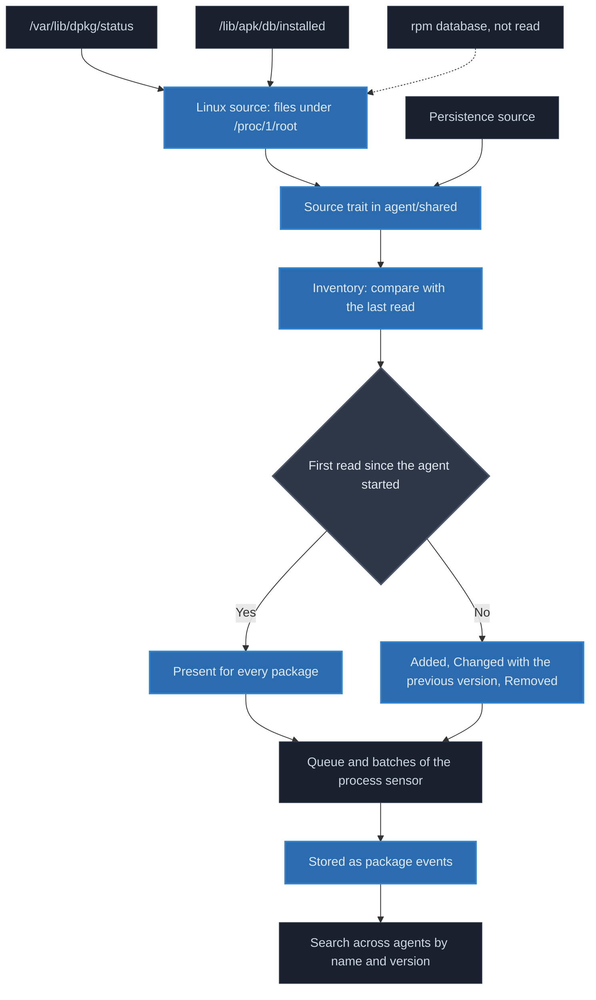

# Installed Package Inventory with Change Events

## Context and Problem Statement

When a vulnerable version of a library is announced, the first question is which machines have it. The agent reports processes, connections and persistence ([ADR 020](./020-polling-sensor-for-process-and-connection-telemetry.md), [ADR 022](./022-persistence-inventory.md)) and nothing about what is installed, so the console cannot answer "which endpoints have this package at this version".

How does the agent list the installed packages and their versions, and report installs, upgrades and removals, in a form that can be searched across every agent?

## Considered Options

- Run the package manager: `dpkg-query`, `rpm -qa`, `apk info`
- Link the package manager's own library, or a SQLite reader for rpm
- Hash the executables on disk instead of listing packages
- Read the package databases as files, behind the same trait and the same comparison as the persistence inventory

## Decision Outcome

Chosen option: "Read the package databases as files, behind the same trait and the same comparison as the persistence inventory", because the databases of dpkg and apk are plain text that a few lines can read, it needs no tool on the host, no new dependency and no `unsafe`, and the first read, the change events and the delivery already exist for persistence. It covers Debian, Ubuntu and Alpine. It does not cover rpm, see below.

Why the others lost for now:

- Running the package manager is shelling out, it trusts a program an intruder can replace, and a slim image may not ship it.
- A library per package manager is a dependency per package manager, and the agent is built static.
- Hashes of executables would also see software that no package manager installed, but they answer another question. Nobody can search hashes for "openssl before 3.0.14".

What is built:

- `protocol` has `SystemEvent::Package`. The control server stores it with `event_type` `package` and the event as `data`:

| Field | Meaning |
|---|---|
| `timestamp` | When the agent noticed, in Unix seconds. Every event of one read carries the same value |
| `action` | `Present` for the first read after the agent starts, then `Added`, `Changed`, `Removed` |
| `manager` | `dpkg` or `apk` |
| `name` | Package name as the database has it |
| `version` | Installed version as the database has it, with epoch and revision. For `Removed`, the version that was installed |
| `architecture` | `amd64`, `arm64`, `all`, `x86_64`, `aarch64` and so on, as the package manager names it |
| `previous_version` | The version that was replaced, on `Changed`. `null` otherwise |

- A package is identified by manager, name and architecture, because dpkg installs the same package for several architectures side by side. `Changed` means the version of that package differs from the last read.
- `agent/shared/src/sensor.rs`: `Source` has `packages()`. The comparison that persistence used is now one `Inventory` that both use, so both behave the same: the first read is reported as `Present`, later reads report only differences, and a read that fails is logged and removes nothing. `PersistenceAction` became `InventoryAction` and is shared, the values on the wire did not change.
- Packages are read every 300 seconds (`ZEDR_PACKAGE_INTERVAL`), against 60 for persistence and five for processes.
- `agent/linux/src/packages.rs` reads, under `/proc/1/root` like the persistence inventory:

| Manager | File | Listed | Left out |
|---|---|---|---|
| `dpkg` | `/var/lib/dpkg/status` | every entry with a name and a version whose state has files on disk: `installed`, `unpacked`, `half-installed`, `half-configured` and the trigger states | `not-installed`, and `config-files`, which is a removed package whose configuration was kept |
| `apk` | `/lib/apk/db/installed` | every entry, from its `P`, `V` and `A` lines | nothing |

- The file is read line by line and never held in memory as a whole. A field is cut at 256 bytes. A database over 64 MiB, or one the agent may not read, fails the read with an error instead of a partial list, because a partial list would look like removals.

Not covered, and reported as nothing at all:

- rpm, which means RHEL, CentOS, Rocky, Alma, Fedora, Amazon Linux and SUSE. Its database is SQLite (`/var/lib/rpm/rpmdb.sqlite`), Berkeley DB (`/var/lib/rpm/Packages`) or ndb depending on the release, and each row is a binary header. Reading it needs a database reader and a header parser, which is either a dependency with C code or a parser of two binary formats inside an agent that runs as root. That is neither cheap nor safe enough to add in passing.
- pacman, Portage, Nix, snap, Flatpak and AppImage.
- Packages of a language: pip, npm, gem, cargo, Go modules, jars.
- Software inside container images, and anything copied or compiled by hand.
- Changes that dpkg has journaled in `/var/lib/dpkg/updates` and not yet written to `status`.

An agent on a host without a covered package manager sends no `package` events. The console can tell such a host from one with no packages only by its operating system.

### Decision Outcome Visualization

### Consequences

- Good, because the newest `Present` group of an agent plus the changes after it is the list of what is installed there, with versions, which is what a search across agents needs.
- Good, because an upgrade is one event that names both versions, so "when did this machine get the fix" has an answer.
- Good, because persistence and packages share one comparison, and a third inventory would only have to produce a list.
- Good, because the cost is small. On an Ubuntu 24.04 test host with 132 packages the agent stayed at 0.11 seconds of CPU per minute with all three reads running and at 1.4 to 1.6 MB of resident memory, the same as before. The arm64 binary grew by 64 KB, the x64 binary by 12 KB.
- Bad, because the first read sends one event per package and sends them again after every restart of the agent: about a hundred for a container image, several hundred for a server, a few thousand for a desktop. The control server stores each as a row and has no retention limit.
- Bad, because rpm hosts report nothing.
- Bad, because the database says what the package manager believes. Root can edit it, a package's files can be replaced without it noticing, and a distribution may fix a flaw without the version looking fixed to someone who compares against upstream.
- Bad, because a package installed and removed again inside five minutes is never reported, and an upgrade through several versions in that time is reported as one step.
- Bad, because the agent now holds the name, architecture and version of every package in memory between reads.
- Bad, because the server stores the event as text. Finding every agent with a given package means reading the `data` of every `package` event until there is an index or a table for it.
