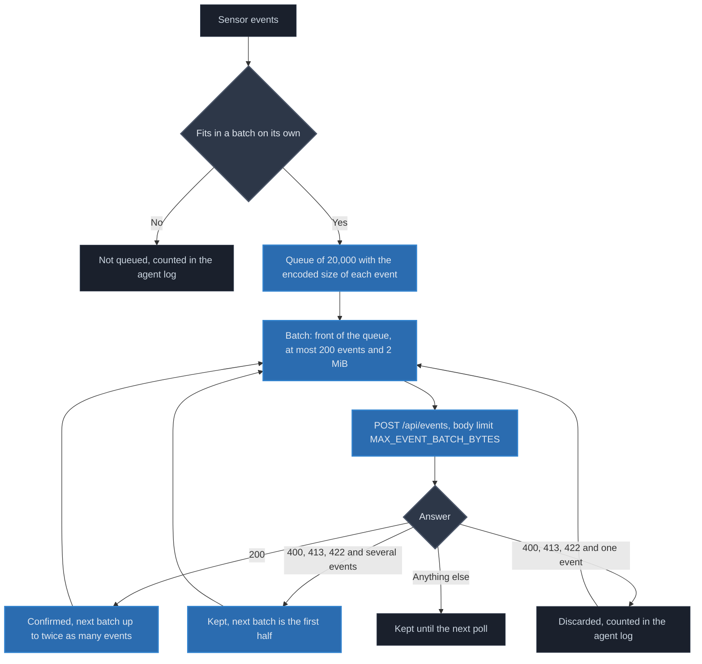

# Event Batches Sized by Their Encoding and Narrowed When Refused

## Context and Problem Statement

The sensor queues events and sends them in batches of 200 ([ADR 020](./020-polling-sensor-for-process-and-connection-telemetry.md)). A batch the control server answered with 400, 413 or 422 was taken as malformed and discarded whole, so that the queue would not wait forever behind something the server will never take. The control server set no limit of its own on a request body, so the framework's default of 2 MiB applied to `/api/events`.

An event carries up to 4096 bytes of command line and as much of executable path, and a control character takes six bytes in JSON. 200 such events are more than 9 MiB. Any local user could start processes, or write cron lines and unit files in their own home ([ADR 022](./022-persistence-inventory.md)), with command lines full of control characters. The batch that held them passed 2 MiB, the server answered 413, and the agent threw the batch away together with every unrelated event in it. An agent newer than its server lost events the same way: one event of a kind the server does not know cost the 199 around it.

How does the agent deliver its queue so that a refusal costs at most the events that are really unacceptable, in the order they were queued, and without waiting forever behind an event the server will never take?

## Considered Options

- Raise the limit on the control server until 200 of the largest events fit
- Bound the encoded size of one event so that 200 always fit
- Fill a batch by encoded size as well as by count, against a limit both sides share
- Split a refused batch and try again until the refused event is alone
- Both of the last two, with the limit stated by the control server

## Decision Outcome

Chosen option: "Both of the last two, with the limit stated by the control server", because each covers what the other cannot. Sizing a batch keeps the agent from ever sending what the server refuses for its size, which is the refusal a local user could cause, but it knows nothing about a limit somewhere in between or about an event the server cannot read. Narrowing a refused batch delivers everything else in both of those cases, but used alone it uploads megabytes that are refused before every batch that is accepted, for as long as someone keeps such command lines coming.

Why the others lost:

- A higher limit only moves the number. The next field or event type moves it again, and the agent still discards a batch when it is passed.
- For 200 events to fit in 2 MiB whatever they hold, one event may take 10 KB encoded. That cuts a command line of control characters at about 1700 bytes and needs a cut that understands the encoding. Events are bounded by what they are read from instead: the agent cuts a command line at 4096 bytes and the kernel hands out no longer path, which keeps the largest event near 50 KB and far below one batch.

What is built:

- `protocol` has `MAX_EVENT_BATCH_BYTES`, 2 MiB. It is the limit that control servers already in use apply by default, so an agent built with it is right for them too.
- The control server reads a body on `/api/events` up to `MAX_EVENT_BATCH_BYTES` and answers 413 above it, before it looks at the signature. The limit is set on the route and no longer inherited from the framework.
- `Outbox` in `agent/shared/src/sensor.rs` measures every event when it is queued. `next_batch` takes events from the front of the queue until the count or the room is used up. The room is the limit less the batch around the events, measured with the agent's id and the longest session and sequence numbers (`ControlLink::event_bytes_per_batch`). An event that fits in no batch on its own is not queued, and the agent logs how many there were. Nothing the Linux agent reads comes near that size.
- `Runtime::deliver` in `agent/shared/src/runtime.rs` acts on the answer:

| Answer | Batch of several events | One event |
|---|---|---|
| 200 | confirmed, the next batch may hold twice as many events, up to 200 | confirmed |
| 400, 413, 422 | kept, the next batch is the first half of it | discarded and counted |
| any other answer, or none | kept as it is until the next poll | kept until the next poll |

- A batch is always the front of the queue, so events arrive in the order they were queued whatever was refused on the way.
- Discarded events are logged once per round and answer: `Server answered HTTP 400 to 3 sensor events sent on their own, discarded them`.

### Decision Outcome Visualization

### Consequences

- Good, because control characters in command lines, paths and unit files no longer make the agent discard anything. 200 process events of 49 KB each, the largest the Linux agent produces, are delivered in five requests of at most 42 events.
- Good, because an event the server refuses costs that event and no other. An agent newer than its server loses the events of the kind the server does not know and keeps the rest.
- Good, because the limit is one constant that the server enforces and the agent fills up to, and the tests on both sides are written against it.
- Good, because the answers 401 and 5xx, a lost connection and a full queue behave as before.
- Bad, because every event is encoded twice, once to be measured and once to be sent.
- Bad, because narrowing down costs requests, and the sensor does not poll while it delivers. One refused event takes 11 to 29 requests more than a clean queue, depending on where it sits, and a server that refuses every event is asked once or twice per event.
- Bad, because a limit below 2 MiB somewhere between the agent and the control server is worked around and not learned. After every accepted batch the agent tries a larger one again, so about every second request is a refused upload. Whatever is put in front of the control server has to let 2 MiB through to `/api/events`.
- Bad, because an event refused on its own is gone and only the agent's log says so. The control server is not told how many events an agent discarded or dropped.
- Bad, because the answer decides, not the reason. Something in front of the control server that answers 400, 413 or 422 to chosen content removes single events, and one that answers anything else holds back the whole queue until it overflows.
- Bad, because the limit also holds for events sent outside the queue. The result of a remote shell command carries up to 1 MiB of each output stream before encoding, so the agent cuts the output of a large result until it fits in one batch ([ADR 027](./027-shell-results-cut-to-one-event-batch.md)).
- Bad, because the queue is still limited by the number of events and not by their size.
