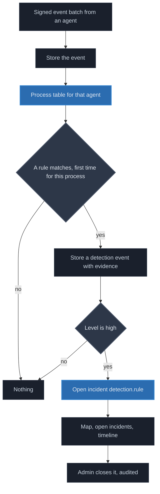

# Server-Side Detections

Status: superseded by [ADR 031](./031-sealed-telemetry-opened-by-proven-rules.md)

## Context and Problem Statement

The control server stored process, network and file events and analysed none of them. The only incidents it raised were about the agent itself: silence, a stopped service, a replayed request, a changed key. The console had named rules with MITRE ATT&CK ids, but they ran in the browser, so a macro dropper raised nothing unless an analyst happened to open that endpoint. Enterprise EDRs detect on the server or the sensor and put the result in front of the analyst.

Where should detection run, and how does a finding reach the map?

## Considered Options

- Keep the rules in the console
- Run the rules in the agent
- Run the rules in the control server as events arrive
- Store events and run scheduled queries over them

## Decision Outcome

Chosen option: "Run the rules in the control server as events arrive", because the server already sees every signed event, a finding is then raised whether or not anyone is looking, and rules can change without shipping an agent. Rules in the agent would also need the server to trust the agent's verdict, and scheduled queries over JSON rows in SQLite would be slow and late.

- `detections.rs` keeps, per agent, the processes it has seen start and not end, with image, command line and parent. Each process, network and file event is checked against the rules as it is ingested.
- Eleven rules to start, the same ones the console had: an Office application starting a script host, a server process starting a shell, an encoded PowerShell command, a shell wired to a socket, a download piped into execution, a system binary reaching the network, a system binary loading code from a user-writable folder, an image running from a user-writable folder, a script host writing an executable file, a hidden window, and a shell with an outbound connection. Each carries an ATT&CK technique id and a level.
- Four more rules read the persistence inventory (ADR 022): an autostart item whose command downloads and runs code or opens a reverse shell, an autostart item that runs from a temporary folder, a library added to `ld.so.preload`, and an SSH key added for root. The first two fire on any item the agent reports, the last two only when the item is new or changed, so a baseline that already has a preload does not raise an incident. Their technique id follows the kind of item, cron or systemd unit or shell profile. The key for root is a medium finding, the others are high.
- Every finding is stored as a `detection` event with its evidence: rule, technique, level, process id and start time, image, command line, parent, and the address or file involved.
- A high finding also opens an incident of type `detection.<rule>` on the agent, through the same incident table the tamper incidents use. So the endpoint turns red on the map, joins the open incidents and shows on its timeline. A medium finding is recorded and opens nothing.
- The table holds at most 20,000 running processes per agent and forgets the oldest first, so an agent that reports starts and never an end cannot grow the server's memory without limit.
- A finding fires once per rule and process. An agent that restarts and sends its process list again repeats nothing, because the key is the rule, the process id and the process start time.
- An admin closes an incident with `POST /api/admin/incidents/{id}/close`, which is written to the audit log. Tamper incidents that end on their own still close themselves.
- The console lists an endpoint's open detection incidents as its findings, each opening the process it is about and each with a close control. Open incidents are grouped per endpoint, and the sidebar counts endpoints with an open incident. The console keeps its copy of the rules only to colour the process tree.

### Decision Outcome Visualization

### Consequences

- Good, because an attack chain raises incidents by itself, with the evidence attached, and the map shows it.
- Good, because the rules stay quiet on build servers and database clients, which the earlier single heuristic flagged.
- Good, because rules are data in one file with a test per attack chain and a test for ordinary work.
- Bad, because the process table lives in memory. After a server restart a rule that needs the parent or the image misses until the agent sends its process list again.
- Bad, because the rules are only as good as the telemetry. The Linux agent polls, so a short-lived process never arrives and cannot match. No agent sends file events yet, so the file rule fires only on simulated data.
- Bad, because the rules exist twice, in Rust for detection and in TypeScript for colouring the tree, and can drift.
- Bad, because there is no suppression or exclusion list and no import of Sigma rules, and the persistence rules read only what the Linux agent inventories.
- Bad, because closing is the only triage state. There is no assignee, comment or false-positive mark, and a closed finding opens again if the same rule fires on a new process.
