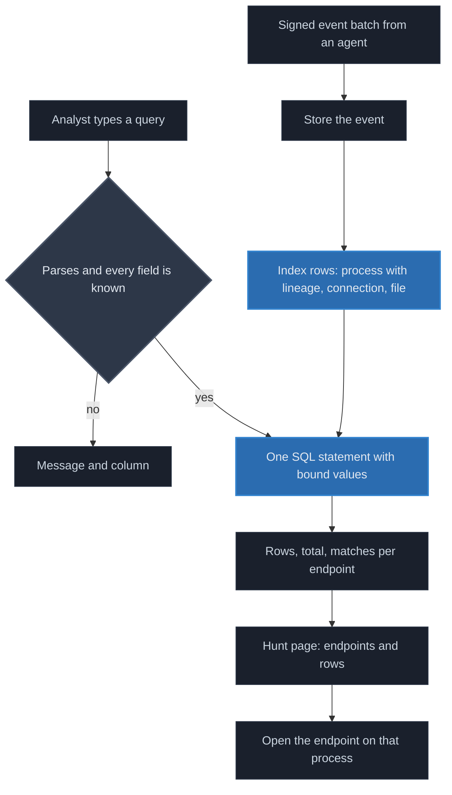

# Hunt Across Endpoints

## Context and Problem Statement

An analyst could look at one endpoint at a time. Events were stored as JSON rows keyed by agent, so "which endpoints ran this image", "who talked to this address" or "where did a script host start under an Office application" had no answer short of opening every endpoint. Enterprise EDRs give the analyst a query language over the whole fleet, and most of the value of collected telemetry sits behind it.

How does an analyst ask a question of every endpoint at once, and what does the server need to answer it quickly?

## Considered Options

- Filter the existing JSON event rows with `json_extract`
- Raw SQL from the console
- An existing language such as KQL, EQL or osquery SQL
- A small query language of our own, compiled to SQL over index tables

## Decision Outcome

Chosen option: "A small query language of our own, compiled to SQL over index tables", because the analyst gets one line to type and the server keeps control of what runs. Filtering JSON rows scans every event for every question. Raw SQL hands the database to the browser. KQL and EQL are large grammars, and a partial implementation that breaks on the second query a user pastes is worse than a small language that says what it supports.

- A query is `<kind> where <expression>`. The kinds are `process`, `connection`, `file`, `detection`, `package` and `persistence`. An expression compares a field with a value using `=`, `!=`, `~` (contains), `!~`, `>`, `>=`, `<`, `<=` or `in (...)`, joined with `and`, `or`, `not` and parentheses. Text compares without case.
- Fields are a fixed list per kind, plus `host`, `host.ip` and `host.platform` on all of them. A process carries its parent and grandparent, so a process tree heuristic is one line: `process where parent.name in (winword.exe, excel.exe) and name = powershell.exe`.
- `hunt.rs` parses the query and compiles it to one SQL statement with bound parameters. A field name is looked up in the list and never copied into the statement, and a value never leaves a parameter. A query that does not parse returns the message and the column, and so does one that names an unknown field or compares a field with the wrong kind of value, so the console can underline the word. A query is at most 4,000 characters and 32 levels of brackets or `not`, so a signed-in user cannot exhaust the server's stack with one request.
- Three index tables are filled as events are ingested: `hunt_processes` (one row per process with its lineage and end time), `hunt_connections` and `hunt_files`. Detections are queried from the events table, where there are few of them. The lineage comes from the process table the detections already keep.
- `package` and `persistence` answer what an endpoint has now. Two more tables, `hunt_packages` and `hunt_persistence`, hold one row per installed package and per autostart item, replaced when the agent reports a change and deleted when it reports a removal (ADR 022, ADR 023).
- A package version compares as a version: `package where name = openssl and version < 3.0.14` finds 3.0.9, which sorts after 3.0.14 as text. Each version is stored with a key whose byte order is the version order, numbers by value, a tilde or an `_rc` style suffix before the release, letters before punctuation, an epoch first, so the comparison is an indexed lookup with no custom SQL function. `=` and `~` still match the version as text.
- `POST /api/admin/hunt` runs a query and returns the newest 500 rows, the total, and the match count per endpoint for up to 200 endpoints. `GET /api/admin/hunt/fields` lists the kinds and their fields. Both need a signed-in console user.
- The Hunt page is one query editor with the field names as chips, a list of starter queries, the reach of the answer (how many endpoints of the fleet matched, drawn as one dot per endpoint grouped by subnet, up to 1,500 endpoints), the endpoints that matched with their counts, a strip of when the matches happened, and the rows. Choosing an endpoint narrows the rows, and a row opens that endpoint on that process. The query and the chosen endpoint live in the URL.

### Decision Outcome Visualization

### Consequences

- Good, because a fleet-wide question is one line and an indexed lookup, and the answer links straight into the investigation of each endpoint.
- Good, because the browser can only reach whitelisted columns through bound parameters, and a read-only user can hunt without being able to change anything.
- Good, because a hunt is a link: the query is in the URL, so one analyst can hand it to another.
- Bad, because the index starts at the first event ingested after the upgrade. Events stored before it are not backfilled.
- Bad, because version order follows the dpkg rules with the apk suffixes added. It has not been checked against rpm, Windows or macOS version schemes, which no agent reports yet.
- Bad, because an inventory row lives until the agent reports the removal. A package removed while the agent was not running stays listed until that agent says otherwise.
- Bad, because the language has no sequences, joins, aggregates or time-window grammar. A chain is expressed only through parent and grandparent, and time is a number of seconds.
- Bad, because `~` compiles to an unanchored `LIKE`, which scans the table. It is fine at the size of one SQLite file and will not be at fleet scale.
- Bad, because hunts cannot be saved, scheduled or turned into a detection rule, and the index tables grow without a retention limit.
