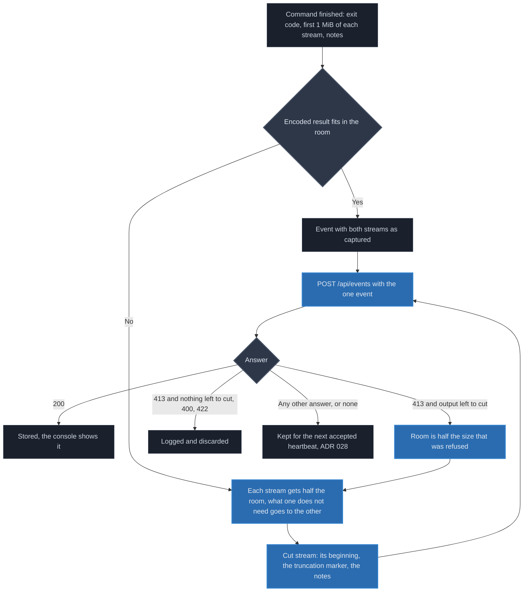

# Shell Command Results Cut to One Event Batch

## Context and Problem Statement

The result of a remote shell command ([ADR 012](./012-secure-remote-shell.md)) is one `ShellCommandExecuted` event. The agent sends it on its own, outside the sensor queue. It kept up to 1 MiB of each output stream, measured before encoding. The control server reads at most `MAX_EVENT_BATCH_BYTES`, 2 MiB, of a request on `/api/events` ([ADR 024](./024-event-batches-sized-by-encoding-and-narrowed-on-refusal.md)).

In JSON a newline, a quote or a backslash takes two bytes and any other control character takes six. A command that filled both streams, or printed a binary file or a long listing to one of them, produced a result the server answered with 413. The agent logged the refusal and that was all. The command was never marked as executed and the console waited for an answer that did not come. The control server hands out the oldest unanswered command first and the agent refuses a command it has already run as a replay, so nothing else ran on that endpoint until the session ended.

How does a result always reach the control server, whatever the command printed, with its exit code and as much of the output as one request can carry?

## Considered Options

- Raise the limit on the control server until two full streams of control characters fit
- Lower the capture limit until the worst case fits
- Send a long result in several events that the control server puts together
- Cut the two streams by their encoded size, so that a result is always one event that fits in one batch
- The last one, and cut further when the answer is still 413

## Decision Outcome

Chosen option: "The last one, and cut further when the answer is still 413", because the result stays one event that is stored and shown in one step, nothing changes in the protocol, the control server or the console, and the agent is right for control servers already in use. A result is there or it is not, there is no half of one to keep, order or time out. Cutting further on 413 is what the sensor queue already does with a batch ([ADR 024](./024-event-batches-sized-by-encoding-and-narrowed-on-refusal.md)), and it keeps the exit code arriving when something between the agent and the control server reads less than 2 MiB.

Why the others lost:

- Two full streams of control characters are more than 12 MiB encoded. The control server reads a body before it looks at the signature, so the limit is what anyone who reaches the port can make it hold in memory per request. Servers in use would keep 2 MiB anyway.
- For the worst case to fit, a stream may hold about 174 KB. That takes most of the megabyte from every command to cover the few whose output is mostly escapes.
- Several events need a new event or new fields. A control server that does not know the event answers 400, and one that does not know the fields keeps only the last part it was sent, so a newer agent would lose the result or most of it there. The server would have to keep unfinished results, know when one is complete and decide what to show when a part never arrives, and every part is a request that can fail on its own. All of that buys the difference between what fits and 1 MiB per stream, for output that ADR 012 already tells the operator to redirect to a file. It is worth another look together with output that streams while a command runs, which needs parts in any case.

What is built:

- `shell::execute` in `agent/shared/src/shell.rs` returns a `CommandResult`: the exit code, what was captured of each stream (the first 1 MiB, as before) and the notes the agent adds about a timeout or a command that could not be started.
- `CommandResult::event` builds the event for a room in bytes. `Runtime::run_shell_command` passes `ControlLink::event_bytes_per_batch`, the room the sensor queue fills its batches to.
- The size of a stream is counted the way the encoder writes it: two bytes for `"`, `\` and the control characters that have a short escape, six for the other control characters, and the UTF-8 length of everything else. A test holds the count against the encoder for every character.
- A result that fits is sent as it was captured. Otherwise each stream gets half the room, and what one stream does not need of its half goes to the other.
- A stream that is cut keeps its beginning, is cut between two characters, and ends with `[OUTPUT TRUNCATED AT n BYTES TO FIT THE RESULT IN ONE REQUEST]`, where `n` is the number of bytes shown. It takes the place of `[OUTPUT TRUNCATED AT 1MB]` when both apply. The timeout note follows it and is never cut, like the exit code and the ids of the command and the session.
- `Runtime::report` in `agent/shared/src/runtime.rs` sends the result and acts on the answer:

| Answer | What the agent does |
|---|---|
| 200 | Nothing more. After a 413 it logs the size that was accepted |
| 413 | Builds the result again for half the size that was refused and sends that. It gives up when the result is no smaller than the one before, which is when nothing more can be cut from it |
| 400, 422 | Logs it and discards the result |
| Any other answer, or none | Keeps the result and sends it again after the next heartbeat the server accepts ([ADR 028](./028-shell-results-kept-until-the-control-server-takes-them.md)) |

What arrives of a command that printed the full megabyte:

| Output | Bytes that arrive |
|---|---|
| One stream of text in lines of 80 characters | All of it |
| Both streams of text in lines of 80 characters | About 1,035,000 of each |
| One stream of control characters, such as a binary file | About 349,000 |
| Both streams of control characters | About 174,000 of each |

### Decision Outcome Visualization

### Consequences

- Good, because no result is larger than the control server reads, whatever the command printed. The exit code always arrives, and the output says where it ends and why.
- Good, because nothing changes in the protocol, the control server or the console, so the agent is right for control servers already in use.
- Good, because a limit below 2 MiB between the agent and the control server costs output and requests, and no longer the result. A result of 2 MiB is tried at most 14 times, each time at half the size.
- Bad, because output that is mostly escapes is cut far below 1 MiB, at about 349 KB for one stream and 174 KB for each of two. The operator has to redirect it to a file and read that in pieces, or print it in an encoding with nothing to escape.
- Bad, because the room is shared half and half. A command with two long streams loses output of both, also when only one of them matters.
- Bad, because a cut stream keeps its beginning, and the end of a long output is often where the error is. The capture limit already works that way.
- Bad, because the agent counts encoded bytes with its own table of what the encoder escapes. A change in the encoder shows in a test and not at compile time.
- Bad, because the answer decides, not the reason. Something in front of the control server that answers 413 for another reason costs the output and up to 14 requests before the agent gives up.
- Bad, because a lower limit is worked around and not learned. The next large result starts at 2 MiB again.
