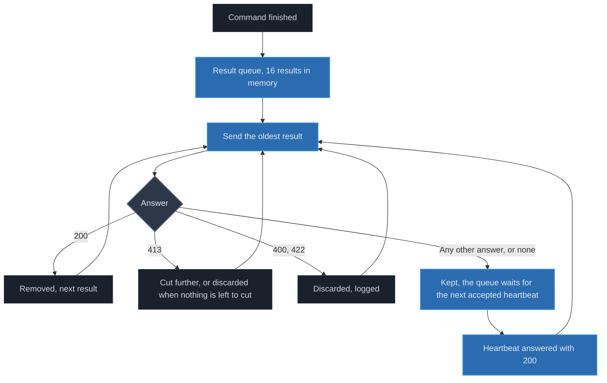

# Shell Command Results Kept Until the Control Server Takes Them

## Context and Problem Statement

The agent sent the result of a remote shell command once ([ADR 012](./012-secure-remote-shell.md)). A result is cut until it fits in one request ([ADR 027](./027-shell-results-cut-to-one-event-batch.md)), so its size no longer costs it. Everything else still did: when the control server could not be reached at that moment, was restarting, did not know the agent yet, or answered with an error, the agent wrote a line in its log and the result was gone.

A lost result is more than missing output. The control server hands out the oldest unanswered command with every heartbeat, and the agent refuses a command it has already run as a replay. So the command stayed unanswered, the console waited, and no other command ran on that endpoint until the session ended.

How does a result reach a control server that could not take it when the command finished, without running the command twice and without uploading megabytes to a server that is not there?

## Considered Options

- Try again from the thread that ran the command, on a timer of its own
- Put the result into the sensor queue
- Take the command that is handed out again as a request for its result
- Keep results in a queue of their own and send them again after every heartbeat the control server accepts

## Decision Outcome

Chosen option: "Keep results in a queue of their own and send them again after every heartbeat the control server accepts", because an accepted heartbeat is the proof that the server is reachable and knows this agent, which is exactly what was missing when the result was not taken. Nothing is uploaded while the server is away, there is no second timer next to the heartbeat, and the number of results held is bounded.

Why the others lost:

- A timer of its own does not know whether the server is back. It uploads up to 2 MiB to find out, needs a backoff like the one registration has, and leaves one waiting thread per result with no limit on how many.
- The sensor queue belongs to the sensor thread, and only the Linux agent has one. It drops its oldest events when it is full, and it discards an event that is refused for its size, where a result has to be cut and sent again.
- The control server hands a command out again only while its session is open. A result whose session ended in the meantime would never be asked for and never stored. The agent would also have to tell a repeated command from a replayed one, which it refuses on purpose.

What is built:

- `Runtime` in `agent/shared/src/runtime.rs` holds up to 16 results in memory. A finished command puts its result there and delivery is tried at once.
- Results are delivered oldest first. What happens to the first one decides:

| Answer | What the agent does |
|---|---|
| 200 | Removes the result and goes on with the next |
| 413 | Cuts it and sends it again ([ADR 027](./027-shell-results-cut-to-one-event-batch.md)). Discards it when nothing more can be cut |
| 400, 422 | Discards it and says so in its log, the server will not read it later either |
| Any other answer, or none | Keeps it and stops. The results behind it wait as well |

- After every heartbeat the control server answers with 200, the agent tries the queue again. That runs on a thread of its own, so the heartbeat loop and a stop request do not wait for an upload. A heartbeat that fails or is answered with anything else leaves the queue alone.
- A 17th result drops the oldest, and the agent logs it.
- The agent logs when results start to wait and why, and when they are delivered again, once per change and not once per attempt.
- The HTTP client reports a connection that closes before an answer as 503, so a lost connection and a 503 are the same case.

### Decision Outcome Visualization

### Consequences

- Good, because a restart of the control server, a network outage or an agent the server has to register again no longer costs a result. The command is answered and the next one runs as soon as the server takes heartbeats again.
- Good, because nothing is uploaded while the control server does not answer heartbeats.
- Good, because a command is not run again to get its result. The server hands it out with every heartbeat while the result is missing, and the agent refuses it as a replay as before.
- Good, because a result that arrives after its session ended is still stored with the command, so the record of what ran is complete.
- Bad, because the queue is in memory. A result that is waiting when the agent stops or restarts is lost.
- Bad, because a result can arrive twice, when the control server stored it and the answer was lost on the way. The command holds the same result either way, and the event list holds two `shell_command_executed` events.
- Bad, because a control server that takes heartbeats and keeps answering a result with anything but 200, 400, 413 or 422 is sent that result again with every heartbeat, up to 2 MiB every 30 seconds, and the results behind it wait.
- Bad, because up to 16 results stay in memory, each with up to 1 MiB of either stream.
- Bad, because the agent logs a refused replay with every heartbeat for as long as a result waits.
- Bad, because `ShellSessionTerminated` is still sent once. When it is lost, the control server keeps the session until its own time limit.
