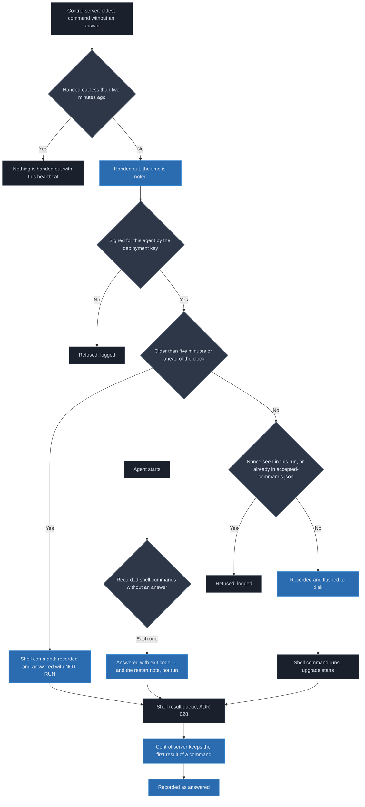

# Signed Commands Run Once, Also After the Agent Restarts

## Context and Problem Statement

A signed command carries a nonce, and the agent refuses a nonce it has seen for as long as the command is accepted, which is five minutes ([ADR 011](./011-upgrade-command-signing.md), [ADR 012](./012-secure-remote-shell.md)). ADR 011 kept the nonces in memory and called that sufficient. It stops being sufficient when the agent restarts: the new process has seen nothing, so a command that is less than five minutes old is accepted again.

The control server made that happen on its own. It handed out the oldest command without an answer with every heartbeat. A shell command that stops or restarts the agent or the machine before it has answered was handed to the restarted agent and run again, and again after every restart, until it was five minutes old. On a test agent that is started again after one second, one such command ran five times in 16 seconds. `reboot` through the remote shell kept the machine rebooting for five minutes. After that the command still had no answer, so no other command ran on that endpoint until the session ended. An upgrade command was accepted again in the same way.

How does a command run at most once on an agent whatever restarts in between, how does a shell command that a restart cut off get an answer, and how often does the control server hand out a command that has none?

## Considered Options

- The control server hands a command out once
- The agent refuses a command that was issued before the agent started
- The agent records every command it accepts on disk before it acts on it
- The last one, the agent answers the shell commands an earlier run left without an answer, and the control server waits before it hands a command out again

## Decision Outcome

Chosen option: "The last one, the agent answers the shell commands an earlier run left without an answer, and the control server waits before it hands a command out again", because running a command at most once is then something the agent guarantees by itself. It does not depend on the clocks of two machines agreeing, nor on the version of the control server, nor on who is on the other end of the connection, which ADR 012 asks of signed commands. Answering what an earlier run left open turns a command that hangs after a restart into a command with an answer, so the session goes on. And because the agent refuses what it has accepted before, the control server can hand a command out a second time without risk, which it needs when its first answer was lost on the way.

Why the others lost:

- A control server that hands a command out once ends the loop only where that server is installed. It does nothing against a captured command that is sent to a restarted agent, and a heartbeat answer that is lost on the way would lose the command for good, because only the agent knows whether it received it.
- Refusing what was issued before the agent started needs no state, but it compares the control server's clock with the agent's. An agent whose clock is behind accepts the command again for as long as the difference, and one whose clock is ahead refuses fresh commands after every start. It also refuses a command that was issued just before a restart and never ran.

What is built in the agent:

- `CommandJournal` in `agent/shared/src/journal.rs` keeps `accepted-commands.json` in the agent's state directory, next to its identity and written the same way: readable by its owner only, to a staged file that is flushed and then renamed. `ControlLink` in `agent/shared/src/link.rs` owns it.

| Field | Meaning |
|---|---|
| `nonce` | The nonce of the command. For a shell command it is also the id its result is stored under |
| `shell_session_id` | The session of a shell command, needed to answer it. Left out for an upgrade command |
| `issued_at` | When the control server issued it |
| `answered` | For a shell command, whether the control server took a result for it or refused one for good. An upgrade command needs no answer of this kind and is recorded as answered |

- `Runtime::run_shell_command` in `agent/shared/src/runtime.rs` verifies a shell command as before, records it, and only then runs it.
- `ControlLink::verify_upgrade_command` verifies an upgrade command and records it. The Linux and the Windows agent call it before they act on an upgrade. The check that does not record is no longer public.
- A command that is in the record already is refused, and so is one that cannot be recorded.
- The signature of a command is checked before its age. A shell command with a valid signature that is older than five minutes, or dated more than a minute ahead of the agent's clock, is recorded and answered instead of dropped: exit code -1 and `[NOT RUN]` with the reason on stderr. A command that is not signed for this agent by the deployment key gets no answer, as before. An upgrade command the agent refuses was reported as a failed upgrade already.
- A result the control server accepts marks its shell command as answered. So does a result the agent discards because the server will not take it ([ADR 028](./028-shell-results-kept-until-the-control-server-takes-them.md)).
- When the agent starts, every recorded shell command without an answer gets one: exit code -1 and `[AGENT RESTARTED BEFORE THE RESULT WAS SENT, THE COMMAND MAY NOT HAVE FINISHED]` on stderr. It goes through the result queue of ADR 028, so it waits for the control server like any other result.
- An answered command is forgotten once it has expired. A shell command without an answer is kept until it has one.
- A record that cannot be read is left as it is. The agent starts, says so in its log and refuses every shell and upgrade command until someone has looked at the file.

What is built in the control server (`control_server/backend/src/api/ingestion/events.rs`):

- It keeps the first result it stores for a shell command. A later one for the same command is accepted, so that the agent does not send it again, and left out of the command. Both arrivals stay in the event list. The restart note can therefore not take the place of a result that had arrived, which matters when the agent stops after the server stored a result and before the agent recorded the answer.
- It notes when it handed a command out (`handed_out_at` on `shell_commands` and `upgrade_commands`) and hands the same command out again only when two minutes have passed without an answer. That is longer than a shell command may run plus a heartbeat, and short enough to hand a command out twice more while the agent still accepts it.
- The order stays as it was: the oldest pending upgrade first, then the oldest shell command without an answer, one at a time. While a command waits for its answer, the commands behind it wait too.

### Decision Outcome Visualization

### Consequences

- Good, because a command, shell or upgrade, is accepted at most once by an agent, through restarts, crashes and reboots, with any control server.
- Good, because a shell command that a restart cut off gets an answer that says so, and the commands behind it run.
- Good, because a captured command that is sent to a restarted agent is refused like any other replay.
- Good, because a shell command that reaches the agent too late, for example because the endpoint was asleep, gets an answer that says so, and the commands behind it run.
- Good, because a result that is stored can no longer be replaced, by a second delivery, by the restart note, or by whoever holds the agent's identity later on.
- Good, because a command that is running, or whose result is on its way, is no longer handed to the agent with every heartbeat, so the agent's log no longer fills with refused replays.
- Good, because the protocol and the console stay as they are, and agents already in use work with the changed control server.
- Bad, because every command costs two small writes that are flushed to disk, one before it runs and one when it is answered.
- Bad, because the answer after a restart carries no output, also when the command had finished and only its result was waiting. The result queue of ADR 028 is in memory.
- Bad, because an upgrade that a restart cut off is not started again by the same command. The agent refuses it, reports the upgrade as failed, and the operator has to issue a new one.
- Bad, because a command whose hand-out was lost on the way is handed out again only after two minutes. The operator waits that long for it.
- Bad, because a shell command the agent refuses for its signature gets no answer and still holds back the commands behind it until its session ends. It is now handed out every two minutes instead of with every heartbeat.
- Bad, because a shell command dated ahead of the agent's clock is refused for good. Before, it ran once the clock had caught up. An agent whose clock is more than a minute behind the control server's answers every shell command with `[NOT RUN]` until its clock is set.
- Bad, because a command that was refused as too old is forgotten once it is answered. If it is handed out again after that, the agent answers again, and the control server leaves the second answer out.
- Bad, because the first result wins whoever sent it. Someone who holds the agent's identity and answers a command before the agent does keeps their answer, and the agent's own is left out with a line in the server log.
- Bad, because a control server from before these rules stores the last result it is sent and hands a command out with every heartbeat. An agent of this version is safe with it, and only the restart note replacing a stored output remains possible there.
- Bad, because whoever can write the state directory can delete the record. After a restart a command that is less than five minutes old is then accepted again. That takes root, which can do more than that.
- Bad, because a record that cannot be read turns the remote shell and upgrades off on that endpoint until someone repairs or removes the file.
- Bad, because the Windows agent was only type-checked with this change. Its upgrade now goes through the record, and that path has not run on Windows.
