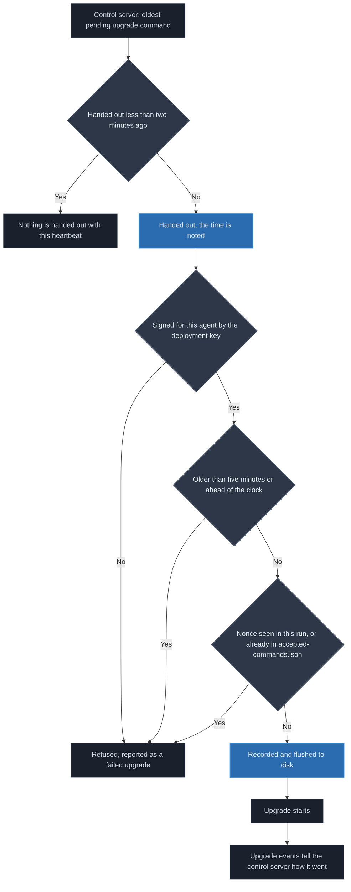

# Signed Commands Run Once, Also After the Agent Restarts

## Context and Problem Statement

A signed command carries a nonce, and the agent refuses a nonce it has seen for as long as the command is accepted, which is five minutes ([ADR 011](./011-upgrade-command-signing.md)). ADR 011 kept the nonces in memory and called that sufficient. It stops being sufficient when the agent restarts: the new process has seen nothing, so a command that is less than five minutes old is accepted again.

The control server made that happen on its own. It handed out the oldest command without an answer with every heartbeat. When this was decided the agent still had a remote shell ([ADR 012](./012-secure-remote-shell.md), removed by [ADR 030](./030-no-remote-shell.md)), and that is where it showed: a command that stopped or restarted the agent or the machine before it had answered was handed to the restarted agent and run again, and again after every restart, until it was five minutes old. On a test agent that is started again after one second, one such command ran five times in 16 seconds. An upgrade command was accepted again in the same way, and it is the command this decision protects today.

How does a command run at most once on an agent whatever restarts in between, and how often does the control server hand out a command that has no answer?

## Considered Options

- The control server hands a command out once
- The agent refuses a command that was issued before the agent started
- The agent records every command it accepts on disk before it acts on it
- The last one, and the control server waits before it hands a command out again

## Decision Outcome

Chosen option: "The last one, and the control server waits before it hands a command out again", because running a command at most once is then something the agent guarantees by itself. It does not depend on the clocks of two machines agreeing, nor on the version of the control server, nor on who is on the other end of the connection. And because the agent refuses what it has accepted before, the control server can hand a command out a second time without risk, which it needs when its first answer was lost on the way.

The decision also said how a shell command that a restart cut off got its answer, and that the control server kept the first result of a command. That part went with the remote shell ([ADR 030](./030-no-remote-shell.md)), and what follows describes what is left.

Why the others lost:

- A control server that hands a command out once ends the loop only where that server is installed. It does nothing against a captured command that is sent to a restarted agent, and a heartbeat answer that is lost on the way would lose the command for good, because only the agent knows whether it received it.
- Refusing what was issued before the agent started needs no state, but it compares the control server's clock with the agent's. An agent whose clock is behind accepts the command again for as long as the difference, and one whose clock is ahead refuses fresh commands after every start. It also refuses a command that was issued just before a restart and never ran.

What is built in the agent:

- `CommandJournal` in `agent/shared/src/journal.rs` keeps `accepted-commands.json` in the agent's state directory, next to its identity and written the same way: readable by its owner only, to a staged file that is flushed and then renamed. `ControlLink` in `agent/shared/src/link.rs` owns it.

| Field | Meaning |
|---|---|
| `nonce` | The nonce of the command |
| `issued_at` | When the control server issued it |

- `ControlLink::verify_upgrade_command` verifies an upgrade command and records it. The Linux and the Windows agent call it before they act on an upgrade. The check that does not record is no longer public.
- A command that is in the record already is refused, and so is one that cannot be recorded.
- The signature of a command is checked before its age, so only a command that the deployment key signed for this agent is refused for being older than five minutes or dated more than a minute ahead of the agent's clock. An upgrade command the agent refuses is reported as a failed upgrade.
- A recorded command is forgotten once it has expired, which is when the agent refuses it for its age.
- A record written by an agent from before ADR 030 has more fields per command. They are ignored when it is read.
- A record that cannot be read is left as it is. The agent starts, says so in its log and refuses every upgrade command until someone has looked at the file.

What is built in the control server (`control_server/backend/src/api/ingestion/events.rs`):

- It notes when it handed a command out (`handed_out_at` on `upgrade_commands`) and hands the same command out again only when two minutes have passed without an answer. That is short enough to hand a command out twice more while the agent still accepts it.
- It hands out one command at a time, the oldest pending upgrade. While it waits for its answer, the upgrades behind it wait too.

### Decision Outcome Visualization

### Consequences

- Good, because an upgrade command is accepted at most once by an agent, through restarts, crashes and reboots, with any control server.
- Good, because a captured command that is sent to a restarted agent is refused like any other replay.
- Good, because a command that is running, or whose answer is on its way, is no longer handed to the agent with every heartbeat, so the agent's log no longer fills with refused replays.
- Good, because the protocol and the console stay as they are, and agents already in use work with the changed control server.
- Bad, because every command costs a small write that is flushed to disk before the agent acts on it.
- Bad, because an upgrade that a restart cut off is not started again by the same command. The agent refuses it, reports the upgrade as failed, and the operator has to issue a new one.
- Bad, because a command whose hand-out was lost on the way is handed out again only after two minutes. The operator waits that long for it.
- Bad, because a control server from before these rules hands a command out with every heartbeat. An agent of this version does not act on it twice, it refuses every further hand-out and reports each one as a failed upgrade.
- Bad, because whoever can write the state directory can delete the record. After a restart a command that is less than five minutes old is then accepted again. That takes root, which can do more than that.
- Bad, because a record that cannot be read turns upgrades off on that endpoint until someone repairs or removes the file.
- Bad, because the Windows agent was only type-checked with this change. Its upgrade now goes through the record, and that path has not run on Windows.
