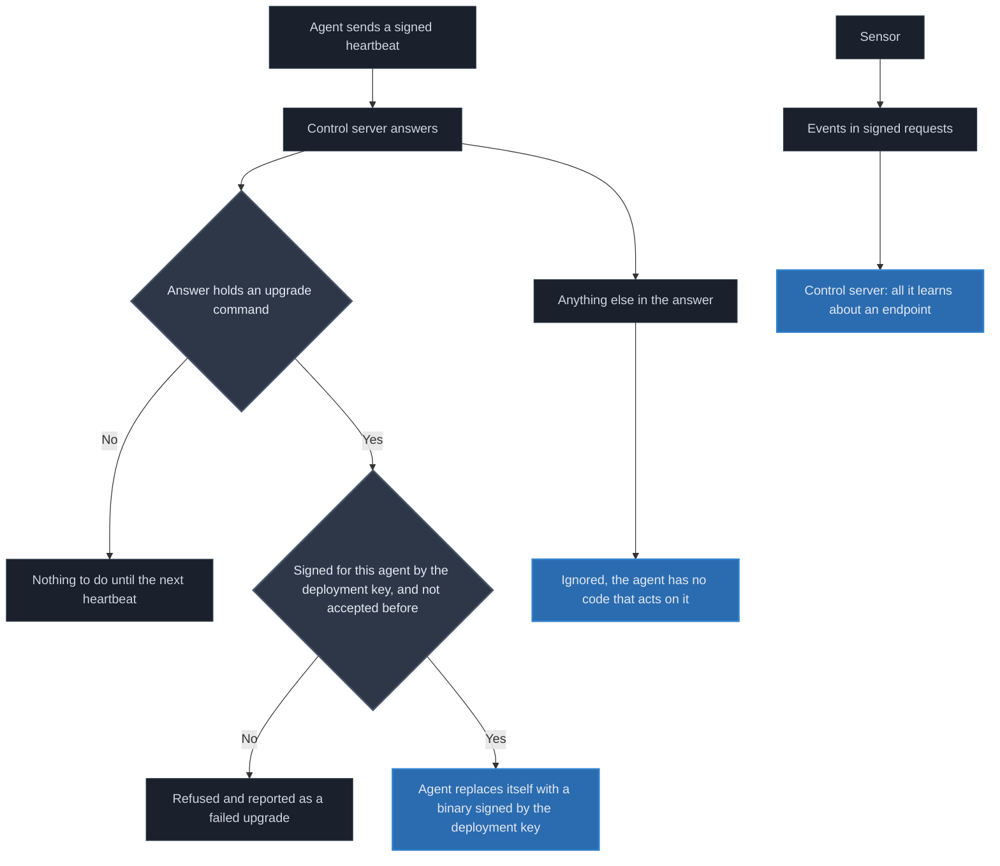

# No Remote Shell

## Context and Problem Statement

zedr is to keep endpoint telemetry private: the control server may read only the events that match a detection rule. The remote shell ([ADR 012](./012-secure-remote-shell.md)) let an admin of the console run any command on an endpoint as SYSTEM or root and read what it printed. Whoever can do that can read every file, every key and every secret on that endpoint, so no statement about what the control server reads holds while the agent has a shell.

The protections the shell had do not change this. Commands were signed, bound to one agent and one session, limited in time and recorded in the audit log. All of that keeps someone else from using the shell. The promise is about the operator, and about whoever takes over the control server and its signing key, and to them the shell was open by design.

Can the remote shell stay in a product that promises that the control server reads only what matches a rule?

## Considered Options

- Keep the remote shell as it is
- Keep it behind a build feature or a deployment setting that is off by default
- Keep it and ask several signers to approve a session
- Limit it to a fixed list of commands
- Remove it from the agent, the protocol, the control server and the console

## Decision Outcome

Chosen option: "Remove it from the agent, the protocol, the control server and the console", because a capability the agent does not have cannot be turned on by an operator, by a stolen admin account, by a compromised control server or by a changed setting. What the control server can read is then decided by the agent binary, which the owner of an endpoint can inspect, and not by how a server is configured.

Why the others lost:

- A build feature or a setting leaves the code on every endpoint, and the party that builds, serves and configures the agent is the control server, which is the party the promise is about. A path that is off everywhere is also a path nobody tests.
- Several signers decide who may open a session. They do not narrow what a session reads, which stays everything.
- A fixed list of commands is still a list of ways to return data that matched no rule. Every command worth having for an investigation lists files, reads one or dumps a table, and such a list only grows. What an analyst needs from an endpoint has to arrive as telemetry, on the one path the promise covers.

What is removed:

- Agent: `agent/shared/src/shell.rs` with the execution of commands, their time limit, the output capture and the session clock, the result queue in `agent/shared/src/runtime.rs`, `Platform::shell_invocation` with its `/bin/sh` and PowerShell implementations, and the `ZEDR_SHELL_*` variables. The agent reads one thing from a heartbeat answer, a signed upgrade command.
- Protocol: `ShellCommand`, the events `ShellSessionCreated`, `ShellCommandExecuted` and `ShellSessionTerminated`, the signing purpose `zedr-shell-command-v1` and `shell_command` in the heartbeat answer.
- Control server: the routes under `/api/admin/shell-sessions`, the signing of shell commands, the handling of their results and the two shell counters in the event statistics. The migration `20261116130000_drop_shell_sessions.sql` drops `shell_commands` and `shell_sessions` with their indexes.
- Console: the Shell page with its terminal, its place in the side rail and in the search, the Shell action on an endpoint, the mark for an endpoint with an open session on the map, the Shell lane on the Events page, and the xterm.js dependency.

What stays:

- Upgrade commands, signed as before ([ADR 011](./011-upgrade-command-signing.md)), and the record that makes an agent accept each one once ([ADR 029](./029-signed-commands-run-once-across-agent-restarts.md)). ADR 029 was written for shell and upgrade commands and now describes upgrade commands only.

This decision supersedes [ADR 012](./012-secure-remote-shell.md), [ADR 027](./027-shell-results-cut-to-one-event-batch.md) and [ADR 028](./028-shell-results-kept-until-the-control-server-takes-them.md). ADRs 008, 013, 015, 016, 018, 019, 020 and 024 mention the shell where they describe what a signed command binds, what is audited, what the console shows and what stays in the customer account. They are left as they were written, and those mentions no longer hold.

### Decision Outcome Visualization

### Consequences

- Good, because no account, no setting and no control server can make an agent of this version run a command and send back its output. The agent has no code for it.
- Good, because everything the control server learns about an endpoint now arrives as events from the sensor, so a rule about which events it may read covers all of it.
- Good, because the agent no longer starts child processes, buffers their output or keeps session state, and the problems that came with that are gone: results too large for one request, results that waited for the control server, and commands that had to be answered after a restart.
- Good, because the console needs no terminal, which was 84 KB of the bundle after compression ([ADR 018](./018-console-redesign.md)).
- Bad, because an analyst can no longer look at an endpoint beyond what the sensor reported. There is no listing a folder, reading a file or stopping a process by hand. What an investigation needs has to be collected as telemetry and found with a hunt ([ADR 026](./026-hunt-across-endpoints.md)), and a response has to be built as an action with one fixed meaning that returns no data.
- Bad, because the upgrade command stays, and the control server still holds the key that signs agent binaries. Whoever holds that key can have an agent replace itself with a binary that does anything. Removing the shell takes the capability out of the product, not out of the reach of the key. Moving the signing key out of the control server is still open.
- Bad, because an agent from before this decision still has a shell. A control server of this version never sends it a shell command, an older or a hostile one can. An endpoint is covered once its agent is upgraded.
- Bad, because a control server of this version answers 400 to a batch that holds a shell event, so an agent from before this decision that still reports a session it timed out logs a refused event.
- Bad, because what the shell brought to a control server before the migration stays in its `events` table and its audit log: the output of commands, and the text of every command that was issued. The migration drops the two shell tables only, and the audit log is a hash chain that must not be rewritten.
- Bad, because `accepted-commands.json` has two fields fewer. An agent of this version reads a record written by an older one, an older agent cannot read a record written by this one and refuses upgrade commands until the file is removed.
