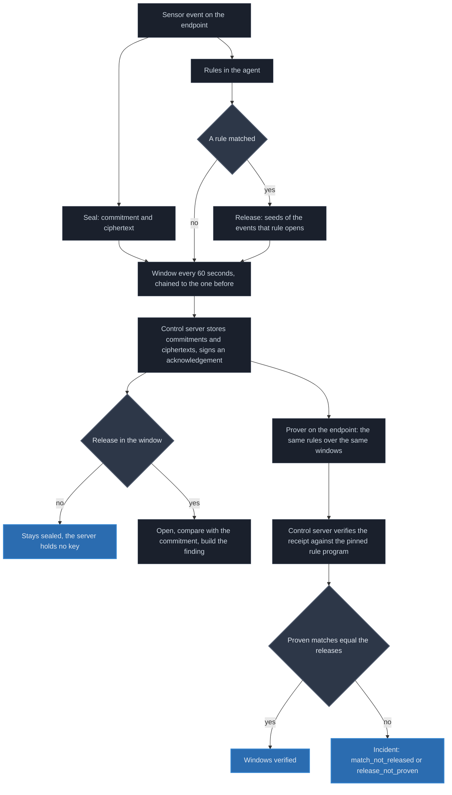

# Sealed Telemetry, Opened Only by a Proven Rule

## Context and Problem Statement

zedr promises that the control server reads an endpoint's telemetry only where a detection rule matched. Under [ADR 025](./025-server-side-detections.md) the agent sent every process, connection, autostart and package event in plaintext and the control server ran the rules. Whoever operated the control server, or took it over, read everything every endpoint did. Removing the remote shell ([ADR 030](./030-no-remote-shell.md)) closed one way to read an endpoint. The telemetry itself was the other.

Moving the rules to the agent and sending only findings would keep the telemetry private, and would also turn the agent's word into the only evidence. An endpoint that reports nothing would look the same whether nothing happened, the sensor was stopped or a finding was held back.

How can the control server detect without reading what matched no rule, and still know that the rules ran over everything the endpoint recorded?

## Considered Options

- Keep the rules on the control server over plaintext events and restrict who may query them
- Run the rules in the agent and send findings only
- Encrypt events to a key that several parties hold together, and decrypt on a quorum
- Write each rule as an arithmetic circuit and prove each event against it
- Seal every event on the endpoint, commit to it in a hash chain, run the rules in the agent, open only what a rule matched, and prove the rule run over the committed events in a zkVM

## Decision Outcome

Chosen option: "Seal every event on the endpoint, commit to it in a hash chain, run the rules in the agent, open only what a rule matched, and prove the rule run over the committed events in a zkVM", because it is the only option where the control server holds no key to what matched nothing and still does not have to take the endpoint's word for it.

Why the others lost:

- Access control on a plaintext store decides who may ask. The store, its backups and whoever takes the server still hold everything.
- Findings only is private and unverifiable. A stopped sensor, a patched agent and a quiet day look the same.
- A quorum key moves the question to who the key holders are, and the plaintext still exists for them. It can be added later for an investigation that needs more than the rules open, it does not replace the default.
- A circuit per rule proves string matching cheaply and makes every rule exist twice, once as the code that runs on the endpoint and once as constraints. The rules here keep a table of running processes across events, which is ordinary code and awkward as a circuit. A zkVM proves the same Rust the agent runs, so there is one implementation to review. Circuits remain an option for the pattern matching alone if proving cost calls for it.

### Sealing

- The agent turns each process, connection, file, autostart and package event into canonical bytes (`SensorEvent`, borsh).
- Each event gets one secret, `seed = HMAC-SHA256(master, agent, epoch, index, SHA-256(event))`. A blinding value and an encryption key are derived from the seed. The master key is derived from the agent's identity key and never leaves the endpoint. Binding the seed to the event bytes means a machine restored from a snapshot, which reuses an index, never encrypts two different events under one key.
- The commitment to the event is `leaf = SHA-256(agent, epoch, index, blind, event)`. The blind makes it useless to guess a low-entropy event and compare hashes.
- The event is padded to one of eight sizes from 256 bytes to 4 MiB and encrypted with ChaCha20-Poly1305, bound to the agent, epoch and index.

### Windows and the chain

- The agent closes a window every 60 seconds, earlier when it holds 1,000 events or 1 MiB, and at once when a rule fires. A window with no events is sealed too, so an endpoint that heartbeats and seals nothing has a stopped sensor and shows it.
- A window header carries the epoch, the window number, the index of its first event, the event count, the Merkle root of the leaves (built as in RFC 6962) and `head = SHA-256(agent, previous head, the fields above)`. Every window so extends one chain per agent.
- The control server stores the leaves and the ciphertexts, checks that the window extends the head it holds, and answers with an acknowledgement signed by the deployment key. The agent keeps a window on disk until it holds that signature. A refusal is signed too and names the position the server holds, and the agent backs off instead of sending again at once.
- A window the server cannot place opens a `chain_gap` or `chain_fork` incident. An agent that lost events before sealing them says so in the header, which also opens `chain_gap`.
- An epoch starts at every agent start. Its first window is marked fresh and the rules start from an empty table, which the proof checks. The first sensor poll after a start reports every running process again, so the table fills itself.

### Rules and release

- The rules live in the `rules` crate: the fifteen rules of ADR 025 and one follow-up that fires when a process with a finding ends. They are deterministic, keep their state in ordered maps, and match strings with DFA tables built at compile time, so the same code gives the same answer on the endpoint, in the proof and in a test.
- When a rule matches, the agent adds a release to the window: the rule, the index of the event that triggered it, the indices it opens, and the seed of each. A rule opens its own evidence and nothing else: the process and its parent, the connection or file with its process and parent, or the autostart item.
- The control server decrypts each opened event with its seed, recomputes the leaf and compares it with the leaf it stored before. It builds the finding from the opened events themselves. A release that does not open what was committed is refused and opens `release_invalid`.
- The hunt, the process tree and the live stream read opened events only. Package inventory, which no rule opens, is no longer stored.

### Proof

- `rules::proof::run` is the function a proof is about. Its private input is the events of a run of windows with their blinds, the rule state before the run and two salts. Its public output is the agent, the epoch, the window and index range, whether it started fresh, the chain head before and after, a salted commitment to the rule state before and after, and every match as rule, trigger index, opened indices, process id and start time.
- The function rebuilds each leaf, each root and each head from the events, so the output is about exactly the windows the control server stored.
- The agent runs this function as a RISC Zero guest through `zedr-prover`, a separate binary the installer places next to the agent. The agent starts it at low priority for the windows the server acknowledged and sends the receipt to `POST /api/proofs`. One proof covers up to 250 events of consecutive windows. After a proof the prover rests for 15 minutes unless that many events already wait, because a window is sealed every minute and an endpoint would otherwise never stop proving.
- The receipt holds one proof per segment of 2^18 cycles of the rule run and is not folded into one small proof. Folding took two thirds of the work when it was measured, and the endpoint is the side that cannot spare it. The price is a receipt of megabytes instead of a quarter of one, which the control server verifies and does not keep.
- The control server verifies the receipt against the image IDs listed in `ZEDR_GUEST_IMAGE_IDS`, with development receipts compiled out. It checks that the proof continues where the previous one ended, by head, by index and by state commitment, and compares the matches with the releases it received. A proven match that was never released opens `match_not_released`. A release no proof stands behind opens `release_not_proven`. A receipt that does not verify opens `proof_invalid`, and a window not proven within `ZEDR_PROOF_DEADLINE_SECS`, one hour unless set, opens `proof_overdue`. An endpoint that proved and then sends windows it says it will not prove opens `proving_stopped`, so removing the prover is not a quiet way out of the comparison.
- The rule program is built reproducibly in a container (`make guest`), so anyone can rebuild it from this repository and compare the image ID with the one a control server accepts.

### Decision Outcome Visualization

### Consequences

- Good, because the control server, its database and its backups hold ciphertext for everything that matched no rule, and hold no key to it. Taking over the server no longer means reading the fleet.
- Good, because an endpoint cannot stay silent about a match in what it committed. The proof names every match, and the server compares.
- Good, because a finding is built by the control server from events it opened and checked against a commitment made before, not from text the agent wrote about itself.
- Good, because there is one implementation of the rules. The agent, the prover and the tests run the same crate, and `make test-zk` requires the proof's output to equal the native output.
- Good, because the commitments make the record tamper-evident for the server as well: it cannot later claim an event the endpoint never sealed.
- Bad, because a compromised endpoint can still keep an event from ever being sealed. The statement a proof makes is that the pinned rules ran over everything the agent committed, in order and without a hidden gap. It says nothing about what the sensor did not see or the agent was made to drop.
- Bad, because an endpoint that holds a release back is only caught when its proof arrives or its deadline passes, so the proof deadline is the longest a match can stay hidden.
- Bad, because the control server still learns how many events each window holds, when, and the size bucket of each.
- Bad, because the rules are now part of the agent. Changing a rule means a new agent, a new prover and a new image ID on the control server, where it used to mean a server deploy.
- Bad, because the rules see one epoch. Rule state does not survive an agent restart, the first poll after a start rebuilds it from what is running.
- Bad, because proving is heavy for an endpoint: about 20 seconds of one core for every event and 2.7 GB of memory while it runs, see the measurements in [DETECTIONS.md](../DETECTIONS.md). A quiet server keeps up, a busy workstation does not, and its windows then wait until `proof_overdue` opens. An endpoint without a prover still seals and releases, and its windows show as not proven.
- Bad, because an analyst can no longer search what matched nothing. A hunt covers opened events only, and package inventory is gone from the console.
- Bad, because the control server serves the agent and prover binaries and signs the agent. An operator who replaces them controls what is sealed. The owner of an endpoint can compare the binaries and the image ID with a build of this repository, nothing forces that check.
- Bad, because the agent's keys are files on the endpoint, readable by root there.
- Bad, because only the Linux agent has a sensor, so this applies to Linux endpoints. The Windows and macOS agents send lifecycle events and seal nothing.

This decision supersedes [ADR 025](./025-server-side-detections.md). [ADR 020](./020-polling-sensor-for-process-and-connection-telemetry.md), [ADR 022](./022-persistence-inventory.md), [ADR 023](./023-package-inventory.md), [ADR 024](./024-event-batches-sized-by-encoding-and-narrowed-on-refusal.md) and [ADR 026](./026-hunt-across-endpoints.md) describe sensor events arriving in plaintext through `POST /api/events`. They are left as written. What they say about collecting the events still holds, what they say about sending and storing them does not, and the `package` hunt of ADR 026 is gone with the package events it read.

[ADR 018](./018-console-redesign.md) is left as written too. Its Apps view is gone: a mosaic sized by what a few findings happened to open says nothing about an endpoint's applications. The console no longer keeps a copy of the rules, a process's findings come from the server's detection events. In their place an endpoint has a Sealed view of every committed event, opened ones in the clear, and the Agent view shows the commitment chain with the proof state of every window.
