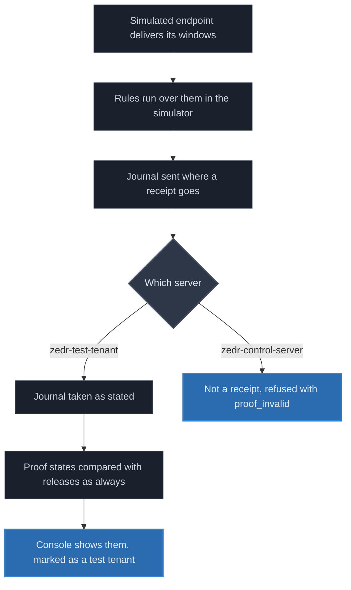

# Test Tenant With Stand-In Proofs

## Context and Problem Statement

`make demo` and the console's browser journeys run the console against a simulated fleet of about 190 endpoints ([ADR 031](./031-sealed-telemetry-opened-by-proven-rules.md)). A real proof costs about 20 seconds of one core for every event. With real proofs a demo showed every window as pending for minutes, kept every core of the developer's machine busy, and could afford only two proving endpoints, so most of the fleet showed no proof state at all. Someone exploring the console saw an empty product.

How can a demo show every proof state at once without proving, and without weakening what a deployed control server accepts?

## Considered Options

- Real proofs for a few endpoints, as before
- Receipts proven once, stored in the repository and replayed by the simulator
- A switch in the control server that skips verification
- A separate server binary for test tenants that takes an endpoint's own statement where a proof goes

## Decision Outcome

Chosen option: "A separate server binary for test tenants that takes an endpoint's own statement where a proof goes", because the binary that a deployment runs keeps no path that skips verification, and a test tenant can still show every proof state, including a mismatch, as soon as it comes up.

Why the others lost:

- Real proofs for a few endpoints leave most of the fleet without a proof state and still cost minutes of every core.
- Stored receipts are bound to the agent identity, epoch and chain head of the run that made them. A simulated fleet enrolls new identities on every start, so a stored receipt fits no window it sees.
- A switch in the control server is a switch an operator can turn on by mistake, or an attacker on purpose, in a deployment.

How it works:

- `zedr-test-tenant` is the control server with one difference: its receipt verifier takes the bytes where a receipt goes as the journal itself, and reports no accepted rule program. The start of the server lives in the library, so both binaries run the same code otherwise.
- The rule set the console reads carries `stand_in`. On a test tenant the console marks the top bar "Test tenant" and the Rules page says that its proof states prove nothing.
- The development simulator, with `stand_in_proofs` in its scenario, runs the rules over the windows an endpoint delivered and sends the journal they produced. An endpoint that withholds a match still states the true journal, so the server catches it as it would with a real proof.
- The release image builds only `zedr-control-server`. `make test-e2e-linux` runs that binary with real proofs.

### Decision Outcome Visualization

### Consequences

- Good, because a test tenant comes up in under a minute with verified windows, mismatches and findings marked proven across the fleet, and costs no more CPU than the rules do.
- Good, because a deployment cannot be configured into accepting stand-ins. The deployed binary does not contain that verifier.
- Good, because the comparison of proofs with releases, and every incident it opens, runs on a test tenant exactly as it does on a deployment.
- Bad, because a screenshot of a test tenant shows proof states that prove nothing. The console marks a test tenant in the top bar, and a screenshot may still be cropped.
- Bad, because the console's browser journeys no longer exercise real receipts. The control server's tests verify a real receipt, and `make test-e2e-linux` runs the whole flow with real proofs.
