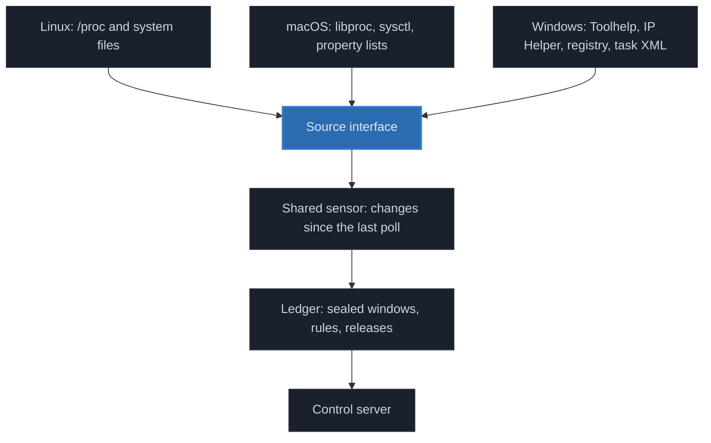

# Sensors for macOS and Windows

## Context and Problem Statement

The Linux agent seals processes, outbound connections, autostart items and installed packages ([ADR 020](./020-polling-sensor-for-process-and-connection-telemetry.md), [ADR 022](./022-persistence-inventory.md), [ADR 023](./023-package-inventory.md), [ADR 031](./031-sealed-telemetry-opened-by-proven-rules.md)). The macOS agent only checked its own signature and printed a list of processes, and the Windows agent enrolled and sent heartbeats with no sensor. The rules already named Windows and macOS programs and folders, and nothing on those platforms fed them.

How do the macOS and Windows agents collect the same four kinds of events, and what must change outside the agents for them to run?

## Considered Options

- Run the platform's own tools (`ps`, `lsof`, `launchctl` on macOS, `tasklist`, `netstat`, `schtasks` on Windows) and parse their output
- Subscribe to the platform's event streams (Endpoint Security on macOS, ETW on Windows)
- Poll the kernel and the system's files through the native APIs, behind the shared `Source` interface the Linux agent implements

## Decision Outcome

Chosen option: "Poll the kernel and the system's files through the native APIs, behind the shared `Source` interface the Linux agent implements", because the sealing, the rules, the proofs and the server stay the same for every platform, and the agent depends on no program an attacker can replace on the path.

Why the others lost:

- A helper program is one more binary to replace or shim, and its output format changes between releases.
- Endpoint Security needs an entitlement Apple grants per developer and a notarized system extension. ETW needs careful session handling to stay quiet. Both are the way to catch short-lived processes, and both can feed the same `Source` later. Polling first gives every platform the same coverage the Linux agent has today.

macOS:

- Processes come from `proc_listallpids` and `proc_pidinfo`, the executable from `proc_pidpath` and the command line from `sysctl(KERN_PROCARGS2)`. Outbound TCP comes from each process's descriptors through `proc_pidfdinfo`. libc does not describe `struct socket_fdinfo`, so its size and offsets were taken from the SDK headers and are checked at compile time and by a test that finds a live connection of its own.
- Autostart items are launch daemons and agents, read from their property lists, plus cron, shell profiles and `authorized_keys`. The crontab and key parsers are shared with the Linux agent. Packages are Homebrew formulas and casks, application bundles and installer receipts.
- State lives in `/Library/Application Support/zedr`, the installer writes a LaunchDaemon, and the agent runs as root.
- The control server writes its address and key into the agent it serves, which breaks the page hashes of the ad hoc code signature the linker gave the binary, and macOS kills such a program at launch. The server now computes those hashes again after filling the slots and before it signs the binary. A universal binary is refused, one is served per architecture.

Windows:

- Processes come from a Toolhelp snapshot, the path and start time from the process itself, and the command line from `NtQueryInformationProcess`. The user is the session id, 0 for services, because the protocol carries a number and a Windows account is a SID.
- Outbound TCP comes from `GetExtendedTcpTable` with the owning process. The listening table tells an accepted connection from an opened one. Windows has no socket number, so a connection is named by a hash of its owner and both ends.
- Autostart items are Run and RunOnce values of the machine and each loaded user hive, services and drivers, scheduled tasks read from their XML files, and Startup folders. Environment variables in their commands are expanded first, because the rules compare expanded paths. Packages are the programs the Uninstall keys list.
- The parsing that needs no Windows API lives in the shared crate and is tested on every platform.

### Decision Outcome Visualization

### Consequences

- Good, because a finding on a Mac or a Windows machine is sealed, released, opened and proven in the same way as on Linux, and the console needs nothing new to show it.
- Good, because neither agent starts another program to see the system.
- Bad, because polling misses what lives shorter than one poll, on every platform.
- Bad, because the macOS agent was tested on Apple silicon as an ordinary user. As root under launchd, installed by the installer and enrolled with a real server, it has not run yet, and Intel Macs were not tried.
- Bad, because the Windows sensor was type-checked for x64 and ARM64 and its parsing unit-tested on a Mac. It has not run on Windows.
- Bad, because neither platform has a prover yet. Their windows are sealed and released and stay unproven, and the console says so.
- Bad, because the server now edits the inside of a Mach-O binary. A change in Apple's code signature format would make it refuse the template rather than serve a broken agent.
