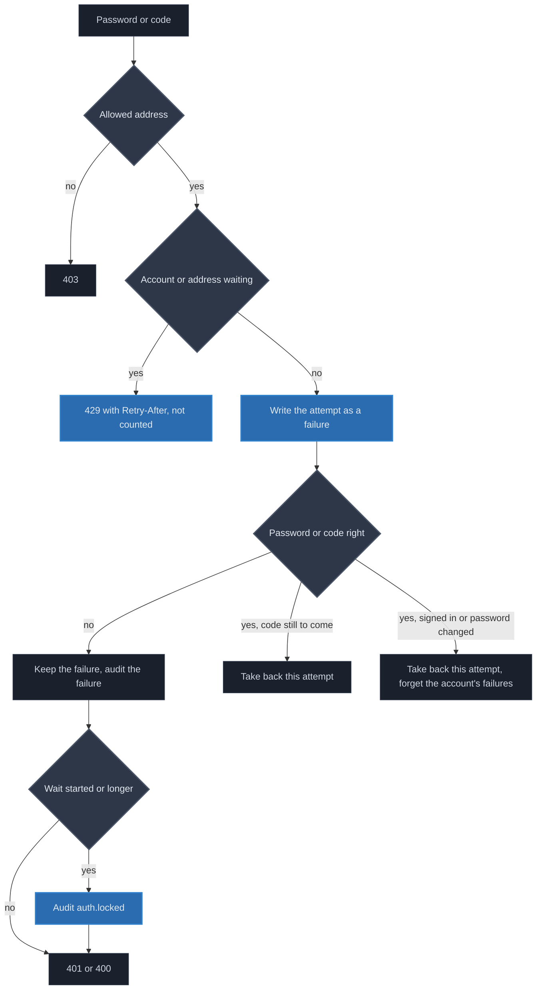

# Limits On Password And Code Attempts

## Context and Problem Statement

`POST /api/auth/login`, `POST /api/auth/login/mfa` and `POST /api/auth/password` could be retried as fast as the server checks a password. A bcrypt check at the default cost takes about a quarter of a second, so one core tried about 350,000 passwords a day against one account, and nothing slowed a six digit code once the password was known. A wrong current password on the password change and on an admin's change of their own password at `POST /api/admin/users/{id}/password` let a stolen session guess the password behind it. Failures were audited as `login.failed`, `login.mfa_failed` and `user.password_change_failed`, and nothing acted on them. [ADR 015](./015-console-access-hardening.md) left the gap, and the exposure model lists brute-force protection as not done.

How many wrong passwords and codes does the server take, for which account and from which address, where does it keep count, and how does an admin who is kept out get back in?

## Considered Options

- Count failures in memory, lost when the server restarts
- Count failures in a SQLite table, kept across restarts
- Lock an account after a number of failures until an admin unlocks it
- Let a few failures through, then make each next one wait longer, and lift the wait by itself
- Keep a separate budget for each route
- Keep one budget per account for every check of its password or code, and one per client address for sign-ins

## Decision Outcome

Chosen options: "Count failures in a SQLite table, kept across restarts", "Let a few failures through, then make each next one wait longer, and lift the wait by itself" and "Keep one budget per account for every check of its password or code, and one per client address for sign-ins", because every failure already writes an audit row, so one more row costs little, a restart does not hand an attacker a fresh budget, and a test can age the rows instead of waiting. A wait that grows lets a mistyped password through after a minute and still holds a patient attacker to a few guesses an hour. A lock that only an admin lifts hands anyone who knows a username a way to keep that account out, and the only admin has nobody to ask. The budget follows the secret: a password guessed through the sign-in form, the password change or the admin's own reset is the same password, and the second factor is checked only after the password.

- `auth_failures` holds one row per failed attempt: the scope, the subject and the time. A row older than an hour is deleted on the next attempt and no longer counts.
- Account scope: the username as typed, cut to 64 characters, whether or not the account exists, so a refusal does not tell which usernames exist. Five failures in an hour go through. The fifth makes the next attempt wait 1 minute, and each further failure doubles the wait, up to 15 minutes. A wrong password at sign-in, a wrong code or recovery code at the second factor, and a wrong current password on `POST /api/auth/password` or on an admin's change of their own password all count.
- Address scope: the TCP peer, as the operator allowlist sees it, with an IPv6 address counted by its /64, since one host holds a whole /64. Twenty failed sign-ins in an hour go through, then the same waits. The password change runs inside a session, so it counts for the account only.
- The limit is checked before the password, so a refused attempt costs no bcrypt check and its answer does not depend on whether the password was right. A refused attempt is not counted and does not move the wait.
- A refused attempt is answered with 429, a `Retry-After` header in seconds, and the error `Too many failed attempts`. The CORS layer exposes `Retry-After` to a console served from another origin.
- An attempt is written as a failure before its password is checked, under a lock in the server process, and taken back when the password is right. Parallel guesses see each other, so a burst sent the moment a wait ends gets one guess, not one per connection.
- A complete sign-in forgets the account's failures: the password for an account without a second factor, or the code after it. A right password with the code still to come takes back its own row and forgets nothing, otherwise every good password would reset the count of wrong codes. A changed password forgets the account's failures too.
- A sign-in never forgets the failures of its address. Anyone with one working account would otherwise reset their address between rounds of guessing other accounts.
- Each failure that starts or lengthens a wait is audited as `auth.locked`, with the scope, the subject, the number of failures and the wait. The entry names the address, so an operator sees where the guessing comes from. A refused attempt is not audited, so a flood of them does not fill the log.

How a locked-out admin gets back in:

- By waiting. The longest wait is 15 minutes, and a refused attempt does not lengthen it.
- Through another admin: replacing the account's password from the Users page forgets its failures, so the new password works at once.
- The only admin, kept out by guessing that goes on: an address outside `ZEDR_ADMIN_ALLOWED_CIDRS` is refused before any handler and cannot count against an account, so the guessing comes from inside the allowed networks. Narrowing the allowlist stops it, and the wait lifts within 15 minutes. No restart, setting or endpoint clears the count, since an attacker could use any of them too.

### Decision Outcome Visualization

### Consequences

- Good, because an attacker who waits out every delay gets about 180 guesses a day at one account and about 490 from one address, where one core tried about 350,000 before.
- Good, because a known password no longer lets a six digit code be tried without limit.
- Good, because a stolen session can no longer guess the password behind it faster than the sign-in form can.
- Good, because a mistyped password costs a minute at most for the first wait, and a sign-in clears it.
- Good, because the count survives a restart and an upgrade, and the rows show what is being guessed.
- Bad, because anyone who can reach the sign-in form and knows a username can keep that account waiting with a few requests every 15 minutes. The allowlist narrows who can, nothing else prevents it.
- Bad, because operators behind one NAT share the address budget, and twenty typos in an hour make everyone there wait.
- Bad, because the lock that orders attempts lives in the server process, which holds only while one replica serves the database, as [ADR 016](./016-byoc-deployment.md) runs it.
- Bad, because behind a proxy every client is the proxy's address, as with the allowlist.
- Bad, because an attempt cut off by a crash between its row and its check stays counted as a failure.
- Bad, because a username that does not exist still answers sooner than one that does, since only a real account's password is checked. The limit slows that probe, it does not hide it.
- Bad, because install keys and fleet enrollment tokens on the agent surface are still not limited. They are long random values, and a guess leaves no trace.
