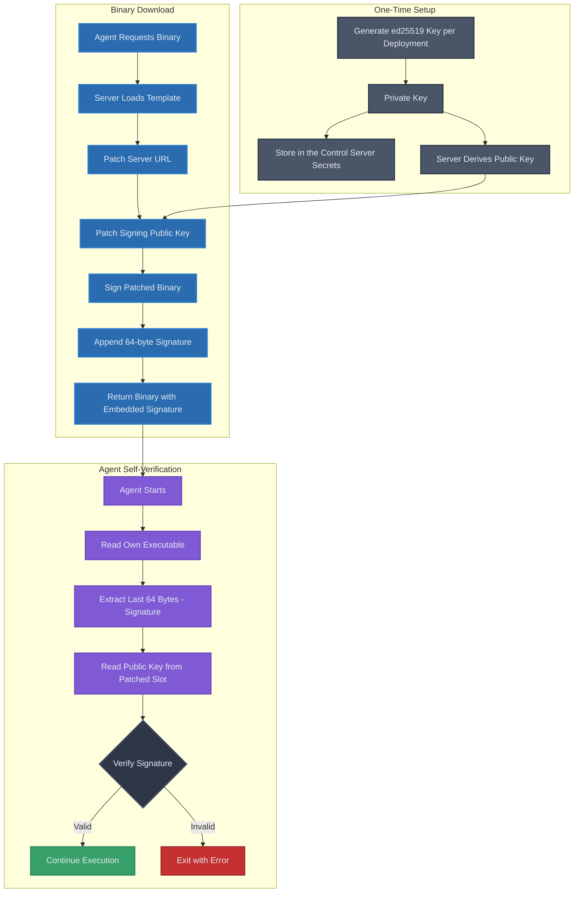

# zedr Binary Signing Architecture

## Overview

All zedr agent binaries are cryptographically signed using ed25519 with the signature embedded as a 64-byte trailer. Agents self-verify on every startup by reading their own executable and checking the embedded signature, ensuring only legitimate binaries can run.

## Architecture



## Cryptographic Details

### Algorithm: ed25519

**Why ed25519:**
- Modern elliptic curve cryptography (Curve25519)
- Fast verification (~10x faster than RSA-2048)
- Small signatures (64 bytes vs 256+ for RSA)
- 128-bit security level (equivalent to RSA-3072)
- No timing attack vulnerabilities
- Well-supported in Rust (`ed25519-dalek`)

**Key sizes:**
- Private key: 32 bytes
- Public key: 32 bytes
- Signature: 64 bytes (appended to binary as trailer)

**Binary File Structure:**
```
[Executable Code with Patched Server URL and Patched Signing Public Key][64-byte ed25519 Signature]
```

The signature is appended to the end of the binary file and covers all preceding bytes, which include the server URL and the signing public key. Agents read their own executable on startup to verify integrity.

### Key Generation

Each deployment generates its own key, once ([ADR 017](../adr/017-per-deployment-signing-key.md)). Any 32 random bytes are a valid ed25519 private key.

```bash
# Development: appends ZEDR_SIGNING_KEY_HEX to secrets/.env.local
cargo run --bin generate-signing-keys

# Any other deployment
openssl rand -hex 32
```

The public key is never configured. The control server derives it from the private key and patches it into every agent binary it serves.

### Key Storage

**Private Key:**
- Location: `secrets/.env.local` as `ZEDR_SIGNING_KEY_HEX`
- Format: 64 hex characters (32 bytes)
- Access: Only backend process on air-gapped control server
- Rotation: Only on compromise or major version change
- Never committed to git (the filled-in env files under secrets/ are gitignored)

**Public Key:**
- Source: Derived by the control server from `ZEDR_SIGNING_KEY_HEX`
- Build time: The agent holds a 64 byte placeholder, `SIGNING_PUBLIC_KEY_PLACEHOLDER` in the `protocol` crate
- Distribution: Written into that slot as 64 hex characters on every download, before the binary is signed
- Runtime: Read from the slot by `agent/shared/src/lib.rs`, an unpatched slot is an error
- Safe to distribute: Cannot be used to forge signatures

## Implementation

### Backend Signing Service

```rust
// control_server/backend/src/signing.rs

use ed25519_dalek::{Signature, Signer, SigningKey};
use sha2::{Digest, Sha256};
use std::env;

pub struct SigningService {
    signing_key: SigningKey,
}

impl SigningService {
    pub fn from_env() -> Result<Self> {
        let key_hex = env::var("ZEDR_SIGNING_KEY_HEX")
            .map_err(|_| Error::Config("ZEDR_SIGNING_KEY_HEX not set in secrets/.env.local"))?;
        
        let key_bytes = hex::decode(&key_hex)
            .map_err(|_| Error::Config("Invalid hex in ZEDR_SIGNING_KEY_HEX"))?;
        
        let key_array: [u8; 32] = key_bytes.try_into()
            .map_err(|_| Error::Config("ZEDR_SIGNING_KEY_HEX must be 32 bytes (64 hex chars)"))?;
        
        let signing_key = SigningKey::from_bytes(&key_array);
        
        Ok(Self { signing_key })
    }
    
    pub fn sign_binary(&self, binary: &[u8]) -> Signature {
        self.signing_key.sign(binary)
    }
}

fn sha256(data: &[u8]) -> Vec<u8> {
    let mut hasher = Sha256::new();
    hasher.update(data);
    hasher.finalize().to_vec()
}
```

### On-the-Fly Binary Signing (Install Key Gated)

```rust
// control_server/backend/src/api/binaries.rs

pub async fn serve_authenticated_binary(
    State(state): State<AppState>,
    Path(platform): Path<String>,
    Query(query): Query<BinaryQuery>,
) -> Result<Response, AppError> {
    // STEP 1: Validate install key (key_hash, expiry, revocation, usage)
    let key_info = validate_and_get_install_key(&state, &query.key).await?;
    let (key_id, _version, admin_username) = key_info;
    
    // STEP 2: Parse platform (e.g., "windows-x64" -> os="windows", arch="x64")
    let (os, arch) = parse_platform(&platform)?;
    
    let extension = match os.as_str() {
        "windows" => ".exe",
        "linux" | "macos" => "",
        _ => return Err(AppError::NotFound),
    };
    
    let version = std::env::var("ZEDR_AGENT_VERSION").unwrap_or_else(|_| "0.1.0".to_string());
    let binary_path = PathBuf::from(format!("binaries/v{}/{}/{}/zedr-agent{}", version, os, arch, extension));
    
    if !binary_path.exists() {
        return Err(AppError::Config(format!("Binary not found: {}-{}", os, arch)));
    }
    
    // STEP 3: Load unsigned template from disk
    let template_binary = std::fs::read(&binary_path)
        .map_err(|_| AppError::InternalError)?;
    
    // STEP 4: Patch server URL into template
    let server_url = std::env::var("ZEDR_SERVER_URL")
        .map_err(|_| AppError::Config("ZEDR_SERVER_URL not set".into()))?;
    
    // STEP 5: Patch the server's own signing public key into the template,
    // sign the result and append the signature as a 64-byte trailer
    // (SigningService::seal_agent_binary in control_server/backend/src/signing.rs)
    let binary_with_signature = SigningService::from_env()?
        .seal_agent_binary(&template_binary, &server_url)?;
    
    // STEP 7: Mark key as used and create installation audit event
    let _ = mark_key_as_used(&state, &key_id).await;
    let _ = create_installation_event(&state, &query.key, &platform, &version, &admin_username).await;
    
    let binary_name = format!("zedr-agent{}", extension);
    
    Ok(Response::builder()
        .status(StatusCode::OK)
        .header(header::CONTENT_TYPE, "application/octet-stream")
        .header(header::CONTENT_DISPOSITION, format!("attachment; filename=\"{}\"", binary_name))
        .header(header::CACHE_CONTROL, "no-store, no-cache, must-revalidate")
        .body(binary_with_signature.into())
        .unwrap())
}

fn patch_server_url(template_binary: &[u8], server_url: &str) -> Result<Vec<u8>> {
    const PLACEHOLDER: &[u8] = b"ZEDR_SERVER_PLACEHOLDER_URL_DO_NOT_MODIFY_EXACTLY_64_BYTES_LONG";
    
    if server_url.len() > 64 {
        return Err(Error::Config("ZEDR_SERVER_URL exceeds 64 bytes"));
    }
    
    // Find placeholder in binary
    let pos = find_subsequence(template_binary, PLACEHOLDER)
        .ok_or(Error::PlaceholderNotFound)?;
    
    // Create patched binary
    let mut patched = template_binary.to_vec();
    
    // Create padded URL (must be exactly 64 bytes, null-terminated)
    let mut url_bytes = server_url.as_bytes().to_vec();
    url_bytes.resize(64, 0);  // Pad with nulls
    
    // Replace placeholder with actual URL
    patched[pos..pos + 64].copy_from_slice(&url_bytes);
    
    Ok(patched)
}

fn find_subsequence(haystack: &[u8], needle: &[u8]) -> Option<usize> {
    haystack.windows(needle.len())
        .position(|window| window == needle)
}
```

### Agent Self-Verification

```rust
// agent/shared/src/lib.rs

use ed25519_dalek::{Signature, Verifier, VerifyingKey};

/// Slot the control server overwrites with its signing public key on download.
/// black_box keeps the compiler from folding the placeholder into the code.
static SIGNING_PUBLIC_KEY_SLOT: [u8; 64] = zedr_protocol::SIGNING_PUBLIC_KEY_PLACEHOLDER;

fn signing_public_key() -> Result<VerifyingKey, String> {
    let key_bytes = signing_public_key_from_slot(std::hint::black_box(&SIGNING_PUBLIC_KEY_SLOT))?;
    VerifyingKey::from_bytes(&key_bytes)
        .map_err(|e| format!("Invalid signing public key: {}", e))
}

pub fn verify_self_signature() -> Result<(), String> {
    let self_path = std::env::current_exe()
        .map_err(|e| format!("Cannot locate own executable: {}", e))?;
    
    let binary = std::fs::read(&self_path)
        .map_err(|e| format!("Cannot read own executable: {}", e))?;
    
    if binary.len() < 64 {
        return Err("Binary too small to contain signature".into());
    }
    
    let (code, sig_bytes) = binary.split_at(binary.len() - 64);
    
    let signature = Signature::from_bytes(sig_bytes.try_into().unwrap());
    
    let public_key = signing_public_key()?;
    
    public_key.verify(code, &signature)
        .map_err(|_| "Signature verification failed - binary may be tampered".to_string())?;
    
    Ok(())
}

// agent/*/src/main.rs - Call at program startup

fn main() {
    if let Err(e) = zedr_shared::verify_self_signature() {
        eprintln!("FATAL: {}", e);
        eprintln!("This binary may be compromised. Exiting.");
        std::process::exit(1);
    }
    
    // Normal agent logic
    run_agent();
}
```

## Security Properties

### Trust Model

```
Trust Anchor: Control Server Private Key
    ↓
Only the control server can create valid signatures
    ↓
Agents only trust binaries signed by this key
    ↓
Even if attacker compromises:
  - Network (MITM)
  - Agent filesystem
  - Download channel
    ↓
Cannot forge valid signature without private key
```

### Attack Resistance

| Attack | Defense |
|--------|---------|
| Malicious binary injection | Agent refuses to start - signature verification fails |
| MITM binary replacement during download | Agent self-verifies on startup, exits if tampered |
| Replace binary on disk post-install | Agent verifies itself on every startup/restart |
| Replay old vulnerable version | Version checking + downgrade protection (future) |
| Steal control server database | No database - binaries signed on-demand |
| Replace the public key in the agent slot | The slot is inside the signed bytes, so the self check fails unless the attacker also re-signs the binary, which needs write access to it on disk |
| Binary or command signed by another deployment | Refused, each agent trusts only the key of the server that served it |

### Failure Modes

**If private key compromised:**
- Attacker can sign malicious binaries
- Mitigation: Replace the key and reinstall the agents of that deployment, other deployments are unaffected
- Detection: Monitor for unexpected binary uploads/signatures

**If an agent build has no key slot, or more than one:**
- The control server refuses to serve it
- Mitigation: Rebuild the agent from the current source

**If the private key of a deployment is replaced:**
- Enrolled agents keep the old public key and refuse new binaries and commands
- Mitigation: Back the key up outside the server, reinstall agents if it is lost

**If signature cannot be appended:**
- Binary download fails
- Agents cannot install/upgrade
- Mitigation: Ensure signing service is configured correctly

## File Structure

**Template binaries (intentionally unsigned):**
```
control_server/backend/binaries/
└── v0.1.0/
    └── windows/
        └── arm64/
            └── zedr-agent.exe   (with placeholder URL and key, PRE SIGNATURE)
    └── linux/
        └── x64/
            └── zedr-agent       (with placeholder URL and key, PRE SIGNATURE)
    └── macos/
        └── arm64/
            └── zedr-agent       (with placeholder URL and key, PRE SIGNATURE)
```

**Critical: Template binaries stored on disk are intentionally unsigned.** This is a security design decision - templates cannot be executed directly. Signatures are only added during download after patching with the control server URL and validating the install key. This ensures:
- Each binary is signed over its specific server URL and the signing public key of its deployment
- Only authenticated clients with valid install keys receive signed binaries
- No pre-signed binaries exist that could be extracted and reused

**Distributed binary format (signed on download):**
```
[Executable Code with Patched Server URL and Patched Signing Public Key][64-byte ed25519 Signature]
```

No database storage - binaries are patched and signed on-the-fly during download.

## Key Rotation Process

Rotation is not implemented. Agents keep the public key that was patched into the binary they were installed from, and the control server holds one key at a time.

**What happens today when `ZEDR_SIGNING_KEY_HEX` is replaced:**
- The control server records its public key in `deployment_signing_key` on the first start and compares it on every later start
- With enrolled agents and a different key it refuses to start, and the error names the old and the new public key
- With no enrolled agents it takes the new key and writes `signing_key.changed` to the audit log
- `ZEDR_SIGNING_KEY_CHANGE_ACCEPTED=<new public key>` lets it start with enrolled agents, also audited. The value covers that one key only
- After that, new downloads carry the new public key, and the agents enrolled before still hold the old one, so they refuse new upgrade binaries and new commands until they are reinstalled with a fresh install key

**What a rotation would need:**
- An upgrade binary that carries the new public key in its slot and is signed by the old key, so enrolled agents accept it
- A control server that holds both keys until every agent has taken that upgrade

## Testing

### Unit Tests

```rust
#[cfg(test)]
mod tests {
    use super::*;
    
    #[test]
    fn test_sign_and_verify() {
        let signing_key = SigningKey::generate(&mut OsRng);
        let public_key = VerifyingKey::from(&signing_key);
        
        let binary = b"test binary data";
        let signature = signing_key.sign(binary);
        
        assert!(public_key.verify(binary, &signature).is_ok());
    }
    
    #[test]
    fn test_tampered_binary_fails() {
        let signing_key = SigningKey::generate(&mut OsRng);
        let public_key = VerifyingKey::from(&signing_key);
        
        let binary = b"test binary data";
        let signature = signing_key.sign(binary);
        
        let tampered = b"evil binary data";
        assert!(public_key.verify(tampered, &signature).is_err());
    }
}
```

### Integration Tests

```rust
#[tokio::test]
async fn test_sign_and_download_binary() {
    let app = create_test_app().await;
    
    // Create test binary on disk
    std::fs::create_dir_all("binaries/v0.1.0").unwrap();
    std::fs::write("binaries/v0.1.0/zedr-agent-linux-x86_64", b"test binary").unwrap();
    
    // Sign binaries (simulates server startup)
    sign_all_binaries(&app.pool).await.unwrap();
    
    // Generate install key
    let key_response = app.post("/api/admin/installers/generate")
        .json(&serde_json::json!({"agent_version": "0.1.0"}))
        .send()
        .await
        .unwrap();
    
    let install_key: InstallKeyResponse = key_response.json().await.unwrap();
    
    // Download binary
    let download = app.get(&format!("/agent/linux/x86_64/zedr-agent?key={}", install_key.install_key))
        .send()
        .await
        .unwrap();
    
    assert_eq!(download.status(), 200);
    
    let signature = download.headers().get("X-Zedr-Signature").unwrap();
    let binary = download.bytes().await.unwrap();
    
    // Verify signature
    assert!(verify_binary_signature(&binary, signature.to_str().unwrap()).is_ok());
    
    // Cleanup
    std::fs::remove_dir_all("binaries").unwrap();
}
```

## References

- ed25519 specification: RFC 8032
- ed25519-dalek crate: https://docs.rs/ed25519-dalek/
- Rust crypto working group: https://github.com/RustCrypto
